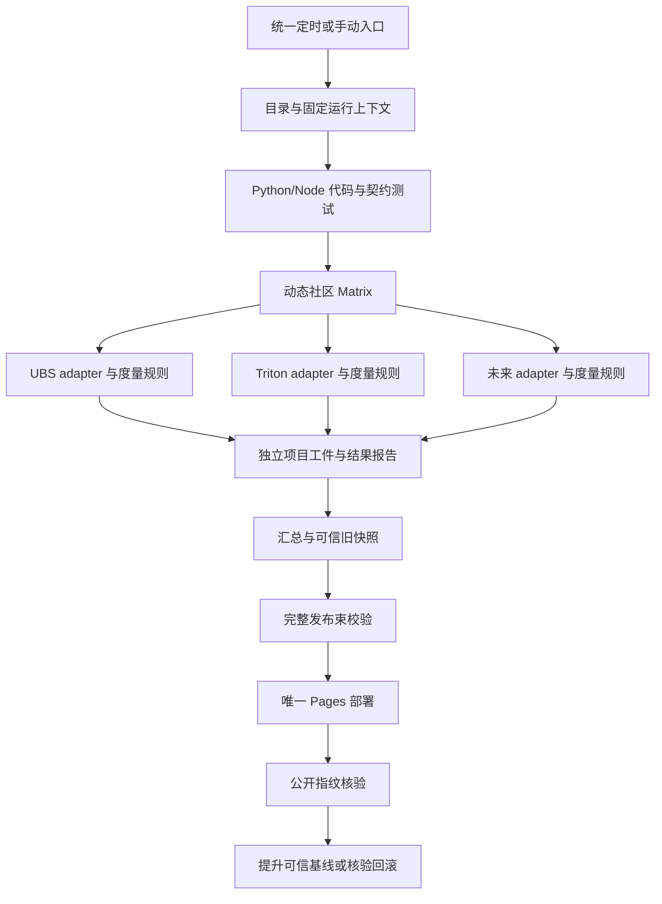
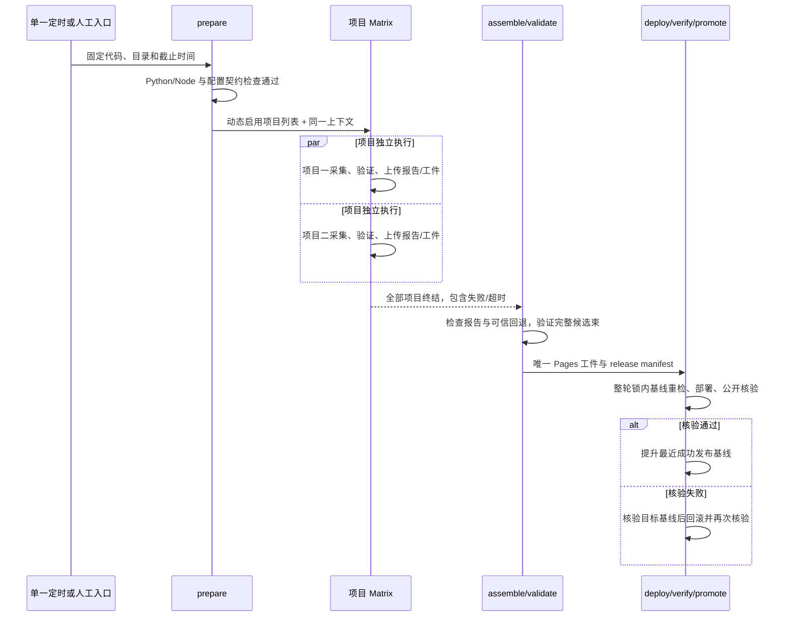

# 统一工程监控看板技术设计

日期：2026-10-10。状态：已批准方向的设计交付，供后续实现与验收使用。

本轮只编写设计文档，不改采集器、网页、工作流或生产数据，不表示本文件描述的能力已经实现或上线。代码基线为 `9aec47355689c243f3f8c35cab40fd275c0e8441`。配套[产品设计](2026-10-10-unified-dashboard-product.md)定义用户任务与页面行为；本文件定义实现边界、契约、发布协议和未来验收。

批准的目标是：代码维护在 GitHub；一个 GitHub Actions 定时入口每天北京时间 07:30 启动，统一调用所有启用社区的独立采集任务，动态项目 Matrix 并行执行并等待全部终结；共享一次固定截止时间，保留 UBS 最近 720 小时与 Triton 最近 72 小时及各自统计口径；用可信回退、完整束校验、部署核验和明确回滚保证数据可追溯。主流程不得依靠社区名称分支。

## 基线与模块边界

<a id="T-001"></a>
### T-001：保持模块化单体，以用户工作台统一入口

当前是 Python 标准库采集、SQLite/JSON 和静态网页，适合继续一个代码仓、一个静态站点与作业级模块化，不需要微服务、消息队列或长期运行的采集服务。当前两个社区已有不同的可靠关联与统计算法，应通过适配器接入公共契约，而非合并成一个巨型采集器。

| 基线模块 | 已有职责 | 后续复用边界 |
|---|---|---|
| [collect.py](../../collect.py)、[repository_store.py](../../repository_store.py) | GitCode/Jenkins 采集、多仓隔离、UBS 快照 | 置于 UBS adapter 内部，保留证据关联与限速；补独立输出目录和上下文注入 |
| [metrics.py](../../metrics.py)、[web/core.js](../../web/core.js) | UBS 代表 PR 与纯统计 | 固定为一个版本化 metric profile，公共工具复用但选择策略不改 |
| [triton/dashboard.py](../../triton/dashboard.py)、[triton/quality.py](../../triton/quality.py)、[triton/pr_identity.py](../../triton/pr_identity.py) | GitHub Actions、PR/attempt 关联、Triton 统计与门禁 | 置于 GitHub Actions adapter 和 Triton profile 内，不据旧代码版本推断缺陷 |
| [web/app.js](../../web/app.js)、[web/triton-view.js](../../web/triton-view.js) | 共用外壳与两域展示 | 拆出通用 shell/目录/查询状态，保留 profile 所需专用视图 |
| [serve.py](../../serve.py) | 仅本机托管 `web/`、CSV 保存 | 保留开发预览；不作为线上采集或 CI 重跑 API |
| [pages.yml](../../.github/workflows/pages.yml)、[triton-refresh.yml](../../.github/workflows/triton-refresh.yml) | 每日两域采集、额外 Triton 刷新、Pages | 迁移为单一采集发布 workflow；本轮文件保持不变 |

后续模块分为：目录与 profile 注册、公共 CLI 与运行上下文、来源 adapter、metric profile、项目验证器、发布束装配器、通用前端 shell 和 profile 视图。工作台只汇总各项目的可用状态、待关注对象和可下钻链接；未经度量契约证明可比，不输出全站混合 E2E 或 P90。

## 配置、公共契约与展示策略

<a id="T-002"></a>
### T-002：目录驱动项目、仓库、能力导航

拟新增版本化 catalog。公共入口读取 `projects`，根据 `enabled` 生成 Matrix 与用户可见目录；collector、metric profile、view profile 分别引用注册容器中的键。公共主流程只解析接口，不写 `if project_id == ...`。项目 ID 是稳定产品标识；仓库 ID 为 `source_instance_id:owner/repository`，来源实例由 `source_instances` 注册并绑定 provider 与唯一服务地址。示例中的 `github` 专指 github.com，未来企业实例使用独立 ID，不能都称为 github。同名仓库在不同实例或组织中不碰撞，展示名和来源大小写另行保存，不统一把路径转小写。

collector 注册的是受版本控制的实现入口；view profile 注册的是受版本控制的视图模块和能力描述，配置不执行任意脚本。能力可以包含仓库比较、PR 生命周期、代表 PR、提交批次趋势、任务分类、排队趋势、分支筛选、证据详情和导出类型。未声明的能力不生成伪指标或补零；界面以“此项目未提供该能力”说明原因。UBS 配置含九仓，Triton 含一个仓库，配置的目标分支必须实际传递给 adapter。

<a id="example-catalog"></a>
#### 合成 catalog 示例

本文 JSON 均为合成契约示例，时间、运行 ID 和指纹仅用于文档一致性检查，不是一次真实采集、发布或核验的证据。

```json
{
  "schema_version": 1,
  "schedule": {"timezone": "Asia/Shanghai", "local_time": "07:30", "frequency": "daily"},
  "source_instances": {
    "gitcode": {"provider": "gitcode", "base_url": "https://gitcode.com"},
    "github": {"provider": "github", "base_url": "https://github.com"}
  },
  "collectors": {
    "gitcode-jenkins-v1": {"entrypoint": "monitor.adapters.gitcode_jenkins", "cache_version": 1},
    "github-actions-v1": {"entrypoint": "monitor.adapters.github_actions", "cache_version": 1}
  },
  "metric_profiles": {
    "ubs-pr-representative-v1": {"sample_unit": "pr_representative", "duration_unit": "ms"},
    "triton-commit-attempt-v1": {"sample_unit": "commit_or_attempt_batch", "duration_unit": "ms"}
  },
  "view_profiles": {
    "pr-representative-v1": {"capabilities": ["repository_comparison", "pr_lifecycle", "task_breakdown", "evidence_detail", "csv"]},
    "commit-attempt-v1": {"capabilities": ["batch_trend", "base_branch_filter", "queue_trend", "evidence_detail", "csv"]}
  },
  "projects": [
    {
      "project_id": "ubs",
      "display_name": "openEuler UBS",
      "enabled": true,
      "collector": "gitcode-jenkins-v1",
      "metric_profile": "ubs-pr-representative-v1",
      "view_profile": "pr-representative-v1",
      "window": {"time_basis": "pr_created_at", "hours": 720},
      "timeout_minutes": 180,
      "repositories": [
        {"repository_id": "gitcode:openeuler/ubs-engine", "target_branches": ["master"]},
        {"repository_id": "gitcode:openeuler/ubs-comm", "target_branches": ["master"]},
        {"repository_id": "gitcode:openeuler/ubs-virt", "target_branches": ["master"]},
        {"repository_id": "gitcode:openeuler/ubs-io", "target_branches": ["master"]},
        {"repository_id": "gitcode:openeuler/ubs-mem", "target_branches": ["master"]},
        {"repository_id": "gitcode:openeuler/OmniStateStore", "target_branches": ["master"]},
        {"repository_id": "gitcode:openeuler/ham", "target_branches": ["master"]},
        {"repository_id": "gitcode:openeuler/ubturbo", "target_branches": ["master"]},
        {"repository_id": "gitcode:openeuler/ubs-atomic", "target_branches": ["master"]}
      ]
    },
    {
      "project_id": "triton",
      "display_name": "Triton-Ascend",
      "enabled": true,
      "collector": "github-actions-v1",
      "metric_profile": "triton-commit-attempt-v1",
      "view_profile": "commit-attempt-v1",
      "window": {"time_basis": "batch_started_at", "hours": 72},
      "timeout_minutes": 60,
      "repositories": [
        {"repository_id": "github:triton-lang/triton-ascend", "target_branches": ["main", "main-dev"]}
      ]
    }
  ]
}
```

示例分支是配置形状演示；实施时以当前项目的真实目标分支配置为准，不能以示例过滤掉已存在数据。新增分支和仓库也须通过配置与关联测试。

<a id="T-003"></a>
### T-003：固定运行上下文，显式表达窗口与可比性

prepare 只生成一次运行上下文，并把同一文件及其指纹传给全部项目。`run_id` 使用工作流运行 ID 与重试 attempt 的组合；`code_sha` 是本次 checkout 的确切提交；`cutoff_at` 是 prepare 时冻结的带时区时间，不能由每个采集器重新读取时钟。定时计划时刻和实际启动时刻另存，平台延迟不伪装成 07:30 已完成。手动补采也使用这个入口，可显式指定截止时间；历史补采默认只出审计工件，不覆盖更新的线上数据。

项目窗口 `start_at = cutoff_at - hours`，fresh 的 `end_at` 必须等于 cutoff。共享截止点不改变样本选择依据：UBS 使用 PR 创建时间，保留入选 PR 的全部已采集关联批次，不再按批次起点二次裁剪窗口；Triton 使用本次提交/attempt 的批次起点及现有可靠发现规则。截止参照的终点处理、来源状态非历史重建等已有边界继续由 profile 描述。

`cutoff_at` 固定的是选样窗口与测量参照，`collected_at`/每来源 `observed_at` 记录实际请求得到数据的时间；并行项目的观测时刻可以不同。外部 API 不保证所有平台在 cutoff 的历史截面，PR 当前状态、后续可见元数据与缓存复用都应保留 provenance。对于发生于参照之后的完成信息，按 profile 限制可使用的终点或以明确观测标记表达，不能把最新状态声称为截止时刻已知状态；精确事件、近似起点和执行中观测值继续分别标明。

跨仓聚合必须核对时间依据、样本粒度、有效状态、起止定义、取消策略、算法版本、窗口及分支范围。不能只依据单位相同合并均值或分位数；P90 必须从兼容的原始样本重算，不平均仓库 P90。跨社区工作台可并列项目摘要，标题和提示显示各自窗口/样本单位；未证明兼容的指标不进入同一排名。

<a id="example-run-context"></a>
#### 合成运行上下文示例

```json
{
  "schema_version": 1,
  "run_id": "synthetic-20261010-0730-attempt-1",
  "code_sha": "9aec47355689c243f3f8c35cab40fd275c0e8441",
  "catalog_sha256": "cccccccccccccccccccccccccccccccccccccccccccccccccccccccccccccccc",
  "trigger": "schedule",
  "scheduled_for": "2026-10-10T07:30:00+08:00",
  "started_at": "2026-10-09T23:30:00Z",
  "cutoff_at": "2026-10-09T23:30:00Z",
  "project_ids": ["ubs", "triton"],
  "artifact_root": "artifacts/synthetic-20261010-0730-attempt-1",
  "publish_mode": "normal"
}
```

<a id="T-004"></a>
### T-004：统一查询状态，按能力开放分析与高级搜索

查询状态明确分层：`analysisScope` 保存项目/仓库、可用目标分支、时间选区及显式高级样本条件；`listState` 保存实体粒度、`q`、局部条件、排序和分页；`moduleState` 保存仅本图的条件；`detailState` 保存选中身份与快照版本。profile 提供合法字段和谓词，PR 生命周期与门禁批次结果使用不同字段。

分析集合 S 由 analysisScope 产生，KPI、趋势基础样本、关注策略/阈值和分析分母消费 S。列表集合 L 从 S 对应记录经过 q 与局部条件产生，默认搜索只影响 L 及记录导出，不能重算 KPI、覆盖率或 P90。图内筛选只产生该图子集，其局部样本数明确标注，不改变 S。UBS 的 `sampleQuery` 放在显式高级统计样本入口，保留原全文、PR 状态、完整性、重跑/推送等样本筛选能力；它选择 PR 后改变 S，必须显示条件、分母与清除入口，不重新选代表批次，也不截掉入选 PR 的其他已采集批次。

记录导出与 L 核对，分析汇总导出与 S 核对，详情全部批次与该 PR 的已采集集合核对。基础搜索仅匹配项目实际提供的编号/标题/作者/SHA/身份等字段，空白忽略、大小写不敏感。切项目恢复各自状态，首次使用项目默认值；不适用条件明确移除并提示。重置分析范围、清除 q、清除高级样本条件分别执行，不能用一个含混的全局重置隐藏作用域。

<a id="T-005"></a>
### T-005：关注对象使用稳定身份，理由与历史分离

统一关注模型为 `batch_id → reasons[]`。工作台与项目专页均每个稳定批次只显示一行，偏长、失败、执行中、数据缺口合并为多个理由标签；理由计数可以重叠，总数使用唯一批次数，不能相加。PR 只作为父实体上下文，不把同号不同仓库 PR 合并；PR ID 含来源实例/完整仓库与 PR 号，批次身份含来源 run/attempt 或完整 trigger URL，任务身份含 batch 与来源 task/attempt，不以序号、标题或列表位置生成身份。

UBS 保留每 PR 最长可测量失败等待对应的批次与后续成功提示；Triton 保留 S 的有效完成样本少于 10 时最长前 5、否则 P90 的候选选择策略，汇入统一关注表后按 batch_id 合并理由。后续成功不删历史失败，只标“快照内后续有成功”并链接相应证据；重跑不覆盖原 attempt，重新采集同一身份不重复。列表搜索只定位已确定的关注项，每条记录直达相应项目、批次和证据。

<a id="T-006"></a>
### T-006：分页仅影响展示，排序是稳定的完整序列

公共分页默认每页 15 条，可选 15/30/50；先形成完整 L、稳定排序，再切页。批次默认本次起点倒序，PR 默认创建时间倒序，保留 UBS 代表 E2E/批次数及任务耗时排序选项。缺值排在有效值之后，不当零参与排序或统计；并列按排序字段、适用时间及稳定身份确定次序，翻页后同一集合恰好覆盖一次。筛选、排序、项目或耗时类型变化回到第 1 页，进入详情再返回恢复原页。

0 条、单条、页大小边界及末页都提供明确范围与禁用按钮。项目卡片或关注摘要的前 N 条不是明细全量；“查看全部”和导出必须消费完整范围，而不是当前页 DOM。

<a id="T-007"></a>
### T-007：公共详情骨架保留项目证据结构

最小实体关系为 repository → PR → execution batch → workflow/task；已确认触发事件和来源关联作为证据引用，不强迫每个来源都提供虚构的 event。每个实体带稳定 ID、来源 URL、原始身份及观察时间。详情通用骨架显示 PR、提交/重跑、运行结果、时间与链接；UBS 扩展提供事件分组、trigger/children 与 upstream 关联，Triton 扩展提供 workflow/attempt、NPU 与重点任务矩阵。

未关联、歧义或缺证据的批次仍保留在明确的未知组，不猜事件或使用最近时间强行配对。代表批次标记及统计采用理由必须可定位；查看 PR 详情和批次 CSV 均保留完整历史。公共快照仅含展示需要的证据摘要和白名单来源链接；原始缓存、凭证、SQLite 和完整日志不进入 Pages。

<a id="T-008"></a>
### T-008：执行、证据与统计资格分别建模

以下三轴独立，不能使用一个 `complete` 字段代表全部含义。

| 维度 | 公共表达 | 原则 |
|---|---|---|
| 执行结果 | `success/failure/running/cancelled/unknown` 加 raw_result | 终态取消不等于采集失败；不同 profile 对取消的纳入策略保留 |
| 证据与关联 | `verified/approximate/missing/invalid/ambiguous`、issues、来源 | 起点近似、关联歧义和时间倒置说明原因，不伪造有效测量 |
| 统计资格 | 每个 metric 的 eligible、reason、profile version | 按样本定义判定，PR 数与有效耗时样本数分开 |

测量分别保存终态 duration、执行中的 observed duration、起止来源与参照 cutoff。运行中跨度只能到参照时刻，不进入完成样本；已完成但无结束证据不能以当前时刻补终点。Triton 的近似起点在图/详情/CSV 中一致说明；UBS 取消体验维持现有可测量终态策略，Triton cancelled 维持排除完成样本策略。

adapter 规范化平台状态，metric profile 定义纳入规则。generic validator 检查类型、身份、时间与契约；项目验证器独立复算关联与派生值，不因为同一生成器自洽就宣称原始来源已验证。

<a id="T-009"></a>
### T-009：公共内部单位为毫秒，保留源精度和未知原因

日期统一带时区，内部时间戳/耗时以毫秒表示，来源为秒时精确转换并记录源单位。聚合基于原始数值，不基于页面四舍五入值；P50/P90 使用既有线性插值，空值、字符串、布尔、非有限数和负值不成为零样本。真实 0 是合法值。

全站主体展示统一分钟，详情/悬浮可查看秒或毫秒；未知、未支持、近似、观测中分别标记。任务分类和排队公式由 profile 声明：Jenkins 三个分项之和与 GitHub created→started 不因字段统一而变成相同口径。任务字段缺失保持空值，不向其他批次借任务、不把并行任务相加成 E2E。

<a id="T-010"></a>
### T-010：导出绑定快照版本、范围与统计契约

公共导出入口调用 profile 的 schema/row builder，再共享 CSV 编码与本地保存/Pages 下载通道。导出元信息或随附 manifest 包含 release ID、项目/仓库 ID、snapshot ID、窗口、当前筛选、metric profile version、单位和生成时间；不得用本轮发布时间覆盖回退数据的原采集时间。

继续支持 UBS 仓库汇总、PR、批次和质量导出，以及 Triton 批次明细。原 CSV 的列名、顺序、单位和值规则保留；新公共格式独立版本化，附属元数据也不得向旧 CSV 插入破坏解析的说明行。完整 L 记录导出与 S 汇总导出不受分页、关注前 N 条或折叠状态限制。BOM、中文/引号/换行、CSV 公式前缀转义、空值和真实 0 保持现有行为。回退数据的导出也显式携带其旧 snapshot ID 和数据截止时间。

<a id="T-011"></a>
### T-011：稳定路径与查询状态保留旧链接

新路径表达项目/仓库/视图和 PR/批次身份，URL 序列化可分享的筛选、时间、排序与页码；profile 校验字段，非法字段给出可读的规范化结果。用户导航每次推进一条历史，旧链接和未知路由规范化使用 replace，不生成中间历史。

`#ubs`、`#ubs/repo/NAME`、`#triton`、`#repositories`、`#overview`、`#prs` 和既有 quality/method 路径均建立兼容映射；兼容 `data/snapshot.json` 的 ubs-engine 内容与原数据接口。新仓库采用带平台/组织的稳定 ID，旧 name 仅作为显式 alias。后退/前进恢复项目、筛选、页码与详情，侧栏、标题、源仓链接和时间上下文同源。

公共加载器先读取 release/catalog，再按 `project_id + snapshot_version` 加载不可变项目资源，URL 指向当前 manifest 列出的文件；类型、归属、schema/profile 与指纹验证后才交给组件。各项目独立超时、有限重试和错误边界，一项失败不阻塞其他项目。重新加载或切范围时用 generation/AbortController 防止旧响应覆盖新选择；失败保留最后有效项目数据并标原版本与读取错误，首次失败显示不可用，不用别的项目填空。缓存键包含 release/snapshot 身份，详情与导出绑定打开时的版本，避免重载途中跨仓或混版。

## 统一采集与发布协议

<a id="T-012"></a>
### T-012：每天单一 Actions 入口，动态 Matrix 等待全部项目

后续唯一采集发布 workflow 设置 UTC `30 23 * * *`，即每天北京时间 07:30，保留 `workflow_dispatch` 人工补采。代码 push/PR 可运行测试，但不额外触发第二条定时采集发布链。所有启用项目每天都实际采集，不保留 Triton 独立四次 cron；页面新鲜度规则相应改为日更。

主 workflow 使用固定并发组，整轮运行串行；一轮内部的项目 Matrix 可以并行。计划、代码/契约检查、采集、装配、部署、公开核验、基线提升或回滚均在同一轮并发锁内，后来的定时/手动任务排队，不取消正在采集的轮次。以下是后续工作流的配置片段，本轮不写入 `.github/workflows/`：

```yaml
on:
  schedule:
    - cron: '30 23 * * *'
  workflow_dispatch:
concurrency:
  group: unified-dashboard-production
  cancel-in-progress: false
  queue: max
```

定时工作流应位于默认分支。GitHub 计划任务可能延迟或丢弃，公开仓库长期无活动也可能停用定时任务；运维检查实际 run/receipt 与预期计划，缺失时提示维护者人工补采，不能承诺 07:30 准时完成。[GitHub schedule 文档](https://docs.github.com/en/actions/reference/workflows-and-actions/events-that-trigger-workflows#schedule)说明这些平台约束。

统一 CLI 的拟定接口如下；`monitor` 为后续新增模块，不是当前已有命令。旧入口继续通过 adapter/wrapper 兼容。

```text
python -m monitor plan --catalog CONFIG --context-out CONTEXT --matrix-out MATRIX
python -m monitor collect --project PROJECT --context CONTEXT --work-dir ISOLATED_DIR
python -m monitor validate --project PROJECT --bundle PROJECT_BUNDLE --context CONTEXT
python -m monitor assemble --catalog CONFIG --context CONTEXT --inputs INPUTS --baseline VERIFIED_RELEASE --out CANDIDATE
python -m monitor verify-deployment --url SITE_URL --manifest RELEASE_MANIFEST
python -m monitor rollback --failed-release RELEASE_ID --baseline VERIFIED_RELEASE
```





prepare 输出 JSON Matrix，采集 job 使用 `fromJSON`；初期 `max-parallel: 2`，每社区一个隔离 runner。UBS 九仓在其任务内继续共享限速/上下文并依次落盘，避免十仓 Matrix 写同一 SQLite。`fail-fast: false` 使一项失败不会取消其他项目；失败 job 保留非零结果，报告上传步骤 `always()`，汇总 job 显式在所有项目终结后执行，不能只消费成功输出。无报告的超时、取消或启动失败由汇总器生成 failed 状态，不当作零数据。[GitHub Matrix 文档](https://docs.github.com/en/actions/how-tos/write-workflows/choose-what-workflows-do/run-job-variations)支持动态 Matrix 与失败/并发控制。

依赖顺序为 prepare → checks → collect Matrix → assemble → publish。checks 执行 Python/Node 回归与目录/契约验证，不通过时不调用来源接口、不发布。每社区超时来自配置，UBS 为 180 分钟、Triton 为 60 分钟；请求配额、并发、退避重试与来源缓存按项目隔离，复用既有来源策略，不能由一个社区的限流消耗另一个社区的全部重试预算。

汇总和发布必须显式覆盖失败祖先的默认 `success()` 条件。以下片段只定义 job 依赖与门禁，steps 由后续实现使用上述 CLI；`collect` 保留真实失败结果，不设置用于掩盖失败的 `continue-on-error`：

```yaml
jobs:
  collect:
    needs: [prepare, checks]
    strategy:
      fail-fast: false
      max-parallel: 2
      matrix: ${{ fromJSON(needs.prepare.outputs.matrix) }}
  assemble:
    needs: [prepare, checks, collect]
    if: ${{ always() && !cancelled() && needs.prepare.result == 'success' && needs.checks.result == 'success' }}
  publish:
    needs: [prepare, assemble]
    if: ${{ always() && !cancelled() && needs.assemble.result == 'success' && needs.assemble.outputs.publishable == 'true' }}
```

assemble 的 `publishable` 只有在至少一个项目有可接受的新数据、全部项目有明确结果或补录缺报告失败、可信回退选择完成、完整束验证通过且基线检查允许发布时为 true；唯一 publish job 负责部署及核验/恢复。Matrix 中一个项目失败不会自动跳过降级发布，但整轮 Actions 仍保留失败采集 job，运行摘要同时列出采集结果与发布结果。[GitHub needs](https://docs.github.com/en/actions/reference/workflows-and-actions/workflow-syntax#jobsjob_idneeds)和[状态条件](https://docs.github.com/en/actions/reference/workflows-and-actions/expressions#status-check-functions)规定默认失败传播与 `always()` 的作用。

整轮取消时禁止启动新部署；runner 超时或取消不保证上传报告。收尾只能尽力保存有界诊断，不能承诺 `always()` 一定产出工件。若取消发生在 Pages 已接受部署之后，下一轮先核对公开版本、deployment receipt 与权威指针并完成恢复/登记，未协调的部署不允许直接覆盖或提升基线。

每项目产生唯一命名工件 `project-bundle-{project_id}-{run_id}`，含 `public/`、`project-manifest.json`、`collection-report.json`；失败可以仅有报告。`source-evidence-{project_id}-{run_id}` 独立保存经过白名单清理的来源证据，不上传到 Pages；工件名称不提供访问控制，公开代码仓的 Actions 工件也不能作为秘密存储。只有汇总器可生成完整 `site-bundle`，采集 job 无 Pages 写权限。Secrets 仅在 Actions 必要请求步骤使用，不进入缓存、日志、报告、工件或公开数据。报告必须分别表达采集、验证、实际退出码、样本计数、来源覆盖、错误、缓存来源、窗口与文件指纹；合法零样本是成功空数据，接口契约错误是失败。

<a id="example-collection-report"></a>
#### 合成 collection report 示例

```json
{
  "schema_version": 1,
  "run_id": "synthetic-20261010-0730-attempt-1",
  "project_id": "ubs",
  "code_sha": "9aec47355689c243f3f8c35cab40fd275c0e8441",
  "collector": "gitcode-jenkins-v1",
  "metric_profile": "ubs-pr-representative-v1",
  "task_status": "success",
  "collection_status": "success",
  "validation_status": "passed",
  "exit_code": 0,
  "started_at": "2026-10-09T23:32:00Z",
  "window": {
    "time_basis": "pr_created_at",
    "start_at": "2026-09-09T23:30:00Z",
    "end_at": "2026-10-09T23:30:00Z"
  },
  "collected_at": "2026-10-10T00:10:00Z",
  "finished_at": "2026-10-10T00:20:00Z",
  "coverage": {"repositories_expected": 9, "repositories_available": 9, "source_verified": true},
  "samples": {"prs": 12, "batches": 28, "valid_e2e_prs": 10},
  "cache": {"source": "versioned-source-cache", "validated": true},
  "snapshot_sha256": "aaaaaaaaaaaaaaaaaaaaaaaaaaaaaaaaaaaaaaaaaaaaaaaaaaaaaaaaaaaaaaaa",
  "errors": [],
  "warnings": []
}
```

<a id="T-013"></a>
### T-013：可信回退、完整发布束、防旧覆盖与回滚

**三维状态。** 用户可见状态必须分别来自 `task_status`（本轮 success/partial/failed/timeout/cancelled）、`data_mode`（fresh/fallback/unavailable）和时间上下文（计划/截止/原采集/版本生成/部署核验）。失败后使用旧数据，任务仍 failed，数据模式 fallback，数据时间仍是旧值；不能改标 success 或让发布时间看起来像重新采集。项目级状态之外，UBS 也保留逐仓状态与参与跨仓汇总的理由。

**缓存和可信基线。** 来源响应/证据缓存按 collector、版本和项目隔离，仅降低 API 成本；本轮作业间通过 immutable artifact 传递完整 bundle，缓存不是发布真相。最近成功发布基线由完整站点工件、release manifest 与公开核验 receipt 构成，带来源运行/代码、契约版本、全部文件指纹和验证时间。基线仅在部署核验通过后提升，持久保留可回滚版本；清理过期 artifact 前不得移除当前与最近可回滚基线。Pages/缓存恢复候选必须与该可信 manifest 逐文件相符，不能因为 HTTP 200、文件非空或来自缓存就可信。[GitHub artifact 文档](https://docs.github.com/en/actions/tutorials/store-and-share-data)说明工件摘要；本方案额外把文件指纹不符作为阻断条件，不仅记录下载警告。

权威版本存储选用 GitHub Releases：成功核验后把完整 `site-bundle`、release manifest 与 deployment receipt 归档到唯一 `dashboard-release-{release_id}`；先建 draft、上传所有资源并核对指纹，再发布。目标仓库启用 release immutability，已发布版本的 tag 和资源不再改写，后续 receipt 使用独立运行报告保存。[GitHub 不可变 Releases](https://docs.github.com/en/code-security/concepts/supply-chain-security/immutable-releases)及[启用说明](https://docs.github.com/en/code-security/how-tos/secure-your-supply-chain/establish-provenance-and-integrity/prevent-release-changes)为实施依据。Actions artifact 只传递当前工件及短期诊断，其保留期到期不影响权威版本；来源缓存也不承担历史保存。保留当前版本及最近一个完整可恢复版本，清理其他历史时先核对引用，不能删除回退/回滚依赖。

权威指针为专用 `dashboard-state` 分支的 `verified.json`，包含 current/previous release ID、资源地址、完整束/manifest/receipt 指纹及 verified 时间。冷启动先读取这个指针，下载被引用 Release 资源，核对归属、结构、所有指纹和 receipt，再允许作为基线；指针缺失且尚无发布历史是首次发布，指针存在但资源缺失/损坏是基线故障，不能擅自把任意缓存或线上 JSON 升为可信。首次也可发布至少一个项目符合 profile 的新数据，其他失败且无旧数据的项目明示 unavailable；完整发布束须包含这些状态而非漏项。首次全项目失败且没有可信上一版则阻断发布。

提升指针是核验和归档都成功后的单次 Git commit：读取当前 state HEAD，在其上写新 pointer，以 `force: false` 更新分支引用；并发更新导致非快进时重新读取、比较并拒绝旧候选，不能强推。仅发布 job 的限定凭证有该分支/Release 所需 Contents 写权限，采集 job 保持读取权限；分支规则限制写入主体，不触发新的生产采集入口。[Git references API](https://docs.github.com/en/rest/git/refs#update-a-reference)说明非强制引用更新。归档或指针更新失败时不报告完整发布成功；保留真实线上版本与诊断，后续轮次先协调公开版本/已归档 receipt/指针后才继续部署。回滚只取 pointer 记录的部署前完整基线，恢复核验生成独立 receipt，不改旧 Release。

**项目失败策略。** 任一项目失败/验证不通过时，汇总器先检查该项目最近成功发布数据：身份、引用文件、指纹和 profile/schema 可读性均通过才允许 fallback，其他成功项目可以进入 fresh。保留原窗口和采集时间，并从当前同窗比较中排除不相容回退数据。没有可信数据则标 unavailable，仍可发布其他项目的新数据；合法无数据与不可用必须显示不同空态。全轮没有任何通过 profile 的新数据时，即使每个失败项目都有可信 fallback，也不生成新的公开版本，保持全站上一完整版本，本轮失败记录在 Actions 报告/运行工件中；此时首次无可信全站基线则阻断发布。公共契约损坏或候选束完整性失败同样不部署。陈旧可信数据按日更计划明确提示延迟；未来最大回退年龄如需增加，作为独立版本化规则配置。

UBS partial 可保留已通过的仓库与现有排除规则，必须列出失败仓库。项目 validator 是否允许 partial 是 profile 门禁，不能由公共流程为了发布而放宽原规则；不符合 profile 的新数据只能整体回退。所有失败/降级写入最终运行摘要并保留失败结果，发布成功不抹除采集失败。

**候选和上线。** 汇总器为每项目选择 fresh/fallback/unavailable 后生成 candidate release manifest，再完成公共与项目语义校验、Python/Node 回归及前端契约检查。任何被引用文件都属于这一候选束；有意选择的旧项目版本在 manifest 明示，不能暗中拼接不同版本同一项目的索引、快照和 CSV。每次新数据生成的 catalog/schema/metric 版本都记录。

`published_at` 是在候选冻结并提交发布时记录的版本标称时间，界面标作“版本生成/发布批次时间”；实际 deploy/verify 完成时间由独立 deployment receipt 记录，不能承诺静态 manifest 事先知道部署完成时刻。候选只有公开核验通过才升级为 verified release。

冻结后的公开 manifest 字节保持不变；`release_status: candidate` 描述生成时阶段，实际核验结论由外部 receipt 与权威指针表达，不能在核验后改写已校验文件使指纹失效。静态界面显示该 release 的数据模式、原时间和已发布运行报告；核验详情链接到对应 receipt/Actions，不通过静态 JSON 伪造实时运行状态。完整发布束须包含导航、各项目状态和必要资源，schema/profile 的回退兼容检查同时覆盖当前前端是否能读取旧快照。

<a id="example-release-manifest"></a>
#### 合成 release manifest 示例

本例表示本轮 UBS 新数据与 Triton 上轮可信数据组成的候选版本；Triton 本轮采集失败事实保留。以下指纹为合成字符值，不可用作真实工件校验。

```json
{
  "schema_version": 1,
  "release_id": "synthetic-release-20261010-0830",
  "run_id": "synthetic-20261010-0730-attempt-1",
  "code_sha": "9aec47355689c243f3f8c35cab40fd275c0e8441",
  "cutoff_at": "2026-10-09T23:30:00Z",
  "published_at": "2026-10-10T00:30:00Z",
  "baseline_release_id": "synthetic-release-20261009-0830",
  "release_status": "candidate",
  "projects": {
    "ubs": {
      "task_status": "success",
      "data_mode": "fresh",
      "snapshot_version": "synthetic-ubs-20261010",
      "snapshot_path": "data/projects/ubs/snapshots/synthetic-ubs-20261010.json",
      "metric_profile": "ubs-pr-representative-v1",
      "window": {
        "time_basis": "pr_created_at",
        "start_at": "2026-09-09T23:30:00Z",
        "end_at": "2026-10-09T23:30:00Z"
      },
      "collected_at": "2026-10-10T00:10:00Z",
      "snapshot_sha256": "aaaaaaaaaaaaaaaaaaaaaaaaaaaaaaaaaaaaaaaaaaaaaaaaaaaaaaaaaaaaaaaa",
      "artifact": "project-bundle-ubs-synthetic-20261010-0730-attempt-1",
      "error": null
    },
    "triton": {
      "task_status": "failed",
      "data_mode": "fallback",
      "snapshot_version": "synthetic-triton-20261009",
      "snapshot_path": "data/projects/triton/snapshots/synthetic-triton-20261009.json",
      "source_release_id": "synthetic-release-20261009-0830",
      "metric_profile": "triton-commit-attempt-v1",
      "window": {
        "time_basis": "batch_started_at",
        "start_at": "2026-10-05T23:30:00Z",
        "end_at": "2026-10-08T23:30:00Z"
      },
      "collected_at": "2026-10-09T00:10:00Z",
      "snapshot_sha256": "bbbbbbbbbbbbbbbbbbbbbbbbbbbbbbbbbbbbbbbbbbbbbbbbbbbbbbbbbbbbbbbb",
      "artifact": "verified-project-triton-synthetic-20261009",
      "error": "合成示例：本轮来源接口不可达，已选择通过指纹与契约核验的上轮快照"
    }
  }
}
```

实际 manifest 还需枚举 public 文件路径、SHA-256、大小及项目归属，并绑定 catalog/context/report 指纹；上例聚焦跨对象关系。文件清单覆盖数据、兼容 CSV、HTML/JS/CSS 等运行资源，manifest 自身的指纹放在外部 receipt/权威指针中，不要求递归自哈希。`snapshot_version` 是所用数据的稳定版本，`snapshot_path` 指向该版本内容，两者与 `snapshot_sha256` 一起核验；不可用项目没有 snapshot 引用和伪指纹。

<a id="example-trusted-baseline"></a>
#### 合成可信基线摘要示例

这是上例 `baseline_release_id` 所引用的旧版本中 Triton 项目条目的合成摘要。真实基线必须另有完整文件清单和成功公开核验 receipt，本示例本身不证明可信。旧快照的版本、路径、指纹、采集时间与窗口逐项保持；本轮失败状态和 error 仅出现在新的 release 项目条目，不改写旧基线。

```json
{
  "schema_version": 1,
  "release_id": "synthetic-release-20261009-0830",
  "release_status": "verified",
  "published_at": "2026-10-09T00:30:00Z",
  "verified_at": "2026-10-09T00:40:00Z",
  "projects": {
    "triton": {
      "task_status": "success",
      "data_mode": "fresh",
      "snapshot_version": "synthetic-triton-20261009",
      "snapshot_path": "data/projects/triton/snapshots/synthetic-triton-20261009.json",
      "snapshot_sha256": "bbbbbbbbbbbbbbbbbbbbbbbbbbbbbbbbbbbbbbbbbbbbbbbbbbbbbbbbbbbbbbbb",
      "collected_at": "2026-10-09T00:10:00Z",
      "window": {
        "time_basis": "batch_started_at",
        "start_at": "2026-10-05T23:30:00Z",
        "end_at": "2026-10-08T23:30:00Z"
      }
    }
  }
}
```

**防止旧运行覆盖新站点。** 整个主 workflow 使用 T-012 的固定 concurrency group、`cancel-in-progress: false`、`queue: max`，整轮串行、轮内 Matrix 并行。当前官方支持最多 100 个 pending；FIFO 是按进入等待队列的时间，而不是 workflow 触发时间严格排序，满队列也不能保证保留新触发。因此队列只防并发，不证明数据更新顺序。[GitHub concurrency 文档](https://docs.github.com/en/actions/reference/workflows-and-actions/workflow-syntax#concurrency)是实施依据。

装配与部署前都重读当前 verified release，不使用 prepare 时冻结的旧基线直接覆盖站点：本轮 cutoff 小于当前 release cutoff 时默认拒绝发布；同 cutoff 只允许更高同 run 重试 attempt 且代码/目录兼容，其他同截止候选默认不提升。每项目新窗口不能无意倒退，fallback 保留原身份和时间。人工处置改变基线时应重新装配并校验或跳过旧候选。历史补采默认只出工件，人工回滚是显式恢复路径，均记录原因，不绕过正常发布门禁。

**部署与回滚。** Pages deploy 只接收完整通过校验的站点束，并使用 `github-pages` 环境及最小 Pages/OIDC 权限；采集任务没有这两项写权限。[GitHub Pages 自定义工作流文档](https://docs.github.com/en/pages/getting-started-with-github-pages/using-custom-workflows-with-github-pages)说明 build/deploy 依赖与权限。

部署后按候选 manifest 逐文件核验公开 JSON/CSV/目录/manifest 的指纹、引用与发布时间，限定重试次数并记录 URL、文件、期待值、实得值及 verify 时间。核验失败时不提升基线，在同一发布锁内重新检查当前站点与失败 release 身份，恢复部署前最近 verified 的完整站点工件并再次核验；不得重新运行采集器伪造“回滚数据”。若恢复也失败，保持失败、记录实际线上状态与人工处置入口，不声称自动回滚已成功。若线上已经是更新的 verified release，禁止旧失败运行回滚覆盖它。

| 故障或边界 | 本轮结果及选用数据 | 发布处置 |
|---|---|---|
| 全部项目采集及验证成功 | success + fresh，各自窗口共用 cutoff | 完整束通过后部署并公开核验 |
| 一项目合法零样本 | success + fresh，零样本有明确窗口 | 可以发布，呈现合法空态 |
| 一项目 API/分页/身份/质量错误 | failed，可信上版则 fallback | 其他 fresh 可发布，失败与旧时间明确展示 |
| 一项目超时或缺报告 | 汇总补 failed/timeout，不视为零样本 | 与失败同策略，并保留缺报告原因 |
| 无可信上版但其他项目可用 | failed + unavailable | 可发布其他项目，能力页显示不可用 |
| 全部社区采集/验证失败，但旧数据可用 | 无 fresh；旧数据保持原完整版本 | 不发布新 release；本轮失败留在 Actions 报告 |
| 全项目 unavailable | 无可信候选数据 | 不部署，保留站点，运行失败 |
| 首次发布且全项目失败/无可信数据 | 无可接受新数据与上一版 | 阻断首次发布，保留诊断工件 |
| 权威指针存在但资源丢失/不一致 | 基线故障，不能冒充首次启动 | 阻断回退/发布，按保存的版本记录恢复 |
| 坏缓存、坏 JSON、错归属或错指纹 | 缓存不可用；可重新采或找可信基线 | 不把坏内容装进候选；无替代则 unavailable |
| 项目索引/快照/CSV 混版本 | 公共束验证失败 | 整体阻断，不能只保证索引非空 |
| 旧运行后取得发布锁 | cutoff/项目版本落后当前基线 | 拒绝、重装配或跳过，不覆盖新站点 |
| 部署调用失败 | 候选不变为 verified | 检查线上实际版本；必要时恢复旧 verified 束 |
| 部署后公开指纹仍旧或被篡改 | verify failed | 限定重试后恢复可信旧束并再次核验 |
| 回滚目标不存在/恢复失败 | rollback failed | 不伪造成功，保留工件与人工修复记录 |

## 展示可访问性与扩展

<a id="T-014"></a>
### T-014：通用 shell 与专用图表共同承担可访问性

窄屏布局、动作按钮、导航名称、空态和错误提示属于公共 shell；时间导航器、散点、详情展开及其焦点管理由 view profile 实现同一可访问性接口。所有鼠标功能提供键盘可达路径；重绘时用稳定身份恢复焦点，对象移出当前集合时移到有意义的邻近控件，不丢到页面顶部。

保留现有 390px 顶栏完整显示、图标轨可见标签、时间滑块 aria 数值、散点固定卡片/返回焦点、行展开 aria-expanded、收起详情不入 Tab 序。第三项目视图也须通过同一检查，不靠为特定社区的 DOM 写豁免。

<a id="T-015"></a>
### T-015：第三项目通过接口接入，主流程不改名录逻辑

接入流程为新增项目/仓库配置，选择现有来源 adapter 与 metric/view profile；不兼容来源或规则时新增受注册容器引用的实现和独立验证器。最小公共 envelope 包含 schema/project/repository/snapshot 身份、窗口、采集时间、状态与测量证据、来源链接和 profile 版本；公共 PR/batch/task 模型只要求可可靠获取的字段，未知 PR 生命周期不能推断。

UBS 事件/代表批次与 Triton workflow/attempt/NPU 等保存在 namespaced extensions 中，避免为第三项目添加全局必填 NPU/x86 字段。任务 category/tags 可扩展；不存在的排队或任务分类不伪装成零。

新增示例第三项目须通过配置生成 Matrix、导航、加载、状态、导出与发布核验，全程不修改主 workflow/主 CLI 的社区列表或增加社区名条件。若需新增 adapter/profile，可以增模块和注册项，但其参数只由公共上下文/配置传入。现阶段 2 个社区保持两项 Matrix，不提前拆成服务。

<a id="T-016"></a>
### T-016：口径版本化，逐阶段迁移并保留可回滚基线

每个 metric definition 明确样本单位、代表选择、起止来源、有效状态、取消策略、缺值处理、分位数公式、单位和版本。界面说明与计算器从同一声明引用；实现改变统计语义时升级版本、展示变化说明并独立核验，不能用字段同名声称兼容。

迁移分五个可独立审阅和回滚的阶段，每阶段更新相关测试，全部适用验证通过后按仓库 AGENTS 创建对应 commit：

1. **冻结兼容基线。** 保存当前 fixtures/来源审计规则、接口/CSV/路由与数据指纹，建立契约对照；本轮不重新声明当前来源已验证。
2. **加公共 envelope 与 adapters。** 新目录/上下文包装现有输出，按字段和样本集合核对，旧 CLI 和数据路径保持可读。
3. **建立影子统一工作流。** 单入口与 Matrix 仅生成审计工件，不部署；验证统一 cutoff、720h/72h 窗口、全部终结和失败报告。
4. **一次切换发布入口。** 新流程接管前记录可恢复的当前 verified 完整站点束，在同一代码变更中停用两个旧定时/部署路径，只保留日更入口；更新页面日更新提示和运维说明。旧工作流如保留文件，只能作为无 schedule 的兼容调用，不允许独立部署。
5. **迁移通用 shell 并验第三项目。** 渐进替换目录/路由/查询状态/导出；用真实浏览器回归现有体验，验证新增项目不改主流程。失败可切回基线代码与可信站点束，不能同时重新启用多条采集发布 cron。

未来实现验证至少包括适配器契约、来源独立审计、纯 metric/profile、前端查询/导航/导出、冷/坏缓存、动态 Matrix/工件完整性、发布防旧覆盖和回滚的故障注入。现有 Python/Node 套件继续执行；原始证据缺失时标未验证而不是把派生自洽当来源正确。文档测试只验证链接、锚点、追踪关系和合成 JSON，不替代这些运行验收。

## 后续实现验收

以下全部为未来实现应通过的验收，不是本轮完成声明。

<a id="AC-001"></a>
### AC-001：工作台聚合边界

两个项目均可从工作台进入各自分析与详情；失败/未知/空数据都有可见状态。不同 profile 的 E2E/P90 不生成一个混合 KPI，项目摘要显示样本单位与范围。

<a id="AC-002"></a>
### AC-002：注册与能力导航

catalog 的唯一 ID、profile 引用、启用/禁用和目标分支通过契约测试；导航从启用项生成。删除某项能力后不再渲染该功能，数据缺值与未支持能力不显示为零。

<a id="AC-003"></a>
### AC-003：统一参照与可比性

不同耗时、启动延迟的采集 job 仍使用同一 run context cutoff；fresh UBS 的跨度恰为 720h，Triton 恰为 72h。UBS 入选 PR 的全部已采集批次保留，不二次按批次起点裁窗；Triton 按批次起点入窗。窗口依据/分支/profile 不兼容时拒绝跨项目合并，实际 collected/observed 时间与 provenance 保留，PR 状态不是历史重建的边界仍可见。

<a id="AC-004"></a>
### AC-004：筛选集合与高级搜索

独立构造 S 与 L：只更改 q/列表局部条件时 L 及记录导出变化，KPI/趋势/关注阈值/分母不变；UBS sampleQuery 显式启用才改变 PR 样本 S，并显示条件/分母/清除。分析汇总导出等于 S，记录导出等于 L，详情全部批次不被 q 裁掉。UBS 代表批次不随样本选择重算，Triton 小样本/P90 策略以 S 判定，分层重置恢复对应默认值。

<a id="AC-005"></a>
### AC-005：关注身份与历史

不同源实例的同路径仓库、同号跨仓 PR、同 SHA 不同 PR、同 run 不同 attempt 不串数据；重复采集同 attempt 不重复，后续成功不删历史失败。工作台与专页均一批次一行多理由标签，唯一总数和可重叠理由数明确，关注项能定位完整批次和快照内后续成功证据。

<a id="AC-006"></a>
### AC-006：稳定排序与分页

覆盖 0/1/15/16/30/31 等边界、缺值及并列；所有分页切片恰好划分完整排序序列，无重复遗漏。筛选后页码合法，导出行数不受当前页影响。

<a id="AC-007"></a>
### AC-007：详情证据完整

每 PR 的全部批次/任务在详情与 CSV 中一致，失配组不丢行；代表标记可核对，已知/未知关联原因准确。PR、trigger/Actions/job 链接属于对应仓库；Pages 工件不存在原始缓存/凭证/SQLite。

<a id="AC-008"></a>
### AC-008：三轴语义与统计资格

组合测试 success/failure/running/cancelled 与精确/近似/缺失/歧义/倒置证据；独立重算各 profile 样本资格。运行中只到 cutoff，缺完成证据不补终点，取消策略与现有 UBS/Triton 口径分别一致。

<a id="AC-009"></a>
### AC-009：单位与数值边界

秒→毫秒、日期时区及线性插值的独立结果一致；真实 0 与 null/unsupported、字符串、布尔、NaN/Infinity/负值可区分。页面舍入不改变聚合，Jenkins 排队分项缺失保留未知。

<a id="AC-010"></a>
### AC-010：导出范围和版本

各既有导出字段/顺序/行集兼容，新公共格式另行版本化，编码和公式前缀样本往返通过；完整 L 记录导出和 S 汇总导出不受分页、折叠和前 N 关注限制。fresh/fallback CSV 的 snapshot ID、单位、窗口和原采集时间与所显示数据一致。

<a id="AC-011"></a>
### AC-011：路由兼容与历史

所有列明旧哈希与兼容数据路径可用；未知路由规范化无历史循环。新 URL 打开、刷新、后退/前进恢复项目/范围/页码/详情，仓库链接、标题和导航高亮无前一社区残留。

<a id="AC-012"></a>
### AC-012：唯一日更采集入口

静态检查只有一个生产 schedule，UTC 23:30，每次 Matrix 恰好覆盖所有启用项目；关掉项目无需改 workflow。代码/契约检查先通过才采集；故障注入一项失败/超时，另一项仍完成，汇总在全部终结后按显式 job 条件执行，缺报告按失败，降级发布不掩盖原失败。定时与手动多轮整轮排队、不取消在途采集，整轮取消不启动新部署；点击页面重新加载只读取快照，不发起采集/重跑。

<a id="AC-013"></a>
### AC-013：可信降级、版本保护和回滚

覆盖故障矩阵各行，fresh/fallback/unavailable 与本轮 task_status、旧 collected/window 时间逐项一致；全轮失败即使有 fallback 也保留整站上一版，首次全失败无可信上一版或束损坏不部署，首次部分成功可发布并明示失败项目不可用。注入冷/坏缓存、Actions 工件过期、权威指针/归档丢失、混版本、旧候选排队、公开旧指纹、提升指针冲突、部署中取消、回滚失败及线上已更新等场景，证明从持久 Release 归档恢复、仅核验且归档后原子提升基线、旧运行不覆盖更新数据、回滚经过再次核验且失败不冒充成功。

<a id="AC-014"></a>
### AC-014：窄屏与键盘

用真实浏览器检验 390px、桌面、时间滑块、散点卡片和批次展开路径；无顶栏裁切/横向溢出，名称/aria/焦点与可见状态同步。筛选重绘、切项目和关闭详情后焦点可预测，未支持能力的空态也可访问。

<a id="AC-015"></a>
### AC-015：第三项目接入

新增一个合成第三项目，复用或注册独立 adapter/profile；只改配置与必要的新模块，主 workflow、公共 CLI 与 shell 不增加社区名条件。其配置生成 Matrix、目录、加载、导出、报告、发布与部署核验，并通过同名仓库隔离及能力缺失测试。

<a id="AC-016"></a>
### AC-016：兼容迁移与口径文档

每阶段相同输入的样本身份、代表批次、聚合和导出与冻结基线相等；语义改变必须另升 profile version。影子工件通过后一次停用旧 cron，保留可恢复站点束；指标说明与计算声明一致，全部相关 Python/Node/来源/浏览器验证通过并形成对应 commit。

<a id="traceability"></a>
## 决策与验收追踪

所有产品要求、技术决策和验收均在下表覆盖；同号引用只表达追踪关系，不把文档检查当成实现验收通过。

| 产品要求 | 技术决策 | 后续实现验收 |
|---|---|---|
| [P-001 用户工作台](2026-10-10-unified-dashboard-product.md#P-001) | [T-001 模块边界与聚合](#T-001) | [AC-001 工作台聚合边界](#AC-001) |
| [P-002 项目能力导航](2026-10-10-unified-dashboard-product.md#P-002) | [T-002 目录与能力](#T-002) | [AC-002 注册与导航](#AC-002) |
| [P-003 范围与可比性](2026-10-10-unified-dashboard-product.md#P-003) | [T-003 上下文与窗口](#T-003) | [AC-003 参照与可比性](#AC-003) |
| [P-004 分析与高级搜索](2026-10-10-unified-dashboard-product.md#P-004) | [T-004 查询状态](#T-004) | [AC-004 筛选集合](#AC-004) |
| [P-005 关注去重与历史](2026-10-10-unified-dashboard-product.md#P-005) | [T-005 身份与理由](#T-005) | [AC-005 历史完整性](#AC-005) |
| [P-006 分页排序](2026-10-10-unified-dashboard-product.md#P-006) | [T-006 完整序列](#T-006) | [AC-006 页边界](#AC-006) |
| [P-007 详情证据](2026-10-10-unified-dashboard-product.md#P-007) | [T-007 详情结构](#T-007) | [AC-007 证据完整](#AC-007) |
| [P-008 执行、证据与资格](2026-10-10-unified-dashboard-product.md#P-008) | [T-008 三轴模型](#T-008) | [AC-008 统计资格](#AC-008) |
| [P-009 单位与精度](2026-10-10-unified-dashboard-product.md#P-009) | [T-009 数值规则](#T-009) | [AC-009 数值边界](#AC-009) |
| [P-010 导出版本](2026-10-10-unified-dashboard-product.md#P-010) | [T-010 快照导出](#T-010) | [AC-010 导出一致性](#AC-010) |
| [P-011 URL 兼容](2026-10-10-unified-dashboard-product.md#P-011) | [T-011 路由与 alias](#T-011) | [AC-011 历史恢复](#AC-011) |
| [P-012 统一采集只读操作](2026-10-10-unified-dashboard-product.md#P-012) | [T-012 日更 Matrix](#T-012) | [AC-012 唯一入口](#AC-012) |
| [P-013 三维状态与降级](2026-10-10-unified-dashboard-product.md#P-013) | [T-013 回退与发布](#T-013) | [AC-013 故障与回滚](#AC-013) |
| [P-014 窄屏键盘](2026-10-10-unified-dashboard-product.md#P-014) | [T-014 可访问性](#T-014) | [AC-014 浏览器路径](#AC-014) |
| [P-015 第三项目](2026-10-10-unified-dashboard-product.md#P-015) | [T-015 扩展接口](#T-015) | [AC-015 接入证明](#AC-015) |
| [P-016 指标说明兼容](2026-10-10-unified-dashboard-product.md#P-016) | [T-016 版本与迁移](#T-016) | [AC-016 兼容基线](#AC-016) |
