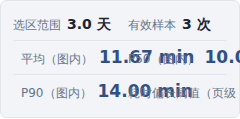

# 需求逐项对抗性审查报告（2026-10-23）

**审查基线：** `88ed1aa1e30a46f825527cc5f8cffa0116b657ad`（PR #1 合入后的 main）。日期与时间均按 Asia/Shanghai；远端观测快照为 2026-10-23T23:38:34.605592+08:00。
**交付范围：** 读取全部六份需求文件，按四份规格提取77项原始需求、159条唯一验收条件，并核对34个Issue分组。报告只审查、补证和验证文档完整性，不修改业务功能。
**证据台账：** [逐需求/逐AC JSON](2026-10-23-requirements-audit.json)；[真实浏览器观测](../../audit/2026-10-23-requirements-review/runtime-observations.json)；[生产与仓库只读观测](../../audit/2026-10-23-requirements-review/remote-observations.json)。

## 1. 结论与使用建议

项目已有可运行的核心页面、默认PR列表、代表批次算法、两社区导航和真实PR门禁；但不能认定全部整改需求已经完成。完整回归通过与逐条需求验收闭环之间仍有明显差距。
本轮严格按每条AC判断：未取得冻结输入或真实生产证据时保留“证据不足”；明确后置能力不算当前发布缺陷；已经被EC替换的旧工作台/固定任务栏要求不要求恢复。

| 状态 | 需求项 | AC条数 | 解释 |
|---|---:|---:|---|
| 已完成 | 2 | 13 | 所有对应AC均有支持证据 |
| 部分完成 | 56 | 81 | 已有实现，但至少一个条件未闭环 |
| 未完成 | 15 | 48 | 有明确代码或运行反例 |
| 证据不足 | 1 | 11 | 缺必要原始输入/真实场景，不能判成失败或完成 |
| 后置 | 3 | 6 | 最新范围明确后置，不作为本期展示阻塞 |

**这些数量是验收闭环统计，不是开发工时或功能完成率。** 77项中包含历史架构、现场补证和后置目标，不应将它们简单相除得到“产品完成百分比”。同一根因可关联多个需求，本报告将重复发现归并为26个审查项。

| 范围 | 需求数 | 已完成 | 部分完成 | 未完成 | 证据不足 | 后置 |
|---|---:|---:|---:|---:|---:|---:|
| 当前范围 | 56 | 1 | 39 | 15 | 1 | 0 |
| 历史后台/迁移回归 | 18 | 1 | 17 | 0 | 0 | 0 |
| 明确后置 | 3 | 0 | 0 | 0 | 0 | 3 |

最先影响用户判断的实测反例：

- **分析与定位混淆：** UBS选择PR状态后KPI发生变化；与现行“列表筛选只决定L”要求不同。
- **地址不等于实际状态：** 无参engineering地址继承旧q/state；Triton搜索后URL不变，新页面打开相同链接得到不同记录。
- **导出不可直接复核：** 受控12批次输入下，关注列表2行而CSV12条；UBS屏幕上的版本/范围说明没有随CSV保存。
- **小屏读数不可用：** 390px虽然无页面级溢出，统计容器右边界约353px，P50/P90读数却伸到约413/489px，且互相重叠。
- **核查工具证明力不足：** 错窗口、丢普通job、无关run的PR证据仍可能得到verified；这是核查工具反例，不是已经证实的现网数据损坏。
- **已通过的能力保留：** 两社区导航在桌面/手机冷启动均正确；Triton规范样本及两个缺失变体的整页指标数值符合预期，合法0和NPU独立资格没有被本轮推翻。
- **生产交付仍未成功：** 新仓首轮UBS采集遇429被正确阻断，deploy/verify跳过，观测时新站点和数据均404。

## 2. 审查方法、证据等级和边界

采用三个独立领域审查，再由主审重放核心模型探针及真实Chromium用户路径。每条结论区分四种证据：源码接线、已运行自动化测试、受控浏览器/模型反例、真实远端运行。历史台账只作为待核对材料，不直接作为完成证据。
最新范围：展示以2026-10-21 EC方案为准；提交时间及门禁以2026-10-22 PSG方案为准；Issue清单明确的17个历史编号采用其映射后语义。人工批准要求按用户2026-10-23后续决定已取消，当前0批准是正确配置，不作为缺陷。
代码与规范验收冻结在88ed1aa；另已补查同期文档PR #2的合入提交2487ca7，其差异仅为README、CONTRIBUTING、docs/README、user-guide、operations五份文档。新指南已改善入口分工、生产失败与迁移边界说明；UDR-037仍保留信息架构和完整运行时验收缺口。详细源码证据保持原基线，避免把后续改动冒充当时观测。报告在独立工作区制作，不覆盖并行工作。

| 验证 | 本轮结果 | 能证明/不能证明 |
|---|---|---|
| 基线完整Python | 940项，1项因缺本地Triton生产工件跳过，其他通过 | 证明现有回归；不证明跳过的生产工件一致性 |
| 完整Node | 281/281通过 | 证明已编写模型用例；不证明所有输入和页面接线 |
| Chromium与BASIC | 47/47通过，12/12必需ID通过 | 证明现有旅程；本轮仍在这些用例之外复现缺陷 |
| actionlint | 1.7.12通过 | 语法/表达式检查，不等于生产采集或部署成功 |
| 新增浏览器观察 | 5个运行反例；桌面/手机导航、3个Triton固定指标场景通过；5个断点截图 | 使用固定fixture与明确构造输入，不代表真实源站数量 |
| 模型反例重放 | 来源verified、装配/回退、异常排队/详情、时间、JUnit与结构契约 | 调用真实函数；不冒充实际部署或恶意PR端到端攻击 |
| main远端CI | [39976648635](https://github.com/tianll12115/union_monitor/actions/runs/39976648635) success | 与本基线SHA一致，不能替代业务验收 |
| 生产运行 | [39976648600](https://github.com/tianll12115/union_monitor/actions/runs/39976648600) failed | ubs-atomic 429，部署/核验skipped；门禁正确阻断 |

未完成的验证必须保留：完整371/93与887/885冻结源输入；36PR/#1627全部9执行45任务浏览器回放；全部字体、长标签与200%缩放矩阵；新仓真实红PR拒绝合入实验；真实成功发布及恢复部署。**未验证不是已证实失败，也不是已完成。**

### 2.1 可重放命令

在独立开发副本执行离线引导，勿覆盖生产采集目录。模型探针仅在本报告证据目录写结果；浏览器探针需先启动本地服务。

```sh
python -B scripts/run_checks.py --browser
python -B scripts/verify_requirements_audit.py
python -B audit/2026-10-23-requirements-review/backend-probe.py
node audit/2026-10-23-requirements-review/ux-probe.cjs
python -B audit/2026-10-23-requirements-review/ecpsg-probe.py
node audit/2026-10-23-requirements-review/submission-time-probe.cjs
# 先运行 python serve.py --port 8899，再在另一个终端运行：
node audit/2026-10-23-requirements-review/runtime-probe.cjs
```

Windows可使用同等Python/Node命令；浏览器探针默认dashboard.test映射127.0.0.1。端口覆盖环境变量为AUDIT_BASE_URL。报告校验器只验证编号覆盖、证据引用和冻结指纹，**不自动证明业务判断正确**；历史源码按Git基线读取，后续修复不会把本报告变成当前完成证明。

## 3. 按根因归并的详细发现

优先级：P1影响当前主任务/数值解释或可信声明；P2影响效率、验收证明力或尚未生产的迁移能力；P3为非阻塞改进。历史统一发布链的问题按当前影响列P2，但启用该链前必须修复。下列未明确写“浏览器实测”的条目，不应当作已完成浏览器全链复现。

| 审查项 | 优先级 | 问题 | 关联需求 |
|---|---|---|---|
| AUD-01 | P1 | [独立来源核查可在错窗口、丢job与错误PR证据下标全量verified](#aud-01) | UDR-003, UDR-004 |
| AUD-02 | P2 | [实际公共assemble入口绕过严格资源验证](#aud-02) | UDR-026 |
| AUD-03 | P2 | [历史验收台账将模型测试冒充真实生产与恢复闭环](#aud-03) | UDR-024, UDR-025, UDR-027, UDR-028, UDR-030, UDR-034, UDR-038 |
| AUD-04 | P2 | [每轮计数账本及跨版本恢复只存在未接线函数](#aud-04) | UDR-002, UDR-005 |
| AUD-05 | P2 | [增量workflow将Pages/OIDC写权限授予构建步骤](#aud-05) | UDR-031 |
| AUD-06 | P2 | [默认可信回退不校验schema/profile并会覆写旧profile](#aud-06) | UDR-027, UDR-035 |
| AUD-07 | P1 | [Triton列表、按图状态与导出没有统一的定位集合](#aud-07) | EC-003, EC-006, EC-007, EC-011, UAR-015, UDR-009, UDR-019 |
| AUD-08 | P1 | [规范engineering路由继承前一链接筛选和页码](#aud-08) | UDR-016, UDR-020, UAR-008, UAR-003 |
| AUD-09 | P1 | [失效显式批次链接静默展示代表批次](#aud-09) | UAR-006, UDR-017, UDR-020 |
| AUD-10 | P1 | [UBS CSV元数据不随文件保存且标错单位/版本](#aud-10) | UAR-018, UDR-019 |
| AUD-11 | P1 | [Triton合法空和坏窗口相同，坏数据覆写可用旧版本](#aud-11) | UAR-020, UDR-013, UAR-016 |
| AUD-12 | P1 | [Triton实际分支时间窗查询详情不随URL分享](#aud-12) | EC-003, EC-009, UAR-007, UAR-009, UDR-020 |
| AUD-13 | P2 | [Triton导出等待期间侧车读取了变化后的筛选](#aud-13) | UDR-019, UAR-018 |
| AUD-14 | P2 | [详情切换展开批次后所选任务导出仍绑定初始批次](#aud-14) | UDR-012, UDR-017, UDR-019 |
| AUD-15 | P2 | [UBS趋势缺P50且每日读数只有鼠标路径](#aud-15) | EC-010, UAR-017, UAR-019, UDR-014 |
| AUD-16 | P2 | [trigger排队异常负数和布尔参与显示排序](#aud-16) | UAR-004, UAR-003 |
| AUD-17 | P1 | [PR状态筛选改变分析集合而当前需求将其列为L条件](#aud-17) | EC-007, EC-012, UDR-016 |
| AUD-18 | P2 | [老run今天重跑的来源发现边界未公开](#aud-18) | UAR-014 |
| AUD-19 | P2 | [旧辅助地址退役迁移不一致并丢有效条件](#aud-19) | UDR-010, UDR-015, UAR-017, UDR-020 |
| AUD-20 | P1 | [390px图内统计读数重叠和裁切](#aud-20) | EC-010, PSG-004, UAR-010, UDR-014 |
| AUD-21 | P2 | [旧快照提交时间缺截止校验且显示/导出语义分裂](#aud-21) | PSG-001, PSG-002, PSG-003 |
| AUD-22 | P2 | [门禁结构契约接受浏览器步骤条件跳过](#aud-22) | PSG-006 |
| AUD-23 | P2 | [BASIC JUnit验收未证明12个独立旅程或当前run](#aud-23) | PSG-004, PSG-007 |
| AUD-24 | P2 | [故障反证交付仅自然语言，缺可回放原始证据](#aud-24) | PSG-007 |
| AUD-25 | P1 | [新仓生产首轮发布未完成，429已被正确阻断](#aud-25) | UDR-023, UDR-033, UDR-037 |
| AUD-26 | P2 | [需求跟踪清单仍指向旧仓，新仓没有需求Issue](#aud-26) | UDR-038 |

<a id="aud-01"></a>
### AUD-01：独立来源核查可在错窗口、丢job与错误PR证据下标全量verified（P1）

**用户影响：** 用户可能相信未完整/错误归属的数据已经全量核实。

**复现/检查：** 复用backend-probe-data：run1/attempt1原job10，公开无job，原始Jan窗口对公开Feb窗口，PR证据文件999.json声明PR7；调用build_coverage_evidence。

**期望：** 任一窗口/任务身份/关联归属差异阻断verified。

**实际：** status=verified且三类别均零缺失；window_matches_payload=false仅作描述。

**证据：** [triton/source_verify.py:122](https://github.com/tianll12115/union_monitor/blob/88ed1aa1e30a46f825527cc5f8cffa0116b657ad/triton/source_verify.py#L122) — 直接实现/回归证据；[triton/source_verify.py:132](https://github.com/tianll12115/union_monitor/blob/88ed1aa1e30a46f825527cc5f8cffa0116b657ad/triton/source_verify.py#L132) — 直接实现/回归证据；[audit/2026-10-12/evidence/triton-source-coverage.json:2](https://github.com/tianll12115/union_monitor/blob/88ed1aa1e30a46f825527cc5f8cffa0116b657ad/audit/2026-10-12/evidence/triton-source-coverage.json#L2) — 直接实现/回归证据；[audit/2026-10-23-requirements-review/backend-probes.json:3](../../audit/2026-10-23-requirements-review/backend-probes.json#L3) — 本次只读模型探针结果

**建议与关闭条件：** 按run/attempt/job完整身份及run→PR证据双向比对，将窗口差异纳入失败；原始文件绑定指纹。

**适用边界：** 此为独立核查工具反例，未发现dashboard生产入口调用它；不能据此断言现网已发生该数据损坏。普通job可合理排除，但必须有逐身份排除解释，不能未比对就全量verified。

<a id="aud-02"></a>
### AUD-02：实际公共assemble入口绕过严格资源验证（P2）

**用户影响：** 调用CLI或公共函数可得到假publishable候选，严格测试未保护真实入口。

**复现/检查：** assemble_release注入success/passed/fake version/零hash/missing.json；is_publishable返回True；cmd_assemble使用同入口。

**期望：** 公共入口独立校验真实字节、归属、context与完整资源闭包。

**实际：** assemble_verified严格辅助函数只被测试调用，实际CLI信任字段。

**证据：** [monitor/assemble.py:60](https://github.com/tianll12115/union_monitor/blob/88ed1aa1e30a46f825527cc5f8cffa0116b657ad/monitor/assemble.py#L60) — 直接实现/回归证据；[monitor/__main__.py:90](https://github.com/tianll12115/union_monitor/blob/88ed1aa1e30a46f825527cc5f8cffa0116b657ad/monitor/__main__.py#L90) — 直接实现/回归证据；[audit/2026-10-23-requirements-review/backend-probes.json:59](../../audit/2026-10-23-requirements-review/backend-probes.json#L59) — 直接实现/回归证据

**建议与关闭条件：** 合并为唯一严格公共入口；用真实CLI运行伪fresh/缺资源攻击。

**适用边界：** 属于尚未接入生产的统一候选发布链；当前legacy Pages流程不使用此入口。按当前用户影响列P2，未来启用统一发布前升级为阻断项。

<a id="aud-03"></a>
### AUD-03：历史验收台账将模型测试冒充真实生产与恢复闭环（P2）

**用户影响：** 误导后续开发/验收并使测试固化错误完成状态。

**复现/检查：** 读取历史ledger及test_udr_acceptance_ledger：仅验证文件存在并强制新release模块已实现；rollback测试deploy为list.append。

**期望：** 标明历史/后置范围，模型通过与真实默认入口/生产/冻结证据分开。

**实际：** ledger称生产统一调度、可信回退、实际恢复、第三项目已实现；README说明未上线，真实workflow未接线。

**证据：** [tests/test_udr_acceptance_ledger.py:54](https://github.com/tianll12115/union_monitor/blob/88ed1aa1e30a46f825527cc5f8cffa0116b657ad/tests/test_udr_acceptance_ledger.py#L54) — 直接实现/回归证据；[tests/test_udr_acceptance_ledger.py:73](https://github.com/tianll12115/union_monitor/blob/88ed1aa1e30a46f825527cc5f8cffa0116b657ad/tests/test_udr_acceptance_ledger.py#L73) — 直接实现/回归证据；[audit/2026-10-12/udr-implementation-ledger.json:36](https://github.com/tianll12115/union_monitor/blob/88ed1aa1e30a46f825527cc5f8cffa0116b657ad/audit/2026-10-12/udr-implementation-ledger.json#L36) — 直接实现/回归证据；[monitor/__main__.py:122](https://github.com/tianll12115/union_monitor/blob/88ed1aa1e30a46f825527cc5f8cffa0116b657ad/monitor/__main__.py#L122) — 直接实现/回归证据；[tests/test_release_rollback_integration.py:38](https://github.com/tianll12115/union_monitor/blob/88ed1aa1e30a46f825527cc5f8cffa0116b657ad/tests/test_release_rollback_integration.py#L38) — 直接实现/回归证据；[README.md:43](https://github.com/tianll12115/union_monitor/blob/88ed1aa1e30a46f825527cc5f8cffa0116b657ad/README.md#L43) — 直接实现/回归证据

**建议与关闭条件：** 保留历史记录，追加勘误及逐AC真实证据，不以历史模块标签扩大本期范围。

<a id="aud-04"></a>
### AUD-04：每轮计数账本及跨版本恢复只存在未接线函数（P2）

**用户影响：** 无法解释真实本轮丢失/排除，也无法追踪未知PR如何在下一版恢复。

**复现/检查：** rg build_ledger/recover_identities调用点：业务路径无调用，只有测试；collector resolve每轮覆盖同文件。

**期望：** 真实入口为每轮保存逐身份分类与迁移记录；887/885继续独立未核实。

**实际：** 只有单元模型；371/93和887/885冻结输入均不可得。

**证据：** [triton/coverage_ledger.py:61](https://github.com/tianll12115/union_monitor/blob/88ed1aa1e30a46f825527cc5f8cffa0116b657ad/triton/coverage_ledger.py#L61) — 直接实现/回归证据；[triton/dashboard.py:689](https://github.com/tianll12115/union_monitor/blob/88ed1aa1e30a46f825527cc5f8cffa0116b657ad/triton/dashboard.py#L689) — 直接实现/回归证据；[triton/pr_identity.py:149](https://github.com/tianll12115/union_monitor/blob/88ed1aa1e30a46f825527cc5f8cffa0116b657ad/triton/pr_identity.py#L149) — 直接实现/回归证据；[triton/dashboard.py:565](https://github.com/tianll12115/union_monitor/blob/88ed1aa1e30a46f825527cc5f8cffa0116b657ad/triton/dashboard.py#L565) — 直接实现/回归证据；[triton/pr_identity.py:133](https://github.com/tianll12115/union_monitor/blob/88ed1aa1e30a46f825527cc5f8cffa0116b657ad/triton/pr_identity.py#L133) — 直接实现/回归证据

**建议与关闭条件：** 当前采集输出绑定原始指纹的账本和append-only身份迁移证据；不可得历史明确未核实。

<a id="aud-05"></a>
### AUD-05：增量workflow将Pages/OIDC写权限授予构建步骤（P2）

**用户影响：** 含网络采集和测试的build作业也获得部署权限，权限边界大于设计。

**复现/检查：** 读取triton-refresh.yml顶层permissions，build没有覆盖；与pages.yml只在deploy授权对照。

**期望：** contents:read为默认，仅deploy pages:write/id-token:write。

**实际：** refresh顶层pages:write/id-token:write继承全部jobs；sentinel扫描也未生产接线。

**证据：** [monitor/boundaries.py:58](https://github.com/tianll12115/union_monitor/blob/88ed1aa1e30a46f825527cc5f8cffa0116b657ad/monitor/boundaries.py#L58) — 直接实现/回归证据；[.github/workflows/triton-refresh.yml:11](https://github.com/tianll12115/union_monitor/blob/88ed1aa1e30a46f825527cc5f8cffa0116b657ad/.github/workflows/triton-refresh.yml#L11) — 直接实现/回归证据；[tests/test_publication_boundaries.py:58](https://github.com/tianll12115/union_monitor/blob/88ed1aa1e30a46f825527cc5f8cffa0116b657ad/tests/test_publication_boundaries.py#L58) — 直接实现/回归证据

**建议与关闭条件：** 权限下沉deploy job，并在上传前执行公共资源清单/敏感哨兵验证。

<a id="aud-06"></a>
### AUD-06：默认可信回退不校验schema/profile并会覆写旧profile（P2）

**用户影响：** 旧数据可能被当前语义解释，损害统计可信性；目前仅历史辅助链，未上线。

**复现/检查：** is_readable_fallback对任意匹配字节返回True；_fallback_entry设置metric_profile=project当前值而非base。；backend-probe.py实测对非JSON字节+obsolete-unknown-profile，默认is_readable_fallback=True。

**期望：** 只允许实际可读兼容旧schema/profile，保留原profile/观察时间。

**实际：** readable只检查存在和hash，无解析或版本检查；fallback使用当前profile。

**证据：** [monitor/release_policy.py:19](https://github.com/tianll12115/union_monitor/blob/88ed1aa1e30a46f825527cc5f8cffa0116b657ad/monitor/release_policy.py#L19) — 直接实现/回归证据；[monitor/assemble.py:35](https://github.com/tianll12115/union_monitor/blob/88ed1aa1e30a46f825527cc5f8cffa0116b657ad/monitor/assemble.py#L35) — 直接实现/回归证据；[audit/2026-10-23-requirements-review/backend-probes.json:60](../../audit/2026-10-23-requirements-review/backend-probes.json#L60) — default_fallback_accepts_invalid_schema_unknown_profile=true（本次模型探针）

**建议与关闭条件：** 在默认策略解析归档schema/profile并显式声明兼容映射，保留原profile。

<a id="aud-07"></a>
### AUD-07：Triton列表、按图状态与导出没有统一的定位集合（P1）

**用户影响：** 用户下载后出现页面未列出的成功/普通批次，行数和排序不能对账。

**复现/检查：** 运行runtime-probe.cjs受控输入：12个成功合格批次、耗时1～12分钟；默认关注列表2行，点击导出得到12条。

**期望：** 单列表完整L，或明确声明关注L并导出同一L。

**实际：** showAll默认false走attentionGroups，但exportPool始终searchPool；下载包含普通批次。；交叉核查：e2eFilters/npuFilters只draw；默认entries关注子集而exportPool为searchPool。 本轮真实12条成功合格输入复现关注列表2行、CSV12行。

**证据：** [web/triton-view.js:212](https://github.com/tianll12115/union_monitor/blob/88ed1aa1e30a46f825527cc5f8cffa0116b657ad/web/triton-view.js#L212) — 默认false；[web/triton-view.js:229](https://github.com/tianll12115/union_monitor/blob/88ed1aa1e30a46f825527cc5f8cffa0116b657ad/web/triton-view.js#L229) — 导出全集；[web/triton-view.js:580](https://github.com/tianll12115/union_monitor/blob/88ed1aa1e30a46f825527cc5f8cffa0116b657ad/web/triton-view.js#L580) — 关注子集；[web/triton-view.js:648](https://github.com/tianll12115/union_monitor/blob/88ed1aa1e30a46f825527cc5f8cffa0116b657ad/web/triton-view.js#L648) — CSV导出；[web/triton-view.js:674](https://github.com/tianll12115/union_monitor/blob/88ed1aa1e30a46f825527cc5f8cffa0116b657ad/web/triton-view.js#L674) — 两图各自过滤；[web/triton-view.js:500](https://github.com/tianll12115/union_monitor/blob/88ed1aa1e30a46f825527cc5f8cffa0116b657ad/web/triton-view.js#L500) — NPU仅浮卡；[audit/2026-10-23-requirements-review/runtime-observations.json:150](../../audit/2026-10-23-requirements-review/runtime-observations.json#L150) — 真实12样本结果；[audit/2026-10-23-requirements-review/triton-default-export.csv:1](../../audit/2026-10-23-requirements-review/triton-default-export.csv#L1) — 实际下载CSV

**建议与关闭条件：** 取消默认关注子集分叉，列表与下载复用排序后的L。

<a id="aud-08"></a>
### AUD-08：规范engineering路由继承前一链接筛选和页码（P1）

**用户影响：** 同一分享链接在已有标签页与新标签页结果不同。

**复现/检查：** 先打开engineering?q=needle&state=merged&ps=50&page=3，再导航无参数同仓engineering；与冷启动对比。

**期望：** 无参数恢复定义默认值。

**实际：** 只有records任务重置，engineering缺省q/state/ps/page均不覆盖旧状态。

**证据：** [web/app.js:110](https://github.com/tianll12115/union_monitor/blob/88ed1aa1e30a46f825527cc5f8cffa0116b657ad/web/app.js#L110) — 只records重置；[web/app.js:112](https://github.com/tianll12115/union_monitor/blob/88ed1aa1e30a46f825527cc5f8cffa0116b657ad/web/app.js#L112) — q有值才覆盖；[web/app.js:116](https://github.com/tianll12115/union_monitor/blob/88ed1aa1e30a46f825527cc5f8cffa0116b657ad/web/app.js#L116) — state有值才覆盖；[web/app.js:120](https://github.com/tianll12115/union_monitor/blob/88ed1aa1e30a46f825527cc5f8cffa0116b657ad/web/app.js#L120) — page有值才覆盖；[audit/2026-10-23-requirements-review/runtime-observations.json:132](../../audit/2026-10-23-requirements-review/runtime-observations.json#L132) — 明确无参地址仍继承q/state

**建议与关闭条件：** 所有现存工作页用统一完整默认状态重建。

<a id="aud-09"></a>
### AUD-09：失效显式批次链接静默展示代表批次（P1）

**用户影响：** 排障者以为在查看指定失败执行，实际看到另一执行。

**复现/检查：** Detail.defaultExpandedBatch([{url:valid,number:2}],{entryId:expired,representativeUrl:valid})；真实URL pr有效&batch=expired。

**期望：** 提示该批次失效，不自动替换。

**实际：** 只读探针返回valid、reason=representative。

**证据：** [web/detail.js:34](https://github.com/tianll12115/union_monitor/blob/88ed1aa1e30a46f825527cc5f8cffa0116b657ad/web/detail.js#L34) — entry回退代表；[web/app.js:129](https://github.com/tianll12115/union_monitor/blob/88ed1aa1e30a46f825527cc5f8cffa0116b657ad/web/app.js#L129) — 传batch但不检查存在；[audit/2026-10-23-requirements-review/ux-probe-results.json:27](../../audit/2026-10-23-requirements-review/ux-probe-results.json#L27) — 实际探针

**建议与关闭条件：** entryId存在但无匹配时返回明确invalid-entry状态。

<a id="aud-10"></a>
### AUD-10：UBS CSV元数据不随文件保存且标错单位/版本（P1）

**用户影响：** 离开页面无法复算导出，旧数据可能被标成新release，毫秒可能被按分钟解释。

**复现/检查：** 保存PR/明细CSV；检查请求和实际文件；再令新release成功、单仓快照失败回退旧数据。

**期望：** 兼容原ms/s列+列级单位与实际snapshot指纹的sidecar，报告版本独立。

**实际：** saveCsv请求仅name/csv，metadata仅返回内存；unit分钟配ms；snapshot_id取release；明细count批次数配任务行。

**证据：** [web/core.js:48](https://github.com/tianll12115/union_monitor/blob/88ed1aa1e30a46f825527cc5f8cffa0116b657ad/web/core.js#L48) — 单位/字段不足；[web/core.js:53](https://github.com/tianll12115/union_monitor/blob/88ed1aa1e30a46f825527cc5f8cffa0116b657ad/web/core.js#L53) — 请求无meta；[web/app.js:217](https://github.com/tianll12115/union_monitor/blob/88ed1aa1e30a46f825527cc5f8cffa0116b657ad/web/app.js#L217) — release版本和分钟单位；[web/app.js:219](https://github.com/tianll12115/union_monitor/blob/88ed1aa1e30a46f825527cc5f8cffa0116b657ad/web/app.js#L219) — 按任务行展开；[audit/2026-10-23-requirements-review/runtime-observations.json:189](../../audit/2026-10-23-requirements-review/runtime-observations.json#L189) — 屏幕声明不随CSV离开页面

**建议与关闭条件：** 随CSV生成版本化sidecar并绑定实际detailSnapshot。

<a id="aud-11"></a>
### AUD-11：Triton合法空和坏窗口相同，坏数据覆写可用旧版本（P1）

**用户影响：** 用户无法区分无活动与格式错误，原可分析旧快照丢失。

**复现/检查：** 先加载有效非空，再返回batches数组且window_end早于window_start；另对比合法空。

**期望：** 坏窗口提示格式错误保留旧版本；合法空保留范围与筛选。

**实际：** load仅查batches数组，替换payload；render对空/无效窗口返回同一暂无文案。

**证据：** [web/app.js:237](https://github.com/tianll12115/union_monitor/blob/88ed1aa1e30a46f825527cc5f8cffa0116b657ad/web/app.js#L237) — 弱校验提交；[web/triton-view.js:91](https://github.com/tianll12115/union_monitor/blob/88ed1aa1e30a46f825527cc5f8cffa0116b657ad/web/triton-view.js#L91) — 合并零与坏窗口

**建议与关闭条件：** 提交payload前完整验证窗口和归属，合法空走完整壳。

<a id="aud-12"></a>
### AUD-12：Triton实际分支时间窗查询详情不随URL分享（P1）

**用户影响：** 复制链接无法让他人重建同一统计与排障对象。

**复现/检查：** 在Triton选择main-dev、24h、搜索PR并打开详情，复制到新标签页。

**期望：** URL恢复所有现存条件与详情；历史不可用显式解释。

**实际：** branch/window/search仅savedState；openTritonDetail不写URL，applyProjectRoute不应用这些query。；交叉核查：Triton未写范围/搜索/batch；旧路由只保留repository；UBS engineering缺省可继承旧query/state。

**证据：** [web/triton-view.js:775](https://github.com/tianll12115/union_monitor/blob/88ed1aa1e30a46f825527cc5f8cffa0116b657ad/web/triton-view.js#L775) — 仅内存state；[web/app.js:87](https://github.com/tianll12115/union_monitor/blob/88ed1aa1e30a46f825527cc5f8cffa0116b657ad/web/app.js#L87) — 未应用query；[web/app.js:67](https://github.com/tianll12115/union_monitor/blob/88ed1aa1e30a46f825527cc5f8cffa0116b657ad/web/app.js#L67) — 详情不写URL；[web/app.js:28](https://github.com/tianll12115/union_monitor/blob/88ed1aa1e30a46f825527cc5f8cffa0116b657ad/web/app.js#L28) — URL覆盖范围；[web/app.js:85](https://github.com/tianll12115/union_monitor/blob/88ed1aa1e30a46f825527cc5f8cffa0116b657ad/web/app.js#L85) — 迁移丢条件；[web/app.js:109](https://github.com/tianll12115/union_monitor/blob/88ed1aa1e30a46f825527cc5f8cffa0116b657ad/web/app.js#L109) — defaults只records；[audit/2026-10-23-requirements-review/runtime-observations.json:132](../../audit/2026-10-23-requirements-review/runtime-observations.json#L132) — engineering状态泄漏；[audit/2026-10-23-requirements-review/runtime-observations.json:172](../../audit/2026-10-23-requirements-review/runtime-observations.json#L172) — Triton搜索分享丢失

**建议与关闭条件：** 统一序列化/解析当前状态，默认从URL构造。

<a id="aud-13"></a>
### AUD-13：Triton导出等待期间侧车读取了变化后的筛选（P2）

**用户影响：** CSV与资格JSON可能属于不同集合，无法审计。

**复现/检查：** 延迟/api/export响应；下载开始后换分支/时间/搜索，再放行响应，比较CSV与资格JSON。

**期望：** 下载起点冻结相同rows、scope、identity、version。

**实际：** CSV在await前生成，qualification在await后再次调用exportPool和读取viewStart/search。

**证据：** [web/triton-view.js:648](https://github.com/tianll12115/union_monitor/blob/88ed1aa1e30a46f825527cc5f8cffa0116b657ad/web/triton-view.js#L648) — await前CSV；[web/triton-view.js:650](https://github.com/tianll12115/union_monitor/blob/88ed1aa1e30a46f825527cc5f8cffa0116b657ad/web/triton-view.js#L650) — 等待保存；[web/triton-view.js:653](https://github.com/tianll12115/union_monitor/blob/88ed1aa1e30a46f825527cc5f8cffa0116b657ad/web/triton-view.js#L653) — 等待后可变scope；[web/triton-view.js:654](https://github.com/tianll12115/union_monitor/blob/88ed1aa1e30a46f825527cc5f8cffa0116b657ad/web/triton-view.js#L654) — 重新exportPool

**建议与关闭条件：** await前冻结完整导出对象及资格，导航后抑制失效UI写入。

<a id="aud-14"></a>
### AUD-14：详情切换展开批次后所选任务导出仍绑定初始批次（P2）

**用户影响：** 用户展开另一执行后点击导出所选任务，得到最初执行的任务。

**复现/检查：** PR详情默认代表，展开另一批次summary，再点击导出所选批次任务。

**期望：** 有明确单选当前执行且导出与可见选中一致。

**实际：** detailChoice仅openDetail初始化；原生details展开没有更新detailChoice，exportBatchTasks仍用旧值。

**证据：** [web/app.js:205](https://github.com/tianll12115/union_monitor/blob/88ed1aa1e30a46f825527cc5f8cffa0116b657ad/web/app.js#L205) — 原生details无选择更新；[web/app.js:206](https://github.com/tianll12115/union_monitor/blob/88ed1aa1e30a46f825527cc5f8cffa0116b657ad/web/app.js#L206) — 仅初始化detailChoice；[web/app.js:220](https://github.com/tianll12115/union_monitor/blob/88ed1aa1e30a46f825527cc5f8cffa0116b657ad/web/app.js#L220) — 导出初始选择

**建议与关闭条件：** 选择执行时同步detailChoice/URL并显式显示导出对象，或将按钮明确标为初始选中执行。

<a id="aud-15"></a>
### AUD-15：UBS趋势缺P50且每日读数只有鼠标路径（P2）

**用户影响：** 键盘或读屏用户无法读取每日统计，界面也未采用当前P50/P90趋势口径。

**复现/检查：** 仅Tab浏览UBS单仓趋势，尝试读取每个日期P50/P90/n。

**期望：** 可聚焦点或等价表格提供当前实际指标及单位。

**实际：** drawTrend用stats(mean/P90)，tooltip只有mousemove；无P50或键盘等价。；交叉核查：svg只有mousemove/mouseleave，role img的aria-label只有整体标题。

**证据：** [web/app.js:49](https://github.com/tianll12115/union_monitor/blob/88ed1aa1e30a46f825527cc5f8cffa0116b657ad/web/app.js#L49) — mean/P90+mousemove；[web/core.js:5](https://github.com/tianll12115/union_monitor/blob/88ed1aa1e30a46f825527cc5f8cffa0116b657ad/web/core.js#L5) — stats无P50；[web/app.js:54](https://github.com/tianll12115/union_monitor/blob/88ed1aa1e30a46f825527cc5f8cffa0116b657ad/web/app.js#L54) — drawTrend事件与svg

**建议与关闭条件：** 使用statsWithP50，并增加可聚焦点/语义表格和可见焦点。

<a id="aud-16"></a>
### AUD-16：trigger排队异常负数和布尔参与显示排序（P2）

**用户影响：** 异常证据被显示为真实时长，影响慢排队诊断。

**复现/检查：** 构造trigger.queue_ms=-1,true,0,null，通过ubsBatchRecords与sortRecords；只读探针已运行。

**期望：** 0有效；负数/布尔为未知并带原因。

**实际：** 负数/布尔原样透传，numericValue(true)=1。

**证据：** [web/records.js:118](https://github.com/tianll12115/union_monitor/blob/88ed1aa1e30a46f825527cc5f8cffa0116b657ad/web/records.js#L118) — 透传queue；[web/records.js:34](https://github.com/tianll12115/union_monitor/blob/88ed1aa1e30a46f825527cc5f8cffa0116b657ad/web/records.js#L34) — 允许负数；[web/records.js:40](https://github.com/tianll12115/union_monitor/blob/88ed1aa1e30a46f825527cc5f8cffa0116b657ad/web/records.js#L40) — 转换布尔；[audit/2026-10-23-requirements-review/ux-probe-results.json:21](../../audit/2026-10-23-requirements-review/ux-probe-results.json#L21) — 异常值输出

**建议与关闭条件：** 归一化只接收有限非负number并记录invalid原因。

<a id="aud-17"></a>
### AUD-17：PR状态筛选改变分析集合而当前需求将其列为L条件（P1）

**用户影响：** 用户仅定位列表却连KPI、趋势和分母一起改变，难以比较。

**复现/检查：** 记录KPI后切PR状态merged，比较KPI/趋势。

**期望：** 按当前有效映射，列表状态筛选只改变L；若产品要改变S需明确改规格。

**实际：** state先传Metrics.filterPRs形成analysisSet，随后KPI/趋势用该集合。；交叉核查：无范围控件；render把state输入Metrics.filterPRs作为analysisSet，且测试锁定旧行为。

**证据：** [web/app.js:23](https://github.com/tianll12115/union_monitor/blob/88ed1aa1e30a46f825527cc5f8cffa0116b657ad/web/app.js#L23) — state读取；[web/app.js:43](https://github.com/tianll12115/union_monitor/blob/88ed1aa1e30a46f825527cc5f8cffa0116b657ad/web/app.js#L43) — state构建S；[web/app.js:45](https://github.com/tianll12115/union_monitor/blob/88ed1aa1e30a46f825527cc5f8cffa0116b657ad/web/app.js#L45) — KPI依S；[web/core.js:41](https://github.com/tianll12115/union_monitor/blob/88ed1aa1e30a46f825527cc5f8cffa0116b657ad/web/core.js#L41) — state过滤；[web/app.js:48](https://github.com/tianll12115/union_monitor/blob/88ed1aa1e30a46f825527cc5f8cffa0116b657ad/web/app.js#L48) — 分析集过滤；[web/index.html:54](https://github.com/tianll12115/union_monitor/blob/88ed1aa1e30a46f825527cc5f8cffa0116b657ad/web/index.html#L54) — 仅生命周期状态；[tests/browser/advanced-sample-filter.spec.cjs:25](https://github.com/tianll12115/union_monitor/blob/88ed1aa1e30a46f825527cc5f8cffa0116b657ad/tests/browser/advanced-sample-filter.spec.cjs#L25) — 错误方向契约；[audit/2026-10-23-requirements-review/runtime-observations.json:119](../../audit/2026-10-23-requirements-review/runtime-observations.json#L119) — 真实Chromium复现

**建议与关闭条件：** 确定state归属并统一标签、URL、导出和测试；当前按L实现。

<a id="aud-18"></a>
### AUD-18：老run今天重跑的来源发现边界未公开（P2）

**用户影响：** 当天列表可能缺老run的新attempt，却无可见不可验证说明。

**复现/检查：** 构造run创建早于窗口起点14天以上、attempt今天发生；检查collector查询。

**期望：** 发现该attempt或显式声明不可验证范围，不称全量。

**实际：** 按created从start-14天枚举，因此该run不进入来源；当前页面无14天说明。

**证据：** [triton/dashboard.py:223](https://github.com/tianll12115/union_monitor/blob/88ed1aa1e30a46f825527cc5f8cffa0116b657ad/triton/dashboard.py#L223) — 14天；[triton/dashboard.py:546](https://github.com/tianll12115/union_monitor/blob/88ed1aa1e30a46f825527cc5f8cffa0116b657ad/triton/dashboard.py#L546) — 发现起点；[triton/dashboard.py:550](https://github.com/tianll12115/union_monitor/blob/88ed1aa1e30a46f825527cc5f8cffa0116b657ad/triton/dashboard.py#L550) — created查询；[web/triton-view.js:177](https://github.com/tianll12115/union_monitor/blob/88ed1aa1e30a46f825527cc5f8cffa0116b657ad/web/triton-view.js#L177) — 无14天说明

**建议与关闭条件：** 采用更新事件/独立清单补发现，或公开边界及证据。

<a id="aud-19"></a>
### AUD-19：旧辅助地址退役迁移不一致并丢有效条件（P2）

**用户影响：** 旧分享链接丢搜索/排序或跨到另一社区而不解释。

**复现/检查：** 打开projects/triton/method、projects/triton/quality，以及projects/triton/records?sort=start&page=2；或旧#ubs/repo/name?q=needle。

**期望：** 归属当前社区的规范页，保留支持意图，退役条件有可见说明。

**实际：** method直接UBS；Tritonquality未提供；records仅保留repository；legacyIntent丢query。

**证据：** [web/app.js:84](https://github.com/tianll12115/union_monitor/blob/88ed1aa1e30a46f825527cc5f8cffa0116b657ad/web/app.js#L84) — method去UBS；[web/app.js:89](https://github.com/tianll12115/union_monitor/blob/88ed1aa1e30a46f825527cc5f8cffa0116b657ad/web/app.js#L89) — Tritonquality未迁移；[web/app.js:93](https://github.com/tianll12115/union_monitor/blob/88ed1aa1e30a46f825527cc5f8cffa0116b657ad/web/app.js#L93) — records丢query；[web/router.js:44](https://github.com/tianll12115/union_monitor/blob/88ed1aa1e30a46f825527cc5f8cffa0116b657ad/web/router.js#L44) — legacyIntent忽略query

**建议与关闭条件：** 集中迁移表保留支持字段并统一说明，无需恢复旧页。

<a id="aud-20"></a>
### AUD-20：390px图内统计读数重叠和裁切（P1）

**用户影响：** 小屏用户无法完整读取图内统计值，即使整页没有横向溢出。

**复现/检查：** 真实Chromium390px渲染受控Triton样本；检查selection-stats读数边界和截图。

**期望：** 统计值在模块内完整可见，无重叠或截断。

**实际：** 本轮几何记录outside_parent=true，截图显示重叠/裁切。；交叉核查：document宽390无横溢，但平均11.67、P50 10.00等读数重叠并截断，多项outside_parent=true。

**证据：** [audit/2026-10-23-requirements-review/runtime-observations.json:435](../../audit/2026-10-23-requirements-review/runtime-observations.json#L435) — 390px统计读数几何；[web/style.css:583](https://github.com/tianll12115/union_monitor/blob/88ed1aa1e30a46f825527cc5f8cffa0116b657ad/web/style.css#L583) — 窄屏selection-stats规则；[audit/2026-10-23-requirements-review/runtime-observations.json:423](../../audit/2026-10-23-requirements-review/runtime-observations.json#L423) — VISUAL-390；[tests/browser/dashboard.spec.cjs:113](https://github.com/tianll12115/union_monitor/blob/88ed1aa1e30a46f825527cc5f8cffa0116b657ad/tests/browser/dashboard.spec.cjs#L113) — 仅document横溢而非读数可读性

**建议与关闭条件：** 统计单元采用可换行/自适应布局并以实际字体边界验收。

**适用边界：** 已实测统计读数重叠/截断；不把它冒充完整图轴长标签或200%缩放验收结果。

<a id="aud-21"></a>
### AUD-21：旧快照提交时间缺截止校验且显示/导出语义分裂（P2）

**用户影响：** 未来事件可排到最前；用户看到未知却CSV带时间；合法0显示为空义。

**复现/检查：** 纯函数probe：events push=9999999999999；另含issues操作日志采集失败；再latest_submission_ms=0。

**期望：** 旧/新Python/JS统一cutoff/partial/0。

**实际：** sort future=9999999999999；partial sort null但export ms=100；零行文本—·创建。

**证据：** [web/core.js:33](https://github.com/tianll12115/union_monitor/blob/88ed1aa1e30a46f825527cc5f8cffa0116b657ad/web/core.js#L33) — 无cutoff；[web/app.js:9](https://github.com/tianll12115/union_monitor/blob/88ed1aa1e30a46f825527cc5f8cffa0116b657ad/web/app.js#L9) — 零显示破折号；[web/app.js:11](https://github.com/tianll12115/union_monitor/blob/88ed1aa1e30a46f825527cc5f8cffa0116b657ad/web/app.js#L11) — partial仍导出best；[audit/2026-10-23-requirements-review/ecpsg-time-probes.json:2](../../audit/2026-10-23-requirements-review/ecpsg-time-probes.json#L2) — 真实函数输出

**建议与关闭条件：** 集中带快照end_ms的派生结果，所有消费者共用；零用null判断。

**适用边界：** 主要影响旧快照/异常时间输入，不证明当前新采集快照已存在未来事件；正常新profile的后端派生已有更强检查。

<a id="aud-22"></a>
### AUD-22：门禁结构契约接受浏览器步骤条件跳过（P2）

**用户影响：** 结构验收不能识别已声明必须拒绝的条件跳过变体；单独if:false不会直接令现有实际CI假绿，因为随后校验器会因本轮JUnit缺失失败。

**复现/检查：** 内存复制workflow，在npm run test:browser步骤加入if:${{ false }}，调用WorkflowYamlStructureTests._validate。

**期望：** 结构契约拒绝执行步骤条件绕过。

**实际：** 返回[]；required_runs其他项仅substring也可被echo文本满足。 现有workflow先rm旧test-results，随后verifier必需执行；此探针只证明结构验收缺口，不证明该单一变体能通过真实聚合门禁。

**证据：** [tests/test_ci_gate.py:174](https://github.com/tianll12115/union_monitor/blob/88ed1aa1e30a46f825527cc5f8cffa0116b657ad/tests/test_ci_gate.py#L174) — 只比较run；[tests/test_ci_gate.py:203](https://github.com/tianll12115/union_monitor/blob/88ed1aa1e30a46f825527cc5f8cffa0116b657ad/tests/test_ci_gate.py#L203) — 未限制if；[audit/2026-10-23-requirements-review/ecpsg-probes.json:2](../../audit/2026-10-23-requirements-review/ecpsg-probes.json#L2) — 接受变体

**建议与关闭条件：** 验证关键job/step条件、真实命令边界及脚本入口，补条件变体负测。

**适用边界：** 内存结构校验器接受if:false不等于实际CI单变体假绿：当前CI先清理旧JUnit，跳过浏览器后下一步会因缺报告失败。问题是结构AC未被充分保护。

<a id="aud-23"></a>
### AUD-23：BASIC JUnit验收未证明12个独立旅程或当前run（P2）

**用户影响：** 报告校验未能独立证明每旅程实际执行及来源绑定；这是可信报告生产链的完整性缺口，不能据此声称防御任意可修改CI的恶意提交者。

**复现/检查：** 造12testcase，首条名字含全部12ID，余11任意名，调用check。

**期望：** 精确令牌与独立case执行，固定版本12清单，当前代码/run可追溯。

**实际：** check返回true；manifest任意非空清单也接受，无SHA/run/报告起止绑定。

**证据：** [scripts/verify_basic_junit.py:47](https://github.com/tianll12115/union_monitor/blob/88ed1aa1e30a46f825527cc5f8cffa0116b657ad/scripts/verify_basic_junit.py#L47) — 非空清单；[scripts/verify_basic_junit.py:79](https://github.com/tianll12115/union_monitor/blob/88ed1aa1e30a46f825527cc5f8cffa0116b657ad/scripts/verify_basic_junit.py#L79) — substring；[audit/2026-10-23-requirements-review/ecpsg-probes.json:3](../../audit/2026-10-23-requirements-review/ecpsg-probes.json#L3) — 伪case接受

**建议与关闭条件：** 严格令牌和case映射，验证清单固定全集及报告run provenance；允许同ID多场景但不能一case覆盖多旅程。

**适用边界：** 伪造报告能通过验证器已实测；当前GitHub工作流清理旧文件并运行真实浏览器，不能据此声称现有真实run是伪造的，也不能承诺可抵御任意修改CI代码的恶意作者。

<a id="aud-24"></a>
### AUD-24：故障反证交付仅自然语言，缺可回放原始证据（P2）

**用户影响：** 不能确认故障因行为断言失败，或确认恢复后当前版本全部绿。

**复现/检查：** 检查mutation-evidence中12项的命令/patch/日志/JUnit/trace链接及当前SHA。

**期望：** 每故障绑定可重放patch、检测命令、真实失败输出和恢复绿报告。

**实际：** 仅fault/detection/observed/restored自然语言，绑定旧64f5750且恢复Python自报7失败；未提供完整原始产物。

**证据：** [audit/2026-10-22/pr-submission-gate-review/mutation-evidence.json:5](https://github.com/tianll12115/union_monitor/blob/88ed1aa1e30a46f825527cc5f8cffa0116b657ad/audit/2026-10-22/pr-submission-gate-review/mutation-evidence.json#L5) — 旧提交；[audit/2026-10-22/pr-submission-gate-review/mutation-evidence.json:12](https://github.com/tianll12115/union_monitor/blob/88ed1aa1e30a46f825527cc5f8cffa0116b657ad/audit/2026-10-22/pr-submission-gate-review/mutation-evidence.json#L12) — 叙述条目；[audit/2026-10-22/pr-submission-gate-review/mutation-evidence.json:99](https://github.com/tianll12115/union_monitor/blob/88ed1aa1e30a46f825527cc5f8cffa0116b657ad/audit/2026-10-22/pr-submission-gate-review/mutation-evidence.json#L99) — 恢复结果自报

**建议与关闭条件：** 在隔离checkout保存patch/命令/原始输出/输入哈希及当前恢复结果，缺失保持未验证。

<a id="aud-25"></a>
### AUD-25：新仓生产首轮发布未完成，429已被正确阻断（P1）

**用户影响：** 新仓公开站点及repositories.json在观测时返回404，不能交付为已上线可用。

**复现/检查：** 读取生产run39976648600、失败job120492873555和新仓Pages公开地址。

**期望：** 来源错误不伪绿；同时，上线交付必须有成功采集、部署与公开字节核验。

**实际：** ubs-atomic遇HTTP429；九仓状态门禁exit1；deploy/verify skipped；公开站点和数据HTTP404。

**证据：** [audit/2026-10-23-requirements-review/remote-observations.json:1](../../audit/2026-10-23-requirements-review/remote-observations.json#L1) — API与HTTP只读快照；[audit/2026-10-23-requirements-review/production-failure-excerpt.txt:1](../../audit/2026-10-23-requirements-review/production-failure-excerpt.txt#L1) — 429及exit1原日志节选

**建议与关闭条件：** 先做有限重试/退避与限流诊断，保持失败阻断；补成功生产run、公开文件指纹和部署核验后再宣布上线。

**适用边界：** 这是交付可用性缺口和保护生效证据，不是已经证实的代码漏采或错误门禁；本轮不触发额外生产采集。

<a id="aud-26"></a>
### AUD-26：需求跟踪清单仍指向旧仓，新仓没有需求Issue（P2）

**用户影响：** 维护者无法从新仓找到77需求的处理状态，容易重复建项或误把旧清单发布状态当当前事实。

**复现/检查：** 核对manifest.repository/publication字段及新仓issues?state=all。

**期望：** 77需求/159AC映射保留，明确新仓是否使用本地台账或迁移34个分组Issue，并读回确认。

**实际：** 本地34分组覆盖77编号/159AC且无重复漏项；发布字段仍为旧仓18已建/16待建的历史自报，新仓实际需求Issue数0。

**证据：** [docs/requirements/2026-10-22-github-issue-manifest.json:1](https://github.com/tianll12115/union_monitor/blob/88ed1aa1e30a46f825527cc5f8cffa0116b657ad/docs/requirements/2026-10-22-github-issue-manifest.json#L1) — 历史发布清单；[audit/2026-10-23-requirements-review/remote-observations.json:1](../../audit/2026-10-23-requirements-review/remote-observations.json#L1) — 新仓全状态Issue读回为空

**建议与关闭条件：** 保留历史清单，另建迁移映射或选定本轮本地台账为准；若迁移Issue应先查重再发布。

**适用边界：** 不能据此断言旧仓全部Issue现仍存在；也不能继续把旧账号暂停记成当前新账号阻断。本轮不擅自批量创建Issue。

### 3.1 390px读数反例

下图来自本轮真实Chromium固定fixture。全页没有横向溢出，但图内统计文字已经相互覆盖；因此仅检查document.scrollWidth不足以完成视觉验收。



完整截图：[320px](../../audit/2026-10-23-requirements-review/screenshots/triton-320.png)、[390px](../../audit/2026-10-23-requirements-review/screenshots/triton-390.png)、[768px](../../audit/2026-10-23-requirements-review/screenshots/triton-768.png)、[1024px](../../audit/2026-10-23-requirements-review/screenshots/triton-1024.png)、[1440px](../../audit/2026-10-23-requirements-review/screenshots/triton-1440.png)。

## 4. 从使用者角度审查需求是否合理

| 需求主题 | 判断 | 建议调整 |
|---|---|---|
| 两社区入口、三种主页面 | 合理，已实测核心导航 | 保留简洁导航；未来新增社区再扩展，不提前恢复固定七任务平台。 |
| S分析范围与L记录定位分离 | 原则合理，生命周期状态的归属需澄清 | 用户可能把PR状态理解为分析条件；如果产品坚持其只定位记录，必须放到列表区域并明确KPI不变。不能让代码与文字各用一套定义。 |
| UBS一PR一行、取最长合格执行 | 适合诊断最差反馈，不等于通常一次CI耗时 | 清楚写“PR内最慢代表”；保留全部执行和失败代表。不同项目样本粒度不应混算或排行。 |
| 导出与当前记录集、来源版本一致 | 必要且优先 | 将CSV和元数据/sidecar作为一次不可变导出事务；保存前冻结集合与范围；不靠仅存在于页面的提示。 |
| 删除独立质量/运维说明页 | 简化主任务合理，不能删掉解释错误的必要信息 | 就地保留截止、样本、排除和失败原因；旧地址提供可解释迁移，不能静默切错项目。 |
| 冻结36PR、#1627、371/93、887/885 | 作为特定输入的历史断言合理，作为每日阈值或永远找不回的功能关闭前置不合理 | 分离“代码行为修复”和“历史取证”。输入不可得则记未核实，使用新的有指纹固定样本验证不变量，不能伪造旧数量或抹去旧缺证。 |
| 12个BASIC旅程与故障反证 | 高价值，但ID/数量不能代替语义覆盖 | 精确映射case与旅程，补动作无效、错误身份、错误集合等结果断言。故障注入保留patch、完整命令、退出码和run/SHA。不要承诺对任意恶意修改CI免疫。 |
| 所有断点、8px、200%缩放 | 可用性目标合理，固定像素不应成为唯一用户价值指标 | 分别验轴、数据读数、控制按钮和局部滚动；优先“可读、可达、不误判”，保留设计间距作为辅助约束。 |
| 统一调度、可信旧束、原子提升、自动回滚 | 对生产可靠性有价值，属于独立迁移工程 | 未接线前不要用模型测试标生产完成；用独立上线里程碑，不把所有后台架构重写设为当前页面整改前置。 |
| 极端值缩放、独立新PR统计、第三社区 | 明确后置合理 | 保留需求和未验证状态，但不挤占当前分享、导出、读数和来源可信问题的整改。 |
| 只需PR门禁全绿即可合入 | 当前用户已确认，属于有效现行策略 | 保留PR、提交前UT、当前SHA门禁、分支最新、禁止直推/强推；0人工批准不能等同所有需求已验收或CI代码不可被提交者修改。 |

## 5. 整改顺序与重新验收要求

1. **先恢复用户判断的一致性：** 固定S/L定义，修复工程页无参状态泄漏、Triton分享与列表/导出集合、显式批次身份、坏快照保留和390px读数。每项使用本轮反例作为输入，改后验证正确结果，不能仅新增本来就会通过的标题/行数检查。
2. **再让文件能够离开页面复核：** 导出冻结集合/范围/版本/单位，修正选中执行任务导出及异步sidecar竞态；核对下载身份集合与数值，而非仅下载成功。
3. **补门禁证明力：** 结构校验覆盖关键if条件；BASIC做精确case映射；将故障注入从叙述变成可重放patch+日志。保持当前真实浏览器与最终汇总失败关闭，不删除测试换绿。
4. **来源核查和统一发布链分开治理：** 核查工具按完整run/attempt/job/PR身份和窗口解释覆盖；统一assemble/回退在默认CLI入口强制真实资源校验，再考虑接入生产。
5. **补真实生产与需求跟踪闭环：** 对429做有边界的退避和诊断，保持失败不发布；取得成功发布与公开字节核验。选定新仓Issue迁移或本地台账，不重复创建旧分组。
6. **历史无法重获的证据单列：** 保留未核实原因、能证明的范围和可替代的新基线；不能借更新文档将旧证据自动标完成。

每条关闭记录至少包含：需求/AC编号、修复SHA、固定输入及指纹、真实入口操作、预期与实际身份/数值、完整测试或浏览器证据；涉及生产时另附实际run、部署URL与公开文件指纹。新的代码修复需要新审查记录，本报告不会自动更新为新版本的完成证明。

## 6. 全部77项需求及159条AC的逐项台账

以下保留全部原编号；“映射”表示按2026-10-22清单采用最新EC语义，旧标题不要求恢复退役界面。源码链接固定到审查SHA，证据JSON保存全部引用。每个AC同时给出原定期望、结论及证据边界。

### UDR-001：Triton E2E 样本资格一致

**结论：部分完成；范围：当前范围。** 后端及Node统一资格规则保留未知PR原值且NPU独立；但所有真实页面/阈值/导出消费者逐身份一致证据未闭环。；有限非负值与零有回归；专用371/93输入明确不可得，不能完成冻结验收。

**规格：** [docs/requirements/2026-10-12-unified-dashboard-audit-requirements.md:41](https://github.com/tianll12115/union_monitor/blob/88ed1aa1e30a46f825527cc5f8cffa0116b657ad/docs/requirements/2026-10-12-unified-dashboard-audit-requirements.md#L41)；追踪分组 `EC-005`。

**合理性：** 保留。需求约束数据可信性，成本与风险相称。 **建议：** 按有效范围补齐缺口并逐AC保存实际输入、命令和结果。

| AC | 当前有效期望 | 状态 | 实施/证据判断 | 主要依据 |
|---|---|---|---|---|
| UDR-001-AC01 | 所有消费者的有效批次身份集合、n 和分位数一致；排除 E2E 不删除原观测或重分类执行结果，不自动排除 NPU。 | 部分完成 | 后端及Node统一资格规则保留未知PR原值且NPU独立；但所有真实页面/阈值/导出消费者逐身份一致证据未闭环。 | [triton/dashboard.py:625](https://github.com/tianll12115/union_monitor/blob/88ed1aa1e30a46f825527cc5f8cffa0116b657ad/triton/dashboard.py#L625)；[web/triton-core.js:15](https://github.com/tianll12115/union_monitor/blob/88ed1aa1e30a46f825527cc5f8cffa0116b657ad/web/triton-core.js#L15)；[tests/test_triton_audit_gates.py:36](https://github.com/tianll12115/union_monitor/blob/88ed1aa1e30a46f825527cc5f8cffa0116b657ad/tests/test_triton_audit_gates.py#L36) |
| UDR-001-AC02 | 非法数值不入样本、合法零入样本；专用冻结输入取得并回放通过后才关闭对应补证，未来运行不固定样本数。 | 部分完成 | 有限非负值与零有回归；专用371/93输入明确不可得，不能完成冻结验收。 | [triton/dashboard.py:619](https://github.com/tianll12115/union_monitor/blob/88ed1aa1e30a46f825527cc5f8cffa0116b657ad/triton/dashboard.py#L619)；[tests/fixtures/audit-2026-10-11/status.json:6](https://github.com/tianll12115/union_monitor/blob/88ed1aa1e30a46f825527cc5f8cffa0116b657ad/tests/fixtures/audit-2026-10-11/status.json#L6) |

### UDR-002：可信 PR 关联与未知身份恢复

**结论：部分完成；范围：历史后台/迁移回归。** Resolver核对来源仓/分支/SHA/历史证据、唯一性及创建先后，保留原SHA；未知保留run/attempt。；恢复函数保存previous迁移记录且有去重回归，来源故障会阻断真实collect；但recover_identities仅测试调用，真实轮次没有持久跨版本迁移账本。

**规格：** [docs/requirements/2026-10-12-unified-dashboard-audit-requirements.md:59](https://github.com/tianll12115/union_monitor/blob/88ed1aa1e30a46f825527cc5f8cffa0116b657ad/docs/requirements/2026-10-12-unified-dashboard-audit-requirements.md#L59)；追踪分组 `HIST-IDENTITY`。

**合理性：** 保留。需求约束数据可信性，成本与风险相称。 **建议：** 按有效范围补齐缺口并逐AC保存实际输入、命令和结果。

| AC | 当前有效期望 | 状态 | 实施/证据判断 | 主要依据 |
|---|---|---|---|---|
| UDR-002-AC01 | 每条恢复记录有可追溯来源证据；未知/歧义记录有稳定身份与原因；不以“未知比例必须为零”逼迫猜测关联。 | 已完成 | Resolver核对来源仓/分支/SHA/历史证据、唯一性及创建先后，保留原SHA；未知保留run/attempt。 | [triton/pr_identity.py:83](https://github.com/tianll12115/union_monitor/blob/88ed1aa1e30a46f825527cc5f8cffa0116b657ad/triton/pr_identity.py#L83)；[tests/test_triton_pr_identity.py:48](https://github.com/tianll12115/union_monitor/blob/88ed1aa1e30a46f825527cc5f8cffa0116b657ad/tests/test_triton_pr_identity.py#L48)；[tests/test_triton_audit_gates.py:55](https://github.com/tianll12115/union_monitor/blob/88ed1aa1e30a46f825527cc5f8cffa0116b657ad/tests/test_triton_audit_gates.py#L55) |
| UDR-002-AC02 | 跨版本恢复可追踪且不重复计数；证据不足和来源故障不会被包装成已核实成功。 | 部分完成 | 恢复函数保存previous迁移记录且有去重回归，来源故障会阻断真实collect；但recover_identities仅测试调用，真实轮次没有持久跨版本迁移账本。 | [triton/pr_identity.py:149](https://github.com/tianll12115/union_monitor/blob/88ed1aa1e30a46f825527cc5f8cffa0116b657ad/triton/pr_identity.py#L149)；[triton/dashboard.py:565](https://github.com/tianll12115/union_monitor/blob/88ed1aa1e30a46f825527cc5f8cffa0116b657ad/triton/dashboard.py#L565)；[triton/pr_identity.py:133](https://github.com/tianll12115/union_monitor/blob/88ed1aa1e30a46f825527cc5f8cffa0116b657ad/triton/pr_identity.py#L133) |

**关联审查项：** AUD-04。

### UDR-003：以原始集合检查批次和任务完整性

**结论：部分完成；范围：当前范围。** 真实dashboard main在write_payload前运行quality.validate，原始run/attempt集合独立形成expected，整批删除导致门禁失败。；窗内workflow和重跑起点有核对；job成员检查仅匹配NPU，普通job被删无逐身份输出比对，重复输出身份也没有集合唯一性计数核验。

**规格：** [docs/requirements/2026-10-12-unified-dashboard-audit-requirements.md:77](https://github.com/tianll12115/union_monitor/blob/88ed1aa1e30a46f825527cc5f8cffa0116b657ad/docs/requirements/2026-10-12-unified-dashboard-audit-requirements.md#L77)；追踪分组 `UAR-014`。

**合理性：** 保留。需求约束数据可信性，成本与风险相称。 **建议：** 按有效范围补齐缺口并逐AC保存实际输入、命令和结果。

| AC | 当前有效期望 | 状态 | 实施/证据判断 | 主要依据 |
|---|---|---|---|---|
| UDR-003-AC01 | 原整批删除攻击被实际发布前门禁拒绝，缺失原因可定位来源身份。 | 已完成 | 真实dashboard main在write_payload前运行quality.validate，原始run/attempt集合独立形成expected，整批删除导致门禁失败。 | [triton/quality.py:40](https://github.com/tianll12115/union_monitor/blob/88ed1aa1e30a46f825527cc5f8cffa0116b657ad/triton/quality.py#L40)；[triton/dashboard.py:702](https://github.com/tianll12115/union_monitor/blob/88ed1aa1e30a46f825527cc5f8cffa0116b657ad/triton/dashboard.py#L702)；[tests/test_triton_audit_gates.py:89](https://github.com/tianll12115/union_monitor/blob/88ed1aa1e30a46f825527cc5f8cffa0116b657ad/tests/test_triton_audit_gates.py#L89) |
| UDR-003-AC02 | 窗内应有身份存在且唯一；每项排除可追溯；完整性不只检查 NPU 数量。 | 部分完成 | 窗内workflow和重跑起点有核对；job成员检查仅匹配NPU，普通job被删无逐身份输出比对，重复输出身份也没有集合唯一性计数核验。 | [triton/quality.py:105](https://github.com/tianll12115/union_monitor/blob/88ed1aa1e30a46f825527cc5f8cffa0116b657ad/triton/quality.py#L105)；[triton/quality.py:39](https://github.com/tianll12115/union_monitor/blob/88ed1aa1e30a46f825527cc5f8cffa0116b657ad/triton/quality.py#L39) |

**关联审查项：** AUD-01。

### UDR-004：全来源枚举与独立核查边界

**结论：部分完成；范围：当前范围。** API分页有total_count及错误传播，受控PR事件/回溯范围有明确实现；独立核查却未将错窗口、额外输出、job身份或run→PR关系纳入失败条件。；只读探针在错窗口/删除普通job/使用别的run关联文件时仍verified；历史607/607/43汇总无绑定原始文件指纹，不能据此关闭全量证据。

**规格：** [docs/requirements/2026-10-12-unified-dashboard-audit-requirements.md:95](https://github.com/tianll12115/union_monitor/blob/88ed1aa1e30a46f825527cc5f8cffa0116b657ad/docs/requirements/2026-10-12-unified-dashboard-audit-requirements.md#L95)；追踪分组 `UAR-014`。

**合理性：** 保留。需求约束数据可信性，成本与风险相称。 **建议：** 按有效范围补齐缺口并逐AC保存实际输入、命令和结果。

| AC | 当前有效期望 | 状态 | 实施/证据判断 | 主要依据 |
|---|---|---|---|---|
| UDR-004-AC01 | 声明可核查范围内的来源枚举与身份集合一致，分页/历史不可得范围明确列出，来源异常不可伪装零数据。 | 部分完成 | API分页有total_count及错误传播，受控PR事件/回溯范围有明确实现；独立核查却未将错窗口、额外输出、job身份或run→PR关系纳入失败条件。 | [triton/dashboard.py:539](https://github.com/tianll12115/union_monitor/blob/88ed1aa1e30a46f825527cc5f8cffa0116b657ad/triton/dashboard.py#L539)；[triton/dashboard.py:425](https://github.com/tianll12115/union_monitor/blob/88ed1aa1e30a46f825527cc5f8cffa0116b657ad/triton/dashboard.py#L425)；[triton/source_verify.py:95](https://github.com/tianll12115/union_monitor/blob/88ed1aa1e30a46f825527cc5f8cffa0116b657ad/triton/source_verify.py#L95) |
| UDR-004-AC02 | 每个“全量已核实”类别有独立原始证据且差异/缺证据均为零；抽样、缓存、健康检查或离线测试不能替代该证据。 | 未完成 | 只读探针在错窗口/删除普通job/使用别的run关联文件时仍verified；历史607/607/43汇总无绑定原始文件指纹，不能据此关闭全量证据。 | [triton/source_verify.py:122](https://github.com/tianll12115/union_monitor/blob/88ed1aa1e30a46f825527cc5f8cffa0116b657ad/triton/source_verify.py#L122)；[triton/source_verify.py:132](https://github.com/tianll12115/union_monitor/blob/88ed1aa1e30a46f825527cc5f8cffa0116b657ad/triton/source_verify.py#L132)；[audit/2026-10-12/evidence/triton-source-coverage.json:2](https://github.com/tianll12115/union_monitor/blob/88ed1aa1e30a46f825527cc5f8cffa0116b657ad/audit/2026-10-12/evidence/triton-source-coverage.json#L2) |

**关联审查项：** AUD-01。

### UDR-005：采集到公开输出的计数账本

**结论：部分完成；范围：当前范围。** coverage_ledger具备分类余额模型；但真实collector/main及workflow从未调用build_ledger，没有每轮原始→公开账本。；887/885缺少完整逐身份冻结原始证据；status明确available=false，差异不能猜成合法排除。

**规格：** [docs/requirements/2026-10-12-unified-dashboard-audit-requirements.md:113](https://github.com/tianll12115/union_monitor/blob/88ed1aa1e30a46f825527cc5f8cffa0116b657ad/docs/requirements/2026-10-12-unified-dashboard-audit-requirements.md#L113)；追踪分组 `UAR-014`。

**合理性：** 澄清。每轮账本合理；不可恢复的历史输入不能设为永久上线阻塞。 **建议：** 保留887/885未核实状态；将当前每轮账本接到真实采集并绑定原始指纹。

| AC | 当前有效期望 | 状态 | 实施/证据判断 | 主要依据 |
|---|---|---|---|---|
| UDR-005-AC01 | 每轮计数可按定义独立复算，去重及排除集合形成完整账本，未解释差异不能标已核实。 | 部分完成 | coverage_ledger具备分类余额模型；但真实collector/main及workflow从未调用build_ledger，没有每轮原始→公开账本。 | [triton/coverage_ledger.py:61](https://github.com/tianll12115/union_monitor/blob/88ed1aa1e30a46f825527cc5f8cffa0116b657ad/triton/coverage_ledger.py#L61)；[triton/dashboard.py:689](https://github.com/tianll12115/union_monitor/blob/88ed1aa1e30a46f825527cc5f8cffa0116b657ad/triton/dashboard.py#L689) |
| UDR-005-AC02 | 历史 887/885 单独完成证据闭环；证据不可得时如实保留未核实，不阻止文档表达真实未完成状态。 | 证据不足 | 887/885缺少完整逐身份冻结原始证据；status明确available=false，差异不能猜成合法排除。 | [tests/fixtures/audit-2026-10-11/status.json:9](https://github.com/tianll12115/union_monitor/blob/88ed1aa1e30a46f825527cc5f8cffa0116b657ad/tests/fixtures/audit-2026-10-11/status.json#L9)；[audit/2026-10-12/udr-implementation-ledger.json:11](https://github.com/tianll12115/union_monitor/blob/88ed1aa1e30a46f825527cc5f8cffa0116b657ad/audit/2026-10-12/udr-implementation-ledger.json#L11) |

**关联审查项：** AUD-04。

### UDR-006：时间、状态、质量、资格和单位独立表达

**结论：部分完成；范围：当前范围。** 批次起点/as-of及近似来源有实现；取消profile独立。所有n/排除提示一次展开定位来源及时间未知入口需真实浏览器逐身份补验。；单位模块明确零/未知/小值/长值；CSV保留源秒字段，测试覆盖0及小值和原始列。

**规格：** [docs/requirements/2026-10-12-unified-dashboard-audit-requirements.md:131](https://github.com/tianll12115/union_monitor/blob/88ed1aa1e30a46f825527cc5f8cffa0116b657ad/docs/requirements/2026-10-12-unified-dashboard-audit-requirements.md#L131)；追踪分组 `EC-008`；已按最新范围重映射。

**合理性：** 保留。需求约束数据可信性，成本与风险相称。 **建议：** 按有效范围补齐缺口并逐AC保存实际输入、命令和结果。

| AC | 当前有效期望 | 状态 | 实施/证据判断 | 主要依据 |
|---|---|---|---|---|
| UDR-006-AC01 | E2E墙钟跨度、本次重跑起点、观测截止及精度可追溯；取消按项目profile；从n/排除提示最多一次展开找同身份来源；缺起点有时间未知入口。 | 部分完成 | 批次起点/as-of及近似来源有实现；取消profile独立。所有n/排除提示一次展开定位来源及时间未知入口需真实浏览器逐身份补验。 | [triton/dashboard.py:238](https://github.com/tianll12115/union_monitor/blob/88ed1aa1e30a46f825527cc5f8cffa0116b657ad/triton/dashboard.py#L238)；[web/triton-core.js:108](https://github.com/tianll12115/union_monitor/blob/88ed1aa1e30a46f825527cc5f8cffa0116b657ad/web/triton-core.js#L108)；[tests/test_monitor_duration.py:15](https://github.com/tianll12115/union_monitor/blob/88ed1aa1e30a46f825527cc5f8cffa0116b657ad/tests/test_monitor_duration.py#L15) |
| UDR-006-AC02 | 0、未知、无样本、100ms/600ms和有证据的超长样本不混淆；小值按精度显示<0.01或0.01分钟，原精度不变，原CSV单位正确。 | 已完成 | 单位模块明确零/未知/小值/长值；CSV保留源秒字段，测试覆盖0及小值和原始列。 | [web/units.js:20](https://github.com/tianll12115/union_monitor/blob/88ed1aa1e30a46f825527cc5f8cffa0116b657ad/web/units.js#L20)；[tests/units.test.cjs:13](https://github.com/tianll12115/union_monitor/blob/88ed1aa1e30a46f825527cc5f8cffa0116b657ad/tests/units.test.cjs#L13)；[triton/dashboard.py:674](https://github.com/tianll12115/union_monitor/blob/88ed1aa1e30a46f825527cc5f8cffa0116b657ad/triton/dashboard.py#L674) |

### UDR-007：项目度量保持独立和可复算

**结论：部分完成；范围：当前范围。** UBS最长代表与任务绑定有oracle回归，Triton资格算法有跨语言测试；尚无所有页面消费者实际身份集与独立oracle端到端比对。；页面/README表达项目差异和分母，列表搜索不重算代表有回归；窗口/profile完整兼容约束真实迁移仍未验证。

**规格：** [docs/requirements/2026-10-12-unified-dashboard-audit-requirements.md:149](https://github.com/tianll12115/union_monitor/blob/88ed1aa1e30a46f825527cc5f8cffa0116b657ad/docs/requirements/2026-10-12-unified-dashboard-audit-requirements.md#L149)；追踪分组 `EC-005`。

**合理性：** 保留。需求约束数据可信性，成本与风险相称。 **建议：** 按有效范围补齐缺口并逐AC保存实际输入、命令和结果。

| AC | 当前有效期望 | 状态 | 实施/证据判断 | 主要依据 |
|---|---|---|---|---|
| UDR-007-AC01 | 独立 oracle 与各计算消费者一致，身份/代表/任务来源严格一致，单样本、零样本、取消边界保持原定义。 | 部分完成 | UBS最长代表与任务绑定有oracle回归，Triton资格算法有跨语言测试；尚无所有页面消费者实际身份集与独立oracle端到端比对。 | [tests/test_representative.py:7](https://github.com/tianll12115/union_monitor/blob/88ed1aa1e30a46f825527cc5f8cffa0116b657ad/tests/test_representative.py#L7)；[tests/test_ubs_semantics.py:73](https://github.com/tianll12115/union_monitor/blob/88ed1aa1e30a46f825527cc5f8cffa0116b657ad/tests/test_ubs_semantics.py#L73)；[tests/triton_audit_gates.test.cjs:5](https://github.com/tianll12115/union_monitor/blob/88ed1aa1e30a46f825527cc5f8cffa0116b657ad/tests/triton_audit_gates.test.cjs#L5) |
| UDR-007-AC02 | 用户可识别时间依据与分母，跨项目及不兼容窗口/profile 不混算；列表定位不改变代表选择。 | 部分完成 | 页面/README表达项目差异和分母，列表搜索不重算代表有回归；窗口/profile完整兼容约束真实迁移仍未验证。 | [README.md:30](https://github.com/tianll12115/union_monitor/blob/88ed1aa1e30a46f825527cc5f8cffa0116b657ad/README.md#L30)；[tests/test_metric_profile_compat.py:43](https://github.com/tianll12115/union_monitor/blob/88ed1aa1e30a46f825527cc5f8cffa0116b657ad/tests/test_metric_profile_compat.py#L43) |

### UDR-008：JSON、原 CSV、资格文件与指纹一致

**结论：部分完成；范围：历史后台/迁移回归。** 生成并校验JSON/原16列秒CSV/资格sidecar逐行一致；旧manifest不声明新契约保持兼容。；资格文件/UBS资源及manifest公开字节对预期构建有检查；Triton JSON只比规范化对象指纹，CSV及HTML/JS/CSS未纳入实际完整公开束。

**规格：** [docs/requirements/2026-10-12-unified-dashboard-audit-requirements.md:167](https://github.com/tianll12115/union_monitor/blob/88ed1aa1e30a46f825527cc5f8cffa0116b657ad/docs/requirements/2026-10-12-unified-dashboard-audit-requirements.md#L167)；追踪分组 `HIST-CONTRACT`。

**合理性：** 保留。需求约束数据可信性，成本与风险相称。 **建议：** 按有效范围补齐缺口并逐AC保存实际输入、命令和结果。

| AC | 当前有效期望 | 状态 | 实施/证据判断 | 主要依据 |
|---|---|---|---|---|
| UDR-008-AC01 | 相关资源实体、条数、字段、单位、时间及版本一致，旧解析器兼容。 | 已完成 | 生成并校验JSON/原16列秒CSV/资格sidecar逐行一致；旧manifest不声明新契约保持兼容。 | [triton/quality.py:184](https://github.com/tianll12115/union_monitor/blob/88ed1aa1e30a46f825527cc5f8cffa0116b657ad/triton/quality.py#L184)；[triton/dashboard.py:674](https://github.com/tianll12115/union_monitor/blob/88ed1aa1e30a46f825527cc5f8cffa0116b657ad/triton/dashboard.py#L674)；[tests/test_triton_audit_gates.py:59](https://github.com/tianll12115/union_monitor/blob/88ed1aa1e30a46f825527cc5f8cffa0116b657ad/tests/test_triton_audit_gates.py#L59) |
| UDR-008-AC02 | 任一新契约资源缺失/篡改/混版被拒绝；部署后验证比较实际公开字节与预期构建指纹。 | 部分完成 | 资格文件/UBS资源及manifest公开字节对预期构建有检查；Triton JSON只比规范化对象指纹，CSV及HTML/JS/CSS未纳入实际完整公开束。 | [triton/verify_deployment.py:36](https://github.com/tianll12115/union_monitor/blob/88ed1aa1e30a46f825527cc5f8cffa0116b657ad/triton/verify_deployment.py#L36)；[triton/verify_deployment.py:81](https://github.com/tianll12115/union_monitor/blob/88ed1aa1e30a46f825527cc5f8cffa0116b657ad/triton/verify_deployment.py#L81) |

### UDR-009：关注批次去重和历史结果

**结论：未完成；范围：当前范围。** 单行多原因去重存在，但默认仍为关注子集，下载不等于可见集合。

**规格：** [docs/requirements/2026-10-12-unified-dashboard-audit-requirements.md:187](https://github.com/tianll12115/union_monitor/blob/88ed1aa1e30a46f825527cc5f8cffa0116b657ad/docs/requirements/2026-10-12-unified-dashboard-audit-requirements.md#L187)；追踪分组 `EC-006`；已按最新范围重映射。

**合理性：** 澄清。单列表价值合理；默认关注列表加全部切换与EC单列表范围有冲突。 **建议：** 统一默认全集加标签，明确L的定义并让下载复用同一集合。

| AC | 当前有效期望 | 状态 | 实施/证据判断 | 主要依据 |
|---|---|---|---|---|
| UDR-009-AC01 | 同批失败/偏长/缺证据三原因仍只一条；异仓同号独立；总数/下载等于唯一集合，搜索不变S阈值，不截前5/8条。 | 未完成 | Triton用Map按batch.id合并原因，无截前N，但默认showAll=false，仅显示attentionGroups；exportPool却是全部搜索结果，非当前关注集合。异仓同号仍需真实fixture。 本轮真实Chromium用12个成功样本复现：默认列表2行、CSV12行。 | [web/triton-view.js:212](https://github.com/tianll12115/union_monitor/blob/88ed1aa1e30a46f825527cc5f8cffa0116b657ad/web/triton-view.js#L212)；[web/triton-view.js:229](https://github.com/tianll12115/union_monitor/blob/88ed1aa1e30a46f825527cc5f8cffa0116b657ad/web/triton-view.js#L229)；[web/triton-view.js:580](https://github.com/tianll12115/union_monitor/blob/88ed1aa1e30a46f825527cc5f8cffa0116b657ad/web/triton-view.js#L580) |
| UDR-009-AC02 | 后续成功不抹历史失败；未观测成功只说未观测；未知关联保留run/attempt来源身份，不造PR序号或链接。 | 部分完成 | 失败记录原状态和来源保留；未知列表身份为run/attempt。但统一Triton详情仍无条件显示E2E第1/1次，未知身份也带伪序号；历史成功语义未全量浏览器核验。 | [web/triton-view.js:52](https://github.com/tianll12115/union_monitor/blob/88ed1aa1e30a46f825527cc5f8cffa0116b657ad/web/triton-view.js#L52)；[web/app.js:66](https://github.com/tianll12115/union_monitor/blob/88ed1aa1e30a46f825527cc5f8cffa0116b657ad/web/app.js#L66) |

**关联审查项：** AUD-07。

### UDR-010：新旧路由正确进入且主视图互斥

**结论：部分完成；范围：当前范围。** 三内容容器切换已接线，旧链接与退役说明不完整。

**规格：** [docs/requirements/2026-10-12-unified-dashboard-audit-requirements.md:205](https://github.com/tianll12115/union_monitor/blob/88ed1aa1e30a46f825527cc5f8cffa0116b657ad/docs/requirements/2026-10-12-unified-dashboard-audit-requirements.md#L205)；追踪分组 `EC-009`；已按最新范围重映射。

**合理性：** 保留。避免串仓与重复视图是核心用户价值。 **建议：** 补齐全部旧地址矩阵与迁移说明，不恢复已退役页面。

| AC | 当前有效期望 | 状态 | 实施/证据判断 | 主要依据 |
|---|---|---|---|---|
| UDR-010-AC01 | 从两社区入口、UBS下钻及Back/Forward进入正确标题/社区/仓/范围，仅一个当前内容树，无旧视图残留。 | 部分完成 | 现存入口隐藏其他容器且按域设置标题/仓库；缺真实Back/Forward与可访问树证据，不宣称完成。 | [web/app.js:137](https://github.com/tianll12115/union_monitor/blob/88ed1aa1e30a46f825527cc5f8cffa0116b657ad/web/app.js#L137)；[web/app.js:149](https://github.com/tianll12115/union_monitor/blob/88ed1aa1e30a46f825527cc5f8cffa0116b657ad/web/app.js#L149)；[web/app.js:157](https://github.com/tianll12115/union_monitor/blob/88ed1aa1e30a46f825527cc5f8cffa0116b657ad/web/app.js#L157) |
| UDR-010-AC02 | 全部支持旧hash保留可用意图，退役条件/页面明确说明；未知源/同名异仓/重复身份不静默替换。 | 未完成 | legacyIntent忽略旧hash的query；triton records迁移仅保留repository；quality/collection迁移无退役说明，method甚至落UBS。 | [web/router.js:44](https://github.com/tianll12115/union_monitor/blob/88ed1aa1e30a46f825527cc5f8cffa0116b657ad/web/router.js#L44)；[web/app.js:84](https://github.com/tianll12115/union_monitor/blob/88ed1aa1e30a46f825527cc5f8cffa0116b657ad/web/app.js#L84)；[web/app.js:86](https://github.com/tianll12115/union_monitor/blob/88ed1aa1e30a46f825527cc5f8cffa0116b657ad/web/app.js#L86) |

**关联审查项：** AUD-19。

### UDR-011：工作台只表达真实已知状态

**结论：部分完成；范围：当前范围。** 读取、采集结果并未完整独立展示；缺report/release路径需要浏览器补证。

**规格：** [docs/requirements/2026-10-12-unified-dashboard-audit-requirements.md:223](https://github.com/tianll12115/union_monitor/blob/88ed1aa1e30a46f825527cc5f8cffa0116b657ad/docs/requirements/2026-10-12-unified-dashboard-audit-requirements.md#L223)；追踪分组 `EC-008`；已按最新范围重映射。

**合理性：** 保留。可读旧数据不等于本轮成功，必须保留。 **建议：** 将读取状态、报告状态、快照来源分开展示且缺值用未知。

| AC | 当前有效期望 | 状态 | 实施/证据判断 | 主要依据 |
|---|---|---|---|---|
| UDR-011-AC01 | 缺report/release但快照可读时显示真实数据与时间，本轮状态未提供；不造本轮失败/成功或不可用。 | 证据不足 | release读取失败被静默置null，数据仍读；页面原采集时间保留，但无显式本轮状态未提供提示。需缺报告浏览器注入。 | [web/app.js:239](https://github.com/tianll12115/union_monitor/blob/88ed1aa1e30a46f825527cc5f8cffa0116b657ad/web/app.js#L239)；[web/app.js:168](https://github.com/tianll12115/union_monitor/blob/88ed1aa1e30a46f825527cc5f8cffa0116b657ad/web/app.js#L168) |
| UDR-011-AC02 | 有可信失败报告、零数据或部分覆盖时分别表达，不用页面读取成功覆盖任务失败，不把未知数量填0。 | 部分完成 | UBS以索引status表达失败/部分，Triton只表达页面读取状态，当前页面未消费可信release采集失败报告。 | [web/app.js:196](https://github.com/tianll12115/union_monitor/blob/88ed1aa1e30a46f825527cc5f8cffa0116b657ad/web/app.js#L196)；[web/app.js:54](https://github.com/tianll12115/union_monitor/blob/88ed1aa1e30a46f825527cc5f8cffa0116b657ad/web/app.js#L54)；[web/app.js:239](https://github.com/tianll12115/union_monitor/blob/88ed1aa1e30a46f825527cc5f8cffa0116b657ad/web/app.js#L239) |

### UDR-012：详情与图表资源生命周期正确

**结论：部分完成；范围：当前范围。** 有明确销毁资源与重载关闭，但全部焦点/十次进出尚未验证。

**规格：** [docs/requirements/2026-10-12-unified-dashboard-audit-requirements.md:241](https://github.com/tianll12115/union_monitor/blob/88ed1aa1e30a46f825527cc5f8cffa0116b657ad/docs/requirements/2026-10-12-unified-dashboard-audit-requirements.md#L241)；追踪分组 `EC-012`。

**合理性：** 保留。防止详情串身份和监听累积是必要要求。 **建议：** 保留生命周期模型并补同域重载及焦点矩阵。

| AC | 当前有效期望 | 状态 | 实施/证据判断 | 主要依据 |
|---|---|---|---|---|
| UDR-012-AC01 | 所有导航/重载路径不存在失效详情或旧身份引用，详情导出绑定正确来源。 | 部分完成 | 换仓/换社区关闭身份，load立即清详情；导出任务保存detailSnapshot引用。渲染内执行切换未更新detailChoice，见UX-08。 | [web/app.js:68](https://github.com/tianll12115/union_monitor/blob/88ed1aa1e30a46f825527cc5f8cffa0116b657ad/web/app.js#L68)；[web/app.js:148](https://github.com/tianll12115/union_monitor/blob/88ed1aa1e30a46f825527cc5f8cffa0116b657ad/web/app.js#L148)；[web/app.js:235](https://github.com/tianll12115/union_monitor/blob/88ed1aa1e30a46f825527cc5f8cffa0116b657ad/web/app.js#L235) |
| UDR-012-AC02 | 资源数量无累计、拖动无遗留，重进和关闭的焦点/交互正常。 | 部分完成 | destroy清timer/resize/document click及pointer capture；真实10次进出、焦点恢复本轮未运行。 | [web/triton-view.js:761](https://github.com/tianll12115/union_monitor/blob/88ed1aa1e30a46f825527cc5f8cffa0116b657ad/web/triton-view.js#L761)；[web/triton-view.js:765](https://github.com/tianll12115/union_monitor/blob/88ed1aa1e30a46f825527cc5f8cffa0116b657ad/web/triton-view.js#L765)；[web/triton-view.js:770](https://github.com/tianll12115/union_monitor/blob/88ed1aa1e30a46f825527cc5f8cffa0116b657ad/web/triton-view.js#L770) |

**关联审查项：** AUD-14。

### UDR-013：完整读取超时、并发防护与失败保留

**结论：部分完成；范围：当前范围。** 全过程超时和generation隔离已实现，但坏Triton窗口仍被接纳。

**规格：** [docs/requirements/2026-10-12-unified-dashboard-audit-requirements.md:259](https://github.com/tianll12115/union_monitor/blob/88ed1aa1e30a46f825527cc5f8cffa0116b657ad/docs/requirements/2026-10-12-unified-dashboard-audit-requirements.md#L259)；追踪分组 `PSG-005`。

**合理性：** 澄清。异步JSON响应体可设超时；同步JSON.parse或主线程阻塞不能被JS timer抢占。 **建议：** 将30秒定义为网络/响应体异步读取预算，并单独定义大JSON体积与解析约束。

| AC | 当前有效期望 | 状态 | 实施/证据判断 | 主要依据 |
|---|---|---|---|---|
| UDR-013-AC01 | 无无限等待/永久 loading，所有完整读取路径能成功、失败或中止并恢复操作。 | 部分完成 | Promise.race包住fetch和response.json，超时abort。挂起响应体、loading恢复和再次操作还需真实浏览器验证。 | [web/app.js:228](https://github.com/tianll12115/union_monitor/blob/88ed1aa1e30a46f825527cc5f8cffa0116b657ad/web/app.js#L228)；[web/app.js:231](https://github.com/tianll12115/union_monitor/blob/88ed1aa1e30a46f825527cc5f8cffa0116b657ad/web/app.js#L231)；[web/app.js:232](https://github.com/tianll12115/union_monitor/blob/88ed1aa1e30a46f825527cc5f8cffa0116b657ad/web/app.js#L232) |
| UDR-013-AC02 | 故障与乱序不串写，不伪造新数据；浏览器测试等待真实 503 提示，不能匹配页面原有“失败批次”文字代替。 | 未完成 | generation保护旧响应、UBS错仓回退存在；Triton只验证batches数组，无窗口/归属校验，坏窗口替换旧payload后变暂无数据。 | [web/app.js:237](https://github.com/tianll12115/union_monitor/blob/88ed1aa1e30a46f825527cc5f8cffa0116b657ad/web/app.js#L237)；[web/app.js:242](https://github.com/tianll12115/union_monitor/blob/88ed1aa1e30a46f825527cc5f8cffa0116b657ad/web/app.js#L242)；[web/triton-view.js:91](https://github.com/tianll12115/union_monitor/blob/88ed1aa1e30a46f825527cc5f8cffa0116b657ad/web/triton-view.js#L91) |

**关联审查项：** AUD-11。

### UDR-014：窄屏核心字段与完整键盘路径

**结论：部分完成；范围：当前范围。** 模块横滚与键盘按钮有基础，完整视觉与键盘验收待补。

**规格：** [docs/requirements/2026-10-12-unified-dashboard-audit-requirements.md:277](https://github.com/tianll12115/union_monitor/blob/88ed1aa1e30a46f825527cc5f8cffa0116b657ad/docs/requirements/2026-10-12-unified-dashboard-audit-requirements.md#L277)；追踪分组 `EC-010`。

**合理性：** 保留。小屏可排障与键盘等价是合理基线。 **建议：** 按当前三规范页建立视口/键盘矩阵，删除旧任务菜单用例。

| AC | 当前有效期望 | 状态 | 实施/证据判断 | 主要依据 |
|---|---|---|---|---|
| UDR-014-AC01 | 各任务三档视口真实浏览器通过，核心诊断字段可见/可达，整页无横向溢出。 | 未完成 | 本轮真实Chromium在390px复现selection-stats数值重叠/裁切；整页无横向溢出不能代表模块可读。已有320/390/768/1024/1440截图；其他任务/768及1440完整矩阵仍未闭环。 | [web/style.css:568](https://github.com/tianll12115/union_monitor/blob/88ed1aa1e30a46f825527cc5f8cffa0116b657ad/web/style.css#L568)；[web/style.css:580](https://github.com/tianll12115/union_monitor/blob/88ed1aa1e30a46f825527cc5f8cffa0116b657ad/web/style.css#L580)；[audit/2026-10-23-requirements-review/runtime-observations.json:435](../../audit/2026-10-23-requirements-review/runtime-observations.json#L435) |
| UDR-014-AC02 | 键盘与鼠标具有等价操作，焦点与 ARIA 正确；仅 CSS/源码契约测试不算完整可访问验收。 | 未完成 | 记录按钮与navigator有键盘处理；UBS趋势只有mousemove监听，无键盘日值读取或等价表格，因此全路径不等价。 | [web/app.js:49](https://github.com/tianll12115/union_monitor/blob/88ed1aa1e30a46f825527cc5f8cffa0116b657ad/web/app.js#L49)；[web/triton-view.js:728](https://github.com/tianll12115/union_monitor/blob/88ed1aa1e30a46f825527cc5f8cffa0116b657ad/web/triton-view.js#L728)；[web/triton-view.js:545](https://github.com/tianll12115/union_monitor/blob/88ed1aa1e30a46f825527cc5f8cffa0116b657ad/web/triton-view.js#L545) |

**关联审查项：** AUD-15, AUD-20。

### UDR-015：项目选择与固定任务导航

**结论：部分完成；范围：当前范围。** 已替代固定菜单，当前入口接线存在；退役地址有遗漏。

**规格：** [docs/requirements/2026-10-12-unified-dashboard-audit-requirements.md:295](https://github.com/tianll12115/union_monitor/blob/88ed1aa1e30a46f825527cc5f8cffa0116b657ad/docs/requirements/2026-10-12-unified-dashboard-audit-requirements.md#L295)；追踪分组 `EC-001`；已按最新范围重映射。

**合理性：** 调整。原固定任务数量已过时，当前映射应独立为三页导航要求。 **建议：** 以EC两社区/三规范页替换旧编号措辞，保留后台项目隔离。

| AC | 当前有效期望 | 状态 | 实施/证据判断 | 主要依据 |
|---|---|---|---|---|
| UDR-015-AC01 | 原项目选择/任务入口验收改由EC-001两社区主导航和正确选中态验收，原固定任务数量不再是目标。 | 部分完成 | sideTasks仅渲染两个社区入口，选中态随域；真实可访问树未核验。 | [web/app.js:72](https://github.com/tianll12115/union_monitor/blob/88ed1aa1e30a46f825527cc5f8cffa0116b657ad/web/app.js#L72)；[web/app.js:150](https://github.com/tianll12115/union_monitor/blob/88ed1aa1e30a46f825527cc5f8cffa0116b657ad/web/app.js#L150) |
| UDR-015-AC02 | 原任务切换验收改为三规范页、UBS九仓下钻及Triton一次进入合并页；后台项目ID和能力隔离保留。 | 部分完成 | UBS仓表下钻与Triton一次进入综合页已接线；Triton质量/采集旧任务却显示未提供而非迁移。 | [web/app.js:203](https://github.com/tianll12115/union_monitor/blob/88ed1aa1e30a46f825527cc5f8cffa0116b657ad/web/app.js#L203)；[web/app.js:89](https://github.com/tianll12115/union_monitor/blob/88ed1aa1e30a46f825527cc5f8cffa0116b657ad/web/app.js#L89)；[web/app.js:94](https://github.com/tianll12115/union_monitor/blob/88ed1aa1e30a46f825527cc5f8cffa0116b657ad/web/app.js#L94) |

**关联审查项：** AUD-19。

### UDR-016：分析集合、列表定位与高级样本筛选

**结论：未完成；范围：当前范围。** 搜索与S隔离成立，但PR状态筛选仍改变KPI/趋势，清除与路由默认不完整。

**规格：** [docs/requirements/2026-10-12-unified-dashboard-audit-requirements.md:313](https://github.com/tianll12115/union_monitor/blob/88ed1aa1e30a46f825527cc5f8cffa0116b657ad/docs/requirements/2026-10-12-unified-dashboard-audit-requirements.md#L313)；追踪分组 `EC-007`；已按最新范围重映射。

**合理性：** 澄清。范围和列表条件隔离有价值；需要确定PR生命周期状态属于S还是L，映射文本称L而代码称S。 **建议：** 让state只作用列表，或经需求确认明确将其纳入S；无条件入口从统一默认重建。

| AC | 当前有效期望 | 状态 | 实施/证据判断 | 主要依据 |
|---|---|---|---|---|
| UDR-016-AC01 | 实际搜索改变L和导出，KPI/图点/P90/分母及阈值不变；零匹配不称社区零数据；范围和时间依据明确。 | 未完成 | q搜索不改变analysisSet，但state由readFilters传filterPRs后决定KPI/趋势，违反结果标签/列表筛选只作用L的要求。 本轮真实Chromium复现state切换导致KPI77.00→76.00、分母31→16。 | [web/app.js:23](https://github.com/tianll12115/union_monitor/blob/88ed1aa1e30a46f825527cc5f8cffa0116b657ad/web/app.js#L23)；[web/app.js:43](https://github.com/tianll12115/union_monitor/blob/88ed1aa1e30a46f825527cc5f8cffa0116b657ad/web/app.js#L43)；[web/app.js:45](https://github.com/tianll12115/union_monitor/blob/88ed1aa1e30a46f825527cc5f8cffa0116b657ad/web/app.js#L45) |
| UDR-016-AC02 | 旧高级入口及改变S的高级控件要求被EC-007/009替代：旧条件移除有提示，不隐藏生效；清除/切换还原默认S且不丢执行历史。 | 未完成 | tf/qf有退役提示；仅records重置所有条件，规范engineering无条件入口继承旧state/q/page。 | [web/app.js:110](https://github.com/tianll12115/union_monitor/blob/88ed1aa1e30a46f825527cc5f8cffa0116b657ad/web/app.js#L110)；[web/app.js:134](https://github.com/tianll12115/union_monitor/blob/88ed1aa1e30a46f825527cc5f8cffa0116b657ad/web/app.js#L134) |

**关联审查项：** AUD-08, AUD-17。

### UDR-017：统一详情与来源证据路径

**结论：未完成；范围：当前范围。** 有效显式批次能选中；失效显式批次会被代表替换。

**规格：** [docs/requirements/2026-10-12-unified-dashboard-audit-requirements.md:331](https://github.com/tianll12115/union_monitor/blob/88ed1aa1e30a46f825527cc5f8cffa0116b657ad/docs/requirements/2026-10-12-unified-dashboard-audit-requirements.md#L331)；追踪分组 `EC-006`；已按最新范围重映射。

**合理性：** 保留。排障入口必须保持精确对象，默认代表只适用于未指定批次。 **建议：** 显式身份不存在时提示失效，不回退；执行切换同步选中状态。

| AC | 当前有效期望 | 状态 | 实施/证据判断 | 主要依据 |
|---|---|---|---|---|
| UDR-017-AC01 | 现存图/列表/标签定位同身份同快照；代表是第二批时PR默认第二批、直接点击第三批打开第三批；所有已采集执行保留，无跨批补任务。 | 部分完成 | 表格携带data-batch，openDetail传entryId，默认代表与执行完整分组存在；实际多执行和跨入口同快照尚缺完整浏览器补证。 | [web/app.js:42](https://github.com/tianll12115/union_monitor/blob/88ed1aa1e30a46f825527cc5f8cffa0116b657ad/web/app.js#L42)；[web/app.js:206](https://github.com/tianll12115/union_monitor/blob/88ed1aa1e30a46f825527cc5f8cffa0116b657ad/web/app.js#L206)；[web/core.js:4](https://github.com/tianll12115/union_monitor/blob/88ed1aa1e30a46f825527cc5f8cffa0116b657ad/web/core.js#L4) |
| UDR-017-AC02 | 无代表/未知/取消/运行中/缺证据仍能定位，原状态/资格/来源清楚；外链独立可用，关闭后返回列表条件与位置，不串批。 | 未完成 | 无代表有最近批次说明；但显式失效批次回退代表。Triton未知详情仍显示第1/1次，且关闭回位置只依赖原生dialog行为未实测。 | [web/detail.js:34](https://github.com/tianll12115/union_monitor/blob/88ed1aa1e30a46f825527cc5f8cffa0116b657ad/web/detail.js#L34)；[web/app.js:66](https://github.com/tianll12115/union_monitor/blob/88ed1aa1e30a46f825527cc5f8cffa0116b657ad/web/app.js#L66)；[web/app.js:206](https://github.com/tianll12115/union_monitor/blob/88ed1aa1e30a46f825527cc5f8cffa0116b657ad/web/app.js#L206) |

**关联审查项：** AUD-09, AUD-14。

### UDR-018：公共记录、稳定排序与分页

**结论：部分完成；范围：当前范围。** 公共排序分页纯函数探针通过，实际URL与默认状态有缺口。

**规格：** [docs/requirements/2026-10-12-unified-dashboard-audit-requirements.md:349](https://github.com/tianll12115/union_monitor/blob/88ed1aa1e30a46f825527cc5f8cffa0116b657ad/docs/requirements/2026-10-12-unified-dashboard-audit-requirements.md#L349)；追踪分组 `PSG-002`；已按最新范围重映射。

**合理性：** 保留。稳定全集排序和未知末位是列表基本契约。 **建议：** 保留显式专家批次模式，补规范页切换和原生select真实遍历。

| AC | 当前有效期望 | 状态 | 实施/证据判断 | 主要依据 |
|---|---|---|---|---|
| UDR-018-AC01 | 31条固定记录在15/30/50页长拼接得相同完整稳定序列，分别15/15/1、30/1、31；排序/计数不受页长影响。 | 部分完成 | 只读31条探针证实15/30/50合并序列一致；Records先排序后分页，未执行原生select/真实日期矩阵。 | [web/records.js:45](https://github.com/tianll12115/union_monitor/blob/88ed1aa1e30a46f825527cc5f8cffa0116b657ad/web/records.js#L45)；[web/records.js:61](https://github.com/tianll12115/union_monitor/blob/88ed1aa1e30a46f825527cc5f8cffa0116b657ad/web/records.js#L61)；[audit/2026-10-23-requirements-review/ux-probe-results.json:39](../../audit/2026-10-23-requirements-review/ux-probe-results.json#L39) |
| UDR-018-AC02 | 实体/排序切换page=1且分析S保留，排序键匹配实体；详情返回上下文正确，未知身份仍可达；公共记录任务改为合并页记录区。 | 未完成 | 交互切实体page=1，但Triton规范页不提供公共排序/分页控件，旧records查询被丢；UBS无条件engineering继承page。 | [web/app.js:93](https://github.com/tianll12115/union_monitor/blob/88ed1aa1e30a46f825527cc5f8cffa0116b657ad/web/app.js#L93)；[web/app.js:110](https://github.com/tianll12115/union_monitor/blob/88ed1aa1e30a46f825527cc5f8cffa0116b657ad/web/app.js#L110)；[web/app.js:252](https://github.com/tianll12115/union_monitor/blob/88ed1aa1e30a46f825527cc5f8cffa0116b657ad/web/app.js#L252) |

### UDR-019：版本化公共导出与原格式兼容

**结论：未完成；范围：当前范围。** CSV兼容值存在，下载集合/顺序/版本元数据未闭环。

**规格：** [docs/requirements/2026-10-12-unified-dashboard-audit-requirements.md:367](https://github.com/tianll12115/union_monitor/blob/88ed1aa1e30a46f825527cc5f8cffa0116b657ad/docs/requirements/2026-10-12-unified-dashboard-audit-requirements.md#L367)；追踪分组 `EC-011`；已按最新范围重映射。

**合理性：** 保留。一个明确的完整L导出与所选执行导出足够，五套按钮没有必要。 **建议：** 复用可见L、冻结导出上下文、生成列级单位及版本sidecar。

| AC | 当前有效期望 | 状态 | 实施/证据判断 | 主要依据 |
|---|---|---|---|---|
| UDR-019-AC01 | 真实下载身份集合/行数/顺序严格等于声明的实体和范围，不受分页/折叠截断；单位/原值/release/snapshot/profile可复算且版本化。 | 未完成 | UBS PR导出完整filtered非分页，但Triton默认关注列表导出searchPool全集，且下载顺序非当前按组排序；UBS无文件元数据。 本轮真实Chromium检查下载缺完整出处元数据。 | [web/app.js:218](https://github.com/tianll12115/union_monitor/blob/88ed1aa1e30a46f825527cc5f8cffa0116b657ad/web/app.js#L218)；[web/triton-view.js:229](https://github.com/tianll12115/union_monitor/blob/88ed1aa1e30a46f825527cc5f8cffa0116b657ad/web/triton-view.js#L229)；[web/triton-view.js:580](https://github.com/tianll12115/union_monitor/blob/88ed1aa1e30a46f825527cc5f8cffa0116b657ad/web/triton-view.js#L580) |
| UDR-019-AC02 | 下载中切社区/换快照不串写，故障恢复可重试、合法空有表头和零条元信息；旧列/顺序/单位/空值/转义不被公共格式替换。 | 未完成 | UBS retry闭包冻结rows；Tritonawait保存CSV后重算exportPool和scope，等待时改条件可令CSV与sidecar身份不一致。空CSV有头，但快照版本与列级单位缺失。 | [web/app.js:212](https://github.com/tianll12115/union_monitor/blob/88ed1aa1e30a46f825527cc5f8cffa0116b657ad/web/app.js#L212)；[web/triton-view.js:648](https://github.com/tianll12115/union_monitor/blob/88ed1aa1e30a46f825527cc5f8cffa0116b657ad/web/triton-view.js#L648)；[web/triton-view.js:653](https://github.com/tianll12115/union_monitor/blob/88ed1aa1e30a46f825527cc5f8cffa0116b657ad/web/triton-view.js#L653) |

**关联审查项：** AUD-07, AUD-10, AUD-13, AUD-14。

### UDR-020：URL 保存并恢复完整上下文

**结论：未完成；范围：当前范围。** UBS部分URL接线，Triton核心条件无URL恢复。

**规格：** [docs/requirements/2026-10-12-unified-dashboard-audit-requirements.md:385](https://github.com/tianll12115/union_monitor/blob/88ed1aa1e30a46f825527cc5f8cffa0116b657ad/docs/requirements/2026-10-12-unified-dashboard-audit-requirements.md#L385)；追踪分组 `EC-009`；已按最新范围重映射。

**合理性：** 澄清。同链接应恢复请求语义，但动态快照不能承诺永远相同结果。 **建议：** 保存快照ID或显式展示旧范围不可用；保留请求范围并要求可见切换。

| AC | 当前有效期望 | 状态 | 实施/证据判断 | 主要依据 |
|---|---|---|---|---|
| UDR-020-AC01 | 同URL冷启动/刷新/Back/Forward实际S/L身份、排序、页码和详情相同；旧hash兼容而非只parse/format正确。 | 未完成 | Triton分支/窗/查询保存在内存savedState，无URL序列化和恢复；旧records迁移丢sort/page。UBScanonical engineering状态继承。 | [web/triton-view.js:775](https://github.com/tianll12115/union_monitor/blob/88ed1aa1e30a46f825527cc5f8cffa0116b657ad/web/triton-view.js#L775)；[web/app.js:87](https://github.com/tianll12115/union_monitor/blob/88ed1aa1e30a46f825527cc5f8cffa0116b657ad/web/app.js#L87)；[web/app.js:93](https://github.com/tianll12115/union_monitor/blob/88ed1aa1e30a46f825527cc5f8cffa0116b657ad/web/app.js#L93) |
| UDR-020-AC02 | 连续键入/拖动以合理历史粒度提交最终状态，非法/越界/过期详情说明并规范化，不换其他对象；已移除条件不继续隐藏生效。 | 未完成 | 输入replace后change尝试push相同URL而早退；非法basis不校验，过期batch回代表；旧hash query被丢，未知参数仅提示未规范化。 | [web/app.js:29](https://github.com/tianll12115/union_monitor/blob/88ed1aa1e30a46f825527cc5f8cffa0116b657ad/web/app.js#L29)；[web/app.js:128](https://github.com/tianll12115/union_monitor/blob/88ed1aa1e30a46f825527cc5f8cffa0116b657ad/web/app.js#L128)；[web/app.js:135](https://github.com/tianll12115/union_monitor/blob/88ed1aa1e30a46f825527cc5f8cffa0116b657ad/web/app.js#L135) |

**关联审查项：** AUD-08, AUD-09, AUD-12, AUD-19。

### UDR-021：真实适配器协议与验证结果传播

**结论：部分完成；范围：历史后台/迁移回归。** GitHub真实默认collect合法空数据通过transport stub并保留观察时间；UBS默认runner缺对应真实collect传输层成功/空数据验收，仅结构validator测试。；通用异常和Triton错误传播有边界回归；UBS来源错误测试替换整个runner，全部真实默认错误路径仍无闭环。

**规格：** [docs/requirements/2026-10-12-unified-dashboard-audit-requirements.md:405](https://github.com/tianll12115/union_monitor/blob/88ed1aa1e30a46f825527cc5f8cffa0116b657ad/docs/requirements/2026-10-12-unified-dashboard-audit-requirements.md#L405)；追踪分组 `HIST-CONTRACT`。

**合理性：** 保留。需求约束数据可信性，成本与风险相称。 **建议：** 按有效范围补齐缺口并逐AC保存实际输入、命令和结果。

| AC | 当前有效期望 | 状态 | 实施/证据判断 | 主要依据 |
|---|---|---|---|---|
| UDR-021-AC01 | 真实默认 adapter 与 collector/validator 边界通过，合法空数据可成功，原观察时间和实际配置可追踪。 | 部分完成 | GitHub真实默认collect合法空数据通过transport stub并保留观察时间；UBS默认runner缺对应真实collect传输层成功/空数据验收，仅结构validator测试。 | [tests/test_monitor_adapter_integration.py:42](https://github.com/tianll12115/union_monitor/blob/88ed1aa1e30a46f825527cc5f8cffa0116b657ad/tests/test_monitor_adapter_integration.py#L42)；[monitor/adapters/gitcode_jenkins.py:21](https://github.com/tianll12115/union_monitor/blob/88ed1aa1e30a46f825527cc5f8cffa0116b657ad/monitor/adapters/gitcode_jenkins.py#L21) |
| UDR-021-AC02 | 所有错误路径保持非成功及正确归属；替换整个 runner 的 fake 测试不能替代该验收。 | 部分完成 | 通用异常和Triton错误传播有边界回归；UBS来源错误测试替换整个runner，全部真实默认错误路径仍无闭环。 | [monitor/collect.py:114](https://github.com/tianll12115/union_monitor/blob/88ed1aa1e30a46f825527cc5f8cffa0116b657ad/monitor/collect.py#L114)；[tests/test_monitor_adapter_integration.py:90](https://github.com/tianll12115/union_monitor/blob/88ed1aa1e30a46f825527cc5f8cffa0116b657ad/tests/test_monitor_adapter_integration.py#L90) |

### UDR-022：项目工件隔离与可信加载

**结论：部分完成；范围：历史后台/迁移回归。** 目录隔离、缺失报告和多数身份/字节校验已有实现；真实工件传输验收与catalog配置指纹绑定仍未闭环。属于历史迁移能力，不冒充当前生产缺陷。

**规格：** [docs/requirements/2026-10-12-unified-dashboard-audit-requirements.md:423](https://github.com/tianll12115/union_monitor/blob/88ed1aa1e30a46f825527cc5f8cffa0116b657ad/docs/requirements/2026-10-12-unified-dashboard-audit-requirements.md#L423)；追踪分组 `HIST-CONTRACT`。

**合理性：** 保留。需求约束数据可信性，成本与风险相称。 **建议：** 按有效范围补齐缺口并逐AC保存实际输入、命令和结果。

| AC | 当前有效期望 | 状态 | 实施/证据判断 | 主要依据 |
|---|---|---|---|---|
| UDR-022-AC01 | 上传/下载/加载全链不发生同名覆盖，缺报告状态真实并进入整轮报告。 | 部分完成 | shadow上传按project/run/attempt隔离，下载merge-multiple:false；loader缺报告生成failed并进入整轮装配。 但目前证据仅目录模拟与静态workflow，未取得受控真实工件传输或shadow下载全链证据。 | [.github/workflows/unified-shadow.yml:113](https://github.com/tianll12115/union_monitor/blob/88ed1aa1e30a46f825527cc5f8cffa0116b657ad/.github/workflows/unified-shadow.yml#L113)；[.github/workflows/unified-shadow.yml:141](https://github.com/tianll12115/union_monitor/blob/88ed1aa1e30a46f825527cc5f8cffa0116b657ad/.github/workflows/unified-shadow.yml#L141)；[monitor/artifacts.py:122](https://github.com/tianll12115/union_monitor/blob/88ed1aa1e30a46f825527cc5f8cffa0116b657ad/monitor/artifacts.py#L122) |
| UDR-022-AC02 | 所有工件身份/版本/实际字节检查执行，不可信资源不能进入后续装配。 | 部分完成 | loader校验run/SHA/profile/window/归属/hash/实际文件，并拒绝重复/禁用/越界工件，测试矩阵覆盖这些攻击。 但monitor/artifacts.py与monitor/report.py未读取context.catalog_sha256，尚不能证明配置指纹绑定；启用统一发布前必须补充。 | [monitor/artifacts.py:48](https://github.com/tianll12115/union_monitor/blob/88ed1aa1e30a46f825527cc5f8cffa0116b657ad/monitor/artifacts.py#L48)；[monitor/artifacts.py:107](https://github.com/tianll12115/union_monitor/blob/88ed1aa1e30a46f825527cc5f8cffa0116b657ad/monitor/artifacts.py#L107)；[tests/test_monitor_artifacts.py:18](https://github.com/tianll12115/union_monitor/blob/88ed1aa1e30a46f825527cc5f8cffa0116b657ad/tests/test_monitor_artifacts.py#L18) |

### UDR-023：迁移前 legacy UBS 采集失败不得伪绿

**结论：已完成；范围：历史后台/迁移回归。** 每日legacy采集后必经九仓状态验证，先于后续采集/上传；success合法零通过回归。；来源错误/partial/缺快照/归属异常阻断legacy构建；README明确仍用legacy且可信回退尚未上线，未混用迁移后策略。 本轮真实生产429失败也触发状态门禁，deploy/verify均skipped。

**规格：** [docs/requirements/2026-10-12-unified-dashboard-audit-requirements.md:441](https://github.com/tianll12115/union_monitor/blob/88ed1aa1e30a46f825527cc5f8cffa0116b657ad/docs/requirements/2026-10-12-unified-dashboard-audit-requirements.md#L441)；追踪分组 `HIST-LEGACY`。

**合理性：** 保留。需求约束数据可信性，成本与风险相称。 **建议：** 按有效范围补齐缺口并逐AC保存实际输入、命令和结果。

| AC | 当前有效期望 | 状态 | 实施/证据判断 | 主要依据 |
|---|---|---|---|---|
| UDR-023-AC01 | legacy 的成功九仓/合法零数据可继续，检查必经且顺序正确。 | 已完成 | 每日legacy采集后必经九仓状态验证，先于后续采集/上传；success合法零通过回归。 | [.github/workflows/pages.yml:62](https://github.com/tianll12115/union_monitor/blob/88ed1aa1e30a46f825527cc5f8cffa0116b657ad/.github/workflows/pages.yml#L62)；[scripts/verify_collection_status.py:15](https://github.com/tianll12115/union_monitor/blob/88ed1aa1e30a46f825527cc5f8cffa0116b657ad/scripts/verify_collection_status.py#L15)；[tests/test_collection_status_gate.py:15](https://github.com/tianll12115/union_monitor/blob/88ed1aa1e30a46f825527cc5f8cffa0116b657ad/tests/test_collection_status_gate.py#L15) |
| UDR-023-AC02 | 任一来源/归属异常阻断该构建发布；迁移后改用 UDR-027 规则，并明确退出该临时全站阻断策略。 | 已完成 | 来源错误/partial/缺快照/归属异常阻断legacy构建；README明确仍用legacy且可信回退尚未上线，未混用迁移后策略。 | [tests/test_collection_status_gate.py:15](https://github.com/tianll12115/union_monitor/blob/88ed1aa1e30a46f825527cc5f8cffa0116b657ad/tests/test_collection_status_gate.py#L15)；[README.md:43](https://github.com/tianll12115/union_monitor/blob/88ed1aa1e30a46f825527cc5f8cffa0116b657ad/README.md#L43)；[audit/2026-10-23-requirements-review/remote-observations.json:1](../../audit/2026-10-23-requirements-review/remote-observations.json#L1) |

**关联审查项：** AUD-25。

### UDR-024：单一生产调度、共享截止与全任务等待

**结论：部分完成；范围：历史后台/迁移回归。** 生产仍每日与Triton增量双入口；shadow仅手动无部署，没有真实同输入legacy/shadow身份/统计/CSV对照。；shadow matrix冻结上下文并等待全部项目，fail-fast=false；生产仍顺序采集没有共享cutoff。run_round串行且只在collector返回后看虚拟时钟，无法实现真实超时隔离。

**规格：** [docs/requirements/2026-10-12-unified-dashboard-audit-requirements.md:459](https://github.com/tianll12115/union_monitor/blob/88ed1aa1e30a46f825527cc5f8cffa0116b657ad/docs/requirements/2026-10-12-unified-dashboard-audit-requirements.md#L459)；追踪分组 `HIST-SCHEDULE`。

**合理性：** 后置。当前manifest明确历史架构且不授权改生产调度；切换成本高，应先证明同输入等价。 **建议：** 保留历史未完成；本期不重构调度，未来迁移先真实shadow对照再切换。

| AC | 当前有效期望 | 状态 | 实施/证据判断 | 主要依据 |
|---|---|---|---|---|
| UDR-024-AC01 | 每日生产入口唯一且共享上下文；同输入下真实 shadow 与 legacy 的窗口/样本身份/代表/统计/原 CSV 对照一致后切换，语义变化须版本化说明。 | 未完成 | 生产仍每日与Triton增量双入口；shadow仅手动无部署，没有真实同输入legacy/shadow身份/统计/CSV对照。 | [.github/workflows/pages.yml:4](https://github.com/tianll12115/union_monitor/blob/88ed1aa1e30a46f825527cc5f8cffa0116b657ad/.github/workflows/pages.yml#L4)；[.github/workflows/triton-refresh.yml:4](https://github.com/tianll12115/union_monitor/blob/88ed1aa1e30a46f825527cc5f8cffa0116b657ad/.github/workflows/triton-refresh.yml#L4)；[.github/workflows/unified-shadow.yml:5](https://github.com/tianll12115/union_monitor/blob/88ed1aa1e30a46f825527cc5f8cffa0116b657ad/.github/workflows/unified-shadow.yml#L5) |
| UDR-024-AC02 | 并行故障隔离、等待屏障和前置/取消规则实际执行，固定 cutoff 不因开始时间漂移；历史补采默认仅产审计工件，不覆盖较新发布。 | 部分完成 | shadow matrix冻结上下文并等待全部项目，fail-fast=false；生产仍顺序采集没有共享cutoff。run_round串行且只在collector返回后看虚拟时钟，无法实现真实超时隔离。 | [.github/workflows/unified-shadow.yml:81](https://github.com/tianll12115/union_monitor/blob/88ed1aa1e30a46f825527cc5f8cffa0116b657ad/.github/workflows/unified-shadow.yml#L81)；[monitor/orchestrate.py:66](https://github.com/tianll12115/union_monitor/blob/88ed1aa1e30a46f825527cc5f8cffa0116b657ad/monitor/orchestrate.py#L66)；[monitor/orchestrate.py:78](https://github.com/tianll12115/union_monitor/blob/88ed1aa1e30a46f825527cc5f8cffa0116b657ad/monitor/orchestrate.py#L78) |

**关联审查项：** AUD-03。

### UDR-025：整轮排队与防旧版本覆盖

**结论：部分完成；范围：历史后台/迁移回归。** 生产共用pages组、不取消在途；默认平台单pending替换不等于FIFO整轮排队，RoundQueue仅内存模型未接线。；should_deploy/reconcile模型存在但生产部署前未调用，手动旧SHA/旧cutoff仍可部署，无已部署状态持久协调。

**规格：** [docs/requirements/2026-10-12-unified-dashboard-audit-requirements.md:477](https://github.com/tianll12115/union_monitor/blob/88ed1aa1e30a46f825527cc5f8cffa0116b657ad/docs/requirements/2026-10-12-unified-dashboard-audit-requirements.md#L477)；追踪分组 `HIST-SCHEDULE`。

**合理性：** 澄清。互斥合理；无限或FIFO要求需对平台排队能力明示且不把模型当生产。 **建议：** 按平台容量记录保证，未来将防旧版本和恢复协调接到真实部署边界。

| AC | 当前有效期望 | 状态 | 实施/证据判断 | 主要依据 |
|---|---|---|---|---|
| UDR-025-AC01 | 可容纳范围内的整轮触发排队，无在途取消或并发站点写入，不承诺无限容量/永不丢定时事件。 | 部分完成 | 生产共用pages组、不取消在途；默认平台单pending替换不等于FIFO整轮排队，RoundQueue仅内存模型未接线。 | [.github/workflows/pages.yml:15](https://github.com/tianll12115/union_monitor/blob/88ed1aa1e30a46f825527cc5f8cffa0116b657ad/.github/workflows/pages.yml#L15)；[README.md:43](https://github.com/tianll12115/union_monitor/blob/88ed1aa1e30a46f825527cc5f8cffa0116b657ad/README.md#L43)；[monitor/release_lock.py:66](https://github.com/tianll12115/union_monitor/blob/88ed1aa1e30a46f825527cc5f8cffa0116b657ad/monitor/release_lock.py#L66) |
| UDR-025-AC02 | 旧版本与不合格 attempt 无法覆盖新基线；中断后的真实已部署状态可识别并协调。 | 未完成 | should_deploy/reconcile模型存在但生产部署前未调用，手动旧SHA/旧cutoff仍可部署，无已部署状态持久协调。 | [monitor/release_lock.py:48](https://github.com/tianll12115/union_monitor/blob/88ed1aa1e30a46f825527cc5f8cffa0116b657ad/monitor/release_lock.py#L48)；[monitor/release_lock.py:97](https://github.com/tianll12115/union_monitor/blob/88ed1aa1e30a46f825527cc5f8cffa0116b657ad/monitor/release_lock.py#L97)；[.github/workflows/pages.yml:154](https://github.com/tianll12115/union_monitor/blob/88ed1aa1e30a46f825527cc5f8cffa0116b657ad/.github/workflows/pages.yml#L154) |

**关联审查项：** AUD-03。

### UDR-026：公共装配与完整发布束校验

**结论：部分完成；范围：历史后台/迁移回归。** bundle严格辅助模块会重算资源/归属/版本；实际CLI和shadow仍只输出candidate manifest，未列完整运行资源闭包。；公共assemble入口只信success/validation/hash字段；探针missing.json仍publishable=true，assemble_verified未接CLI。

**规格：** [docs/requirements/2026-10-12-unified-dashboard-audit-requirements.md:495](https://github.com/tianll12115/union_monitor/blob/88ed1aa1e30a46f825527cc5f8cffa0116b657ad/docs/requirements/2026-10-12-unified-dashboard-audit-requirements.md#L495)；追踪分组 `HIST-BUNDLE`。

**合理性：** 保留。需求约束数据可信性，成本与风险相称。 **建议：** 按有效范围补齐缺口并逐AC保存实际输入、命令和结果。

| AC | 当前有效期望 | 状态 | 实施/证据判断 | 主要依据 |
|---|---|---|---|---|
| UDR-026-AC01 | 完整束及引用集合可独立验证，同项目版本一致，冻结 manifest 不被状态提升修改。 | 部分完成 | bundle严格辅助模块会重算资源/归属/版本；实际CLI和shadow仍只输出candidate manifest，未列完整运行资源闭包。 | [monitor/bundle.py:141](https://github.com/tianll12115/union_monitor/blob/88ed1aa1e30a46f825527cc5f8cffa0116b657ad/monitor/bundle.py#L141)；[monitor/__main__.py:84](https://github.com/tianll12115/union_monitor/blob/88ed1aa1e30a46f825527cc5f8cffa0116b657ad/monitor/__main__.py#L84) |
| UDR-026-AC02 | 直接调用公共入口也拒绝所有伪 fresh/坏文件/缺资源/混版输入，完整束不合法时部署调用零。 | 未完成 | 公共assemble入口只信success/validation/hash字段；探针missing.json仍publishable=true，assemble_verified未接CLI。 | [monitor/assemble.py:60](https://github.com/tianll12115/union_monitor/blob/88ed1aa1e30a46f825527cc5f8cffa0116b657ad/monitor/assemble.py#L60)；[monitor/__main__.py:90](https://github.com/tianll12115/union_monitor/blob/88ed1aa1e30a46f825527cc5f8cffa0116b657ad/monitor/__main__.py#L90)；[audit/2026-10-23-requirements-review/backend-probes.json:59](../../audit/2026-10-23-requirements-review/backend-probes.json#L59) |

**关联审查项：** AUD-02。

### UDR-027：部分失败可信回退与首次/全失败策略

**结论：部分完成；范围：历史后台/迁移回归。** 失败回退/首次/全失败有辅助模型测试；生产仍任一采集失败整轮终止，没有成功项目更新+失败项目可信回退的真实故障表。；全失败legacy不上传而保留站点；readable fallback只检查字节存在/hash，未校验schema/profile兼容，assemble fallback将profile替换为当前配置。

**规格：** [docs/requirements/2026-10-12-unified-dashboard-audit-requirements.md:513](https://github.com/tianll12115/union_monitor/blob/88ed1aa1e30a46f825527cc5f8cffa0116b657ad/docs/requirements/2026-10-12-unified-dashboard-audit-requirements.md#L513)；追踪分组 `HIST-FALLBACK`。

**合理性：** 保留。需求约束数据可信性，成本与风险相称。 **建议：** 按有效范围补齐缺口并逐AC保存实际输入、命令和结果。

| AC | 当前有效期望 | 状态 | 实施/证据判断 | 主要依据 |
|---|---|---|---|---|
| UDR-027-AC01 | 生产故障表逐行有自动化证据，成功社区更新与失败结论并存；首次不可用、合法零和采集失败可区别。 | 部分完成 | 失败回退/首次/全失败有辅助模型测试；生产仍任一采集失败整轮终止，没有成功项目更新+失败项目可信回退的真实故障表。 | [monitor/release_policy.py:36](https://github.com/tianll12115/union_monitor/blob/88ed1aa1e30a46f825527cc5f8cffa0116b657ad/monitor/release_policy.py#L36)；[tests/test_degraded_release.py:83](https://github.com/tianll12115/union_monitor/blob/88ed1aa1e30a46f825527cc5f8cffa0116b657ad/tests/test_degraded_release.py#L83)；[.github/workflows/pages.yml:70](https://github.com/tianll12115/union_monitor/blob/88ed1aa1e30a46f825527cc5f8cffa0116b657ad/.github/workflows/pages.yml#L70) |
| UDR-027-AC02 | 全失败保留上一完整站点；只有实际可验证兼容旧束可回退，旧语义/时间不被当前配置覆写。 | 部分完成 | 全失败legacy不上传而保留站点；readable fallback只检查字节存在/hash，未校验schema/profile兼容，assemble fallback将profile替换为当前配置。 | [monitor/release_policy.py:19](https://github.com/tianll12115/union_monitor/blob/88ed1aa1e30a46f825527cc5f8cffa0116b657ad/monitor/release_policy.py#L19)；[monitor/assemble.py:35](https://github.com/tianll12115/union_monitor/blob/88ed1aa1e30a46f825527cc5f8cffa0116b657ad/monitor/assemble.py#L35) |

**关联审查项：** AUD-03, AUD-06。

### UDR-028：持久 verified 基线与原子提升

**结论：部分完成；范围：历史后台/迁移回归。** ReleaseStore实现本地archive/pointer及冷恢复模型，但workflow没有持久化这些资源/receipt，不能证明真实冷恢复。；有原子replace及旧pointer比较测试；无真实持久提升事务，compare与replace未互斥，verify_fn可省略导致未公开核验也能提升。

**规格：** [docs/requirements/2026-10-12-unified-dashboard-audit-requirements.md:531](https://github.com/tianll12115/union_monitor/blob/88ed1aa1e30a46f825527cc5f8cffa0116b657ad/docs/requirements/2026-10-12-unified-dashboard-audit-requirements.md#L531)；追踪分组 `HIST-FALLBACK`。

**合理性：** 保留。需求约束数据可信性，成本与风险相称。 **建议：** 按有效范围补齐缺口并逐AC保存实际输入、命令和结果。

| AC | 当前有效期望 | 状态 | 实施/证据判断 | 主要依据 |
|---|---|---|---|---|
| UDR-028-AC01 | 可信版本以实际持久资源/receipt/pointer 表达，冷恢复成功，提升顺序和写入事务可核对。 | 部分完成 | ReleaseStore实现本地archive/pointer及冷恢复模型，但workflow没有持久化这些资源/receipt，不能证明真实冷恢复。 | [monitor/baseline.py:36](https://github.com/tianll12115/union_monitor/blob/88ed1aa1e30a46f825527cc5f8cffa0116b657ad/monitor/baseline.py#L36)；[tests/test_release_baseline.py:34](https://github.com/tianll12115/union_monitor/blob/88ed1aa1e30a46f825527cc5f8cffa0116b657ad/tests/test_release_baseline.py#L34) |
| UDR-028-AC02 | 事务故障不提升本轮、不强推、不覆盖已更新可信指针；公开/pointer不一致交 UDR-025 协调，资源损坏不改称“无上一版”或随意用缓存。 | 部分完成 | 有原子replace及旧pointer比较测试；无真实持久提升事务，compare与replace未互斥，verify_fn可省略导致未公开核验也能提升。 | [monitor/baseline.py:117](https://github.com/tianll12115/union_monitor/blob/88ed1aa1e30a46f825527cc5f8cffa0116b657ad/monitor/baseline.py#L117)；[monitor/baseline.py:146](https://github.com/tianll12115/union_monitor/blob/88ed1aa1e30a46f825527cc5f8cffa0116b657ad/monitor/baseline.py#L146)；[monitor/baseline.py:108](https://github.com/tianll12115/union_monitor/blob/88ed1aa1e30a46f825527cc5f8cffa0116b657ad/monitor/baseline.py#L108) |

**关联审查项：** AUD-03。

### UDR-029：公共部署核验比较实际公开字节

**结论：部分完成；范围：历史后台/迁移回归。** legacy生产实际下载本轮manifest并公开对照UBS/资格字节；完整runtime/CSV集合未纳入，Triton JSON规范化比较非实际字节，统一PublicVerifier仅测试使用。；网络耗尽/差异会非零且无成功记录；无统一可信基线生产提升，无法验收整套verified事务。

**规格：** [docs/requirements/2026-10-12-unified-dashboard-audit-requirements.md:549](https://github.com/tianll12115/union_monitor/blob/88ed1aa1e30a46f825527cc5f8cffa0116b657ad/docs/requirements/2026-10-12-unified-dashboard-audit-requirements.md#L549)；追踪分组 `HIST-DEPLOY`。

**合理性：** 保留。需求约束数据可信性，成本与风险相称。 **建议：** 按有效范围补齐缺口并逐AC保存实际输入、命令和结果。

| AC | 当前有效期望 | 状态 | 实施/证据判断 | 主要依据 |
|---|---|---|---|---|
| UDR-029-AC01 | 成功记录证明公开实际完整文件与本轮候选一致，而非公开文件彼此自洽。 | 部分完成 | legacy生产实际下载本轮manifest并公开对照UBS/资格字节；完整runtime/CSV集合未纳入，Triton JSON规范化比较非实际字节，统一PublicVerifier仅测试使用。 | [.github/workflows/pages.yml:171](https://github.com/tianll12115/union_monitor/blob/88ed1aa1e30a46f825527cc5f8cffa0116b657ad/.github/workflows/pages.yml#L171)；[triton/verify_deployment.py:32](https://github.com/tianll12115/union_monitor/blob/88ed1aa1e30a46f825527cc5f8cffa0116b657ad/triton/verify_deployment.py#L32)；[monitor/public_verify.py:90](https://github.com/tianll12115/union_monitor/blob/88ed1aa1e30a46f825527cc5f8cffa0116b657ad/monitor/public_verify.py#L90) |
| UDR-029-AC02 | 字节篡改、集合/身份差异及网络耗尽导致真实失败，不会标 verified 或提升基线。 | 部分完成 | 网络耗尽/差异会非零且无成功记录；无统一可信基线生产提升，无法验收整套verified事务。 | [triton/verify_deployment.py:203](https://github.com/tianll12115/union_monitor/blob/88ed1aa1e30a46f825527cc5f8cffa0116b657ad/triton/verify_deployment.py#L203)；[tests/test_verify_deployment.py:13](https://github.com/tianll12115/union_monitor/blob/88ed1aa1e30a46f825527cc5f8cffa0116b657ad/tests/test_verify_deployment.py#L13) |

### UDR-030：真实恢复部署和恢复后再次核验

**结论：部分完成；范围：历史后台/迁移回归。** 生产没有恢复部署；CLI rollback只生成字典。所谓integration测试deploy_fn只是追加list，verify_fn直接返回True，不能代替真实恢复部署。；模型拒绝更近pointer/缺archive并保留恢复失败；无真实生产失败/重验和协调证据，verify_fn抛异常也未转成持久失败报告。

**规格：** [docs/requirements/2026-10-12-unified-dashboard-audit-requirements.md:567](https://github.com/tianll12115/union_monitor/blob/88ed1aa1e30a46f825527cc5f8cffa0116b657ad/docs/requirements/2026-10-12-unified-dashboard-audit-requirements.md#L567)；追踪分组 `HIST-DEPLOY`。

**合理性：** 保留。需求约束数据可信性，成本与风险相称。 **建议：** 按有效范围补齐缺口并逐AC保存实际输入、命令和结果。

| AC | 当前有效期望 | 状态 | 实施/证据判断 | 主要依据 |
|---|---|---|---|---|
| UDR-030-AC01 | 必须有真实恢复部署调用和恢复后公开字节验证证据，记录字典/退出零本身不能验收。 | 未完成 | 生产没有恢复部署；CLI rollback只生成字典。所谓integration测试deploy_fn只是追加list，verify_fn直接返回True，不能代替真实恢复部署。 | [monitor/__main__.py:122](https://github.com/tianll12115/union_monitor/blob/88ed1aa1e30a46f825527cc5f8cffa0116b657ad/monitor/__main__.py#L122)；[tests/test_release_rollback_integration.py:38](https://github.com/tianll12115/union_monitor/blob/88ed1aa1e30a46f825527cc5f8cffa0116b657ad/tests/test_release_rollback_integration.py#L38)；[README.md:43](https://github.com/tianll12115/union_monitor/blob/88ed1aa1e30a46f825527cc5f8cffa0116b657ad/README.md#L43) |
| UDR-030-AC02 | 目标/执行/重验失败如实保留失败，旧轮不会破坏更新版本，恢复结果可追溯。 | 部分完成 | 模型拒绝更近pointer/缺archive并保留恢复失败；无真实生产失败/重验和协调证据，verify_fn抛异常也未转成持久失败报告。 | [monitor/rollback.py:61](https://github.com/tianll12115/union_monitor/blob/88ed1aa1e30a46f825527cc5f8cffa0116b657ad/monitor/rollback.py#L61)；[monitor/rollback.py:77](https://github.com/tianll12115/union_monitor/blob/88ed1aa1e30a46f825527cc5f8cffa0116b657ad/monitor/rollback.py#L77) |

**关联审查项：** AUD-03。

### UDR-031：缓存、来源证据、公开资源与权限边界

**结论：部分完成；范围：历史后台/迁移回归。** 生产cache miss有公开快照fallback且manifest校验；统一可信archive只在模型，缓存故障/隔离全矩阵没有真实生产运行证明。；公共资源whitelist/sentinel扫描器仅测试调用；refresh在workflow全局授予pages/id-token写权限，构建作业也继承，不满足仅deploy作业权限边界。

**规格：** [docs/requirements/2026-10-12-unified-dashboard-audit-requirements.md:585](https://github.com/tianll12115/union_monitor/blob/88ed1aa1e30a46f825527cc5f8cffa0116b657ad/docs/requirements/2026-10-12-unified-dashboard-audit-requirements.md#L585)；追踪分组 `HIST-SECURITY`。

**合理性：** 保留。需求约束数据可信性，成本与风险相称。 **建议：** 按有效范围补齐缺口并逐AC保存实际输入、命令和结果。

| AC | 当前有效期望 | 状态 | 实施/证据判断 | 主要依据 |
|---|---|---|---|---|
| UDR-031-AC01 | 缓存故障不改变数据可信性/社区隔离，缓存不成为唯一历史或可信发布基线。 | 部分完成 | 生产cache miss有公开快照fallback且manifest校验；统一可信archive只在模型，缓存故障/隔离全矩阵没有真实生产运行证明。 | [.github/workflows/triton-refresh.yml:53](https://github.com/tianll12115/union_monitor/blob/88ed1aa1e30a46f825527cc5f8cffa0116b657ad/.github/workflows/triton-refresh.yml#L53)；[monitor/boundaries.py:26](https://github.com/tianll12115/union_monitor/blob/88ed1aa1e30a46f825527cc5f8cffa0116b657ad/monitor/boundaries.py#L26) |
| UDR-031-AC02 | 哨兵扫描与权限/资源清单验证通过，原始证据和敏感信息不在公共站点暴露。 | 部分完成 | 公共资源whitelist/sentinel扫描器仅测试调用；refresh在workflow全局授予pages/id-token写权限，构建作业也继承，不满足仅deploy作业权限边界。 | [monitor/boundaries.py:58](https://github.com/tianll12115/union_monitor/blob/88ed1aa1e30a46f825527cc5f8cffa0116b657ad/monitor/boundaries.py#L58)；[.github/workflows/triton-refresh.yml:11](https://github.com/tianll12115/union_monitor/blob/88ed1aa1e30a46f825527cc5f8cffa0116b657ad/.github/workflows/triton-refresh.yml#L11)；[tests/test_publication_boundaries.py:58](https://github.com/tianll12115/union_monitor/blob/88ed1aa1e30a46f825527cc5f8cffa0116b657ad/tests/test_publication_boundaries.py#L58) |

**关联审查项：** AUD-05。

### UDR-032：运行报告、版本与时间三维展示

**结论：部分完成；范围：历史后台/迁移回归。** 当前快照时间可显示；README明确没有统一运行报告/发布版本接线，版本与失败/未知就地显示不足。按EC范围不要求恢复工作台/运行矩阵。；run_report在模型拒绝错归属/错窗口，页面reload只重读；生产没有绑定实际轮次report提供给页面，不能证明缺报告不伪可信完整闭环。

**规格：** [docs/requirements/2026-10-12-unified-dashboard-audit-requirements.md:603](https://github.com/tianll12115/union_monitor/blob/88ed1aa1e30a46f825527cc5f8cffa0116b657ad/docs/requirements/2026-10-12-unified-dashboard-audit-requirements.md#L603)；追踪分组 `HIST-FRESHNESS`；已按最新范围重映射。

**合理性：** 澄清。三维可信信息合理，但旧独立运维面板已被EC替代。 **建议：** 只在现存页面就地显示数据时间与异常，后台保留完整报告。

| AC | 当前有效期望 | 状态 | 实施/证据判断 | 主要依据 |
|---|---|---|---|---|
| UDR-032-AC01 | 用户在现存页面可辨各社区数据时间、版本与失败/未知，必要时直达对应Actions/证据；旧数据保留原时间，正常说明简短，不加运维面板。 | 部分完成 | 当前快照时间可显示；README明确没有统一运行报告/发布版本接线，版本与失败/未知就地显示不足。按EC范围不要求恢复工作台/运行矩阵。 | [README.md:13](https://github.com/tianll12115/union_monitor/blob/88ed1aa1e30a46f825527cc5f8cffa0116b657ad/README.md#L13)；[monitor/status_view.py:84](https://github.com/tianll12115/union_monitor/blob/88ed1aa1e30a46f825527cc5f8cffa0116b657ad/monitor/status_view.py#L84) |
| UDR-032-AC02 | 缺报告/错run或SHA/错归属/跨窗不能产生伪可信结论；旧窗可查但不混同窗池，页面读取成功不当采集成功，reload不补采。 | 部分完成 | run_report在模型拒绝错归属/错窗口，页面reload只重读；生产没有绑定实际轮次report提供给页面，不能证明缺报告不伪可信完整闭环。 | [monitor/run_report.py:51](https://github.com/tianll12115/union_monitor/blob/88ed1aa1e30a46f825527cc5f8cffa0116b657ad/monitor/run_report.py#L51)；[README.md:13](https://github.com/tianll12115/union_monitor/blob/88ed1aa1e30a46f825527cc5f8cffa0116b657ad/README.md#L13) |

### UDR-033：计划一致的新鲜度与公开健康检查

**结论：部分完成；范围：历史后台/迁移回归。** 时区日程/跨日/宽限及时间非法边界有独立测试；README明确计划启动而非更新时间保证。；health工作流有每仓完整性/新鲜度核验；本次未做线上网络运行，也未取得当前真实故障可见证据，不能当全来源核实。

**规格：** [docs/requirements/2026-10-12-unified-dashboard-audit-requirements.md:621](https://github.com/tianll12115/union_monitor/blob/88ed1aa1e30a46f825527cc5f8cffa0116b657ad/docs/requirements/2026-10-12-unified-dashboard-audit-requirements.md#L621)；追踪分组 `HIST-FRESHNESS`。

**合理性：** 保留。需求约束数据可信性，成本与风险相称。 **建议：** 按有效范围补齐缺口并逐AC保存实际输入、命令和结果。

| AC | 当前有效期望 | 状态 | 实施/证据判断 | 主要依据 |
|---|---|---|---|---|
| UDR-033-AC01 | 时区/跨日/宽限/时间合法性正确，计划标为启动而不是完成承诺。 | 已完成 | 时区日程/跨日/宽限及时间非法边界有独立测试；README明确计划启动而非更新时间保证。 | [scripts/published_health.py:20](https://github.com/tianll12115/union_monitor/blob/88ed1aa1e30a46f825527cc5f8cffa0116b657ad/scripts/published_health.py#L20)；[tests/test_freshness.py:32](https://github.com/tianll12115/union_monitor/blob/88ed1aa1e30a46f825527cc5f8cffa0116b657ad/tests/test_freshness.py#L32)；[README.md:43](https://github.com/tianll12115/union_monitor/blob/88ed1aa1e30a46f825527cc5f8cffa0116b657ad/README.md#L43) |
| UDR-033-AC02 | 公开完整性/每仓新鲜度异常可见，检测与生产配置一致；通过只证明该时刻公开健康，不证明全来源完整或定时永不失败。 | 部分完成 | health工作流有每仓完整性/新鲜度核验；本次未做线上网络运行，也未取得当前真实故障可见证据，不能当全来源核实。 | [.github/workflows/published-health.yml:1](https://github.com/tianll12115/union_monitor/blob/88ed1aa1e30a46f825527cc5f8cffa0116b657ad/.github/workflows/published-health.yml#L1)；[scripts/published_health.py:55](https://github.com/tianll12115/union_monitor/blob/88ed1aa1e30a46f825527cc5f8cffa0116b657ad/scripts/published_health.py#L55)；[README.md:73](https://github.com/tianll12115/union_monitor/blob/88ed1aa1e30a46f825527cc5f8cffa0116b657ad/README.md#L73) |

**关联审查项：** AUD-25。

### UDR-034：第三项目真实全链路接入

**结论：后置；范围：明确后置。** 后置能力未完成：真实默认github adapter硬拒绝非Triton仓；所谓端到端测试注入runner/validator，不含真实来源/装配/公开/页面/导出。；完整身份模型隔离及能力配置有单元回归，但没有第三项目真实全链证据；当前不应增加第三社区导航。

**规格：** [docs/requirements/2026-10-12-unified-dashboard-audit-requirements.md:639](https://github.com/tianll12115/union_monitor/blob/88ed1aa1e30a46f825527cc5f8cffa0116b657ad/docs/requirements/2026-10-12-unified-dashboard-audit-requirements.md#L639)；追踪分组 `HIST-THIRD`。

**合理性：** 后置。最新manifest明确第三社区为后续项；投入真实通用采集与展示链成本高于本期两社区目标。 **建议：** 保留未完成并撤销历史已实现宣称，后续用本地真实API验收默认适配器。

| AC | 当前有效期望 | 状态 | 实施/证据判断 | 主要依据 |
|---|---|---|---|---|
| UDR-034-AC01 | 配置/注册即可接入实际来源到公开与用户路径，仓/分支/窗口不被固定实现偷换。 | 后置 | 后置能力未完成：真实默认github adapter硬拒绝非Triton仓；所谓端到端测试注入runner/validator，不含真实来源/装配/公开/页面/导出。 | [monitor/adapters/github_actions.py:25](https://github.com/tianll12115/union_monitor/blob/88ed1aa1e30a46f825527cc5f8cffa0116b657ad/monitor/adapters/github_actions.py#L25)；[tests/test_third_project_end_to_end.py:63](https://github.com/tianll12115/union_monitor/blob/88ed1aa1e30a46f825527cc5f8cffa0116b657ad/tests/test_third_project_end_to_end.py#L63) |
| UDR-034-AC02 | 同名/同号/重跑隔离，能力按配置呈现；只有目录/Matrix 绿色不能关闭此需求。 | 后置 | 完整身份模型隔离及能力配置有单元回归，但没有第三项目真实全链证据；当前不应增加第三社区导航。 | [tests/test_third_project_end_to_end.py:84](https://github.com/tianll12115/union_monitor/blob/88ed1aa1e30a46f825527cc5f8cffa0116b657ad/tests/test_third_project_end_to_end.py#L84)；[tests/test_third_project_end_to_end.py:95](https://github.com/tianll12115/union_monitor/blob/88ed1aa1e30a46f825527cc5f8cffa0116b657ad/tests/test_third_project_end_to_end.py#L95) |

**关联审查项：** AUD-03。

### UDR-035：稳定公共身份、能力与版本化度量契约

**结论：部分完成；范围：历史后台/迁移回归。** repository/pr复合身份模型存在；batch_id_for_attempt仅run+attempt、commit仅SHA，非所有公共实体自动包含source/repo，跨异源全链身份仍待证。；profile字段/源精度和旧CSV兼容有回归；真实old/new CLI同冻结输入字节级shadow未取得，不能将相同函数自比较当迁移证明。

**规格：** [docs/requirements/2026-10-12-unified-dashboard-audit-requirements.md:657](https://github.com/tianll12115/union_monitor/blob/88ed1aa1e30a46f825527cc5f8cffa0116b657ad/docs/requirements/2026-10-12-unified-dashboard-audit-requirements.md#L657)；追踪分组 `HIST-CONTRACT`。

**合理性：** 保留。需求约束数据可信性，成本与风险相称。 **建议：** 按有效范围补齐缺口并逐AC保存实际输入、命令和结果。

| AC | 当前有效期望 | 状态 | 实施/证据判断 | 主要依据 |
|---|---|---|---|---|
| UDR-035-AC01 | 公共身份/能力契约可支撑异源与多社区，关联/去重严格按完整稳定身份。 | 部分完成 | repository/pr复合身份模型存在；batch_id_for_attempt仅run+attempt、commit仅SHA，非所有公共实体自动包含source/repo，跨异源全链身份仍待证。 | [monitor/identity.py:21](https://github.com/tianll12115/union_monitor/blob/88ed1aa1e30a46f825527cc5f8cffa0116b657ad/monitor/identity.py#L21)；[monitor/identity.py:57](https://github.com/tianll12115/union_monitor/blob/88ed1aa1e30a46f825527cc5f8cffa0116b657ad/monitor/identity.py#L57)；[monitor/identity.py:64](https://github.com/tianll12115/union_monitor/blob/88ed1aa1e30a46f825527cc5f8cffa0116b657ad/monitor/identity.py#L64) |
| UDR-035-AC02 | 保留源精度与完整度量定义；旧CLI/兼容snapshot/原CSV可用，同语义迁移结果一致，语义变化有新版profile且旧版不伪装新语义。 | 部分完成 | profile字段/源精度和旧CSV兼容有回归；真实old/new CLI同冻结输入字节级shadow未取得，不能将相同函数自比较当迁移证明。 | [tests/test_metric_profile_compat.py:57](https://github.com/tianll12115/union_monitor/blob/88ed1aa1e30a46f825527cc5f8cffa0116b657ad/tests/test_metric_profile_compat.py#L57)；[audit/2026-10-12/udr-implementation-ledger.json:41](https://github.com/tianll12115/union_monitor/blob/88ed1aa1e30a46f825527cc5f8cffa0116b657ad/audit/2026-10-12/udr-implementation-ledger.json#L41) |

**关联审查项：** AUD-06。

### UDR-036：所有 PR 的必需质量门禁与 main 保护

**结论：部分完成；范围：当前范围。** 所有PR无路径过滤，四个job必经，always最终汇总仅接受全success；read-only权限，无生产部署/Secrets。；已保存新仓main远端保护读回，以及基线SHA四门禁和最终汇总全部success的真实run；required状态检查、PR规则及0批准配置符合现行决定。尚未执行新仓真实红PR拒绝合入实验，不能宣称完整故障端到端验收。

**规格：** [docs/requirements/2026-10-12-unified-dashboard-audit-requirements.md:677](https://github.com/tianll12115/union_monitor/blob/88ed1aa1e30a46f825527cc5f8cffa0116b657ad/docs/requirements/2026-10-12-unified-dashboard-audit-requirements.md#L677)；追踪分组 `PSG-006`。

**合理性：** 保留。需求约束数据可信性，成本与风险相称。 **建议：** 按有效范围补齐缺口并逐AC保存实际输入、命令和结果。

| AC | 当前有效期望 | 状态 | 实施/证据判断 | 主要依据 |
|---|---|---|---|---|
| UDR-036-AC01 | 每个 PR 生成全部必需检查，失败/取消/跳过/缺失不能伪绿，无 Secrets 或生产副作用。 | 已完成 | 所有PR无路径过滤，四个job必经，always最终汇总仅接受全success；read-only权限，无生产部署/Secrets。 | [.github/workflows/pr-gate.yml:4](https://github.com/tianll12115/union_monitor/blob/88ed1aa1e30a46f825527cc5f8cffa0116b657ad/.github/workflows/pr-gate.yml#L4)；[.github/workflows/pr-gate.yml:113](https://github.com/tianll12115/union_monitor/blob/88ed1aa1e30a46f825527cc5f8cffa0116b657ad/.github/workflows/pr-gate.yml#L113)；[scripts/ci_gate.py:12](https://github.com/tianll12115/union_monitor/blob/88ed1aa1e30a46f825527cc5f8cffa0116b657ad/scripts/ci_gate.py#L12) |
| UDR-036-AC02 | 远端策略读回与真实故障阻断证据一致，最终检查在当前提交成功后方可合入。 | 证据不足 | 已保存新仓main远端保护读回，以及基线SHA四门禁和最终汇总全部success的真实run；required状态检查、PR规则及0批准配置符合现行决定。尚未执行新仓真实红PR拒绝合入实验，不能宣称完整故障端到端验收。 | [audit/2026-10-23-requirements-review/remote-observations.json:1](../../audit/2026-10-23-requirements-review/remote-observations.json#L1)；[.github/main-protection.json:2](https://github.com/tianll12115/union_monitor/blob/88ed1aa1e30a46f825527cc5f8cffa0116b657ad/.github/main-protection.json#L2)；[README.md:5](https://github.com/tianll12115/union_monitor/blob/88ed1aa1e30a46f825527cc5f8cffa0116b657ad/README.md#L5) |

### UDR-037：简洁可用且与实际行为一致的文档

**结论：部分完成；范围：历史后台/迁移回归。** 基线文档说明了legacy/shadow和离线边界，但导航说明仍需同步；本轮固定fixture已启动并验证核心路径。补查2487ca7：只改5份文档，已拆分使用/运维指南并说明未上线能力；仍保留工作台章节，未统一最新EC信息架构，不判整项完成。

**规格：** [docs/requirements/2026-10-12-unified-dashboard-audit-requirements.md:695](https://github.com/tianll12115/union_monitor/blob/88ed1aa1e30a46f825527cc5f8cffa0116b657ad/docs/requirements/2026-10-12-unified-dashboard-audit-requirements.md#L695)；追踪分组 `HIST-DOCS`。

**合理性：** 保留。需求约束数据可信性，成本与风险相称。 **建议：** 按有效范围补齐缺口并逐AC保存实际输入、命令和结果。

| AC | 当前有效期望 | 状态 | 实施/证据判断 | 主要依据 |
|---|---|---|---|---|
| UDR-037-AC01 | 新用户可直接找到入口、口径、当前运行/迁移与故障处理；不把未来能力写成已上线。 | 部分完成 | README准确区分legacy/shadow/未上线回滚和离线边界；但仍主推工作台/旧信息架构，与最新EC两社区三页目标及当前逐步变化需同步。 | [README.md:9](https://github.com/tianll12115/union_monitor/blob/88ed1aa1e30a46f825527cc5f8cffa0116b657ad/README.md#L9)；[README.md:45](https://github.com/tianll12115/union_monitor/blob/88ed1aa1e30a46f825527cc5f8cffa0116b657ad/README.md#L45) |
| UDR-037-AC02 | 支持运行时可按文档完成固定输入启动/验证；离线通过与今日来源采集/全量完整严格区分。 | 部分完成 | 本轮已用固定fixture运行devdata、serve及Chromium核心路径；离线结果明确不代表当日来源全量采集。尚未逐一验证所有支持运行时和文档命令，保持部分完成。 | [audit/2026-10-23-requirements-review/runtime-observations.json:8](../../audit/2026-10-23-requirements-review/runtime-observations.json#L8)；[README.md:20](https://github.com/tianll12115/union_monitor/blob/88ed1aa1e30a46f825527cc5f8cffa0116b657ad/README.md#L20)；[README.md:65](https://github.com/tianll12115/union_monitor/blob/88ed1aa1e30a46f825527cc5f8cffa0116b657ad/README.md#L65) |

**关联审查项：** AUD-25。

### UDR-038：逐需求/验收证据闭环及规格完整性

**结论：部分完成；范围：当前范围。** 原38项结构与映射有校验测试；规格完整不等于业务通过。最新manifest部分Issue未发布/未独立读回，应保留状态。；历史ledger以测试文件存在判已实现，并强制024..031/034已实现；未核验公共入口/生产/原始输入，形成假闭环，与README真实未上线状态矛盾。

**规格：** [docs/requirements/2026-10-12-unified-dashboard-audit-requirements.md:713](https://github.com/tianll12115/union_monitor/blob/88ed1aa1e30a46f825527cc5f8cffa0116b657ad/docs/requirements/2026-10-12-unified-dashboard-audit-requirements.md#L713)；追踪分组 `PSG-007`。

**合理性：** 调整。逐AC闭环必要；将历史标签/文件存在当完成标准是不合理且会诱发假绿。 **建议：** 改为AC级证据与范围账本，分开模型、默认入口、生产、冻结补证四类结论。

| AC | 当前有效期望 | 状态 | 实施/证据判断 | 主要依据 |
|---|---|---|---|---|
| UDR-038-AC01 | 规格结构、来源追踪、编号和用例/AC/链接校验全部通过；明确待新增/待补覆盖，不据此宣布业务完成。 | 部分完成 | 原38项结构与映射有校验测试；规格完整不等于业务通过。最新manifest部分Issue未发布/未独立读回，应保留状态。 | [tests/test_audit_requirements_doc.py:15](https://github.com/tianll12115/union_monitor/blob/88ed1aa1e30a46f825527cc5f8cffa0116b657ad/tests/test_audit_requirements_doc.py#L15)；[docs/requirements/2026-10-22-github-issue-manifest.json:32](https://github.com/tianll12115/union_monitor/blob/88ed1aa1e30a46f825527cc5f8cffa0116b657ad/docs/requirements/2026-10-22-github-issue-manifest.json#L32) |
| UDR-038-AC02 | 所有业务通过均有实际可复核证据；未实现/未验证不隐藏，commit 与测试/输入/证据一致且不含既有未提交改动。 | 未完成 | 历史ledger以测试文件存在判已实现，并强制024..031/034已实现；未核验公共入口/生产/原始输入，形成假闭环，与README真实未上线状态矛盾。 | [tests/test_udr_acceptance_ledger.py:54](https://github.com/tianll12115/union_monitor/blob/88ed1aa1e30a46f825527cc5f8cffa0116b657ad/tests/test_udr_acceptance_ledger.py#L54)；[tests/test_udr_acceptance_ledger.py:73](https://github.com/tianll12115/union_monitor/blob/88ed1aa1e30a46f825527cc5f8cffa0116b657ad/tests/test_udr_acceptance_ledger.py#L73)；[audit/2026-10-12/udr-implementation-ledger.json:36](https://github.com/tianll12115/union_monitor/blob/88ed1aa1e30a46f825527cc5f8cffa0116b657ad/audit/2026-10-12/udr-implementation-ledger.json#L36) |

**关联审查项：** AUD-03, AUD-26。

### UAR-001：默认 PR 列表去重

**结论：部分完成；范围：当前范围。** 默认PR路径已改，36行冻结样本及异源身份需补证。

**规格：** [docs/requirements/2026-10-21-dashboard-user-audit.md:61](https://github.com/tianll12115/union_monitor/blob/88ed1aa1e30a46f825527cc5f8cffa0116b657ad/docs/requirements/2026-10-21-dashboard-user-audit.md#L61)；追踪分组 `EC-006`。

**合理性：** 保留。一PR一行能消除重复PR误读。 **建议：** 冻结样本与真实浏览器遍历共同验收，并验证重复源身份输入。

| AC | 当前有效期望 | 状态 | 实施/证据判断 | 主要依据 |
|---|---|---|---|---|
| UAR-001-AC01 | 加载 E02 固定样本并遍历全部分页，恰有 36 行、36 个不同 PR，#1627 仅 1 行；切换页长 15/30/50 不增减集合。 | 部分完成 | 缺省entity=prs且renderTable每PR一行；未在本轮运行E02全分页36行。 | [web/app.js:111](https://github.com/tianll12115/union_monitor/blob/88ed1aa1e30a46f825527cc5f8cffa0116b657ad/web/app.js#L111)；[web/app.js:51](https://github.com/tianll12115/union_monitor/blob/88ed1aa1e30a46f825527cc5f8cffa0116b657ad/web/app.js#L51) |
| UAR-001-AC02 | 同号异仓、异源 PR 各保留一行；重新加载和直接打开用户原链接仍默认 PR，不能靠搜索 #1627 或手动选 PR 才满足。 | 部分完成 | 当前单仓避免跨仓同号，但renderTable cache以number键，来源复合身份不在此层去重/验证；直接旧入口默认PR。 | [web/app.js:43](https://github.com/tianll12115/union_monitor/blob/88ed1aa1e30a46f825527cc5f8cffa0116b657ad/web/app.js#L43)；[web/router.js:44](https://github.com/tianll12115/union_monitor/blob/88ed1aa1e30a46f825527cc5f8cffa0116b657ad/web/router.js#L44) |

### UAR-002：最长代表与全部执行可核对

**结论：部分完成；范围：当前范围。** 最长合格代表算法可追踪，固定样本与一致性未完整验收。

**规格：** [docs/requirements/2026-10-21-dashboard-user-audit.md:73](https://github.com/tianll12115/union_monitor/blob/88ed1aa1e30a46f825527cc5f8cffa0116b657ad/docs/requirements/2026-10-21-dashboard-user-audit.md#L73)；追踪分组 `EC-006`。

**合理性：** 保留。最长代表和全部执行能同时回答效率与诊断。 **建议：** 保留现有算法并补失败/零/未知的跨列表导出及浏览器校验。

| AC | 当前有效期望 | 状态 | 实施/证据判断 | 主要依据 |
|---|---|---|---|---|
| UAR-002-AC01 | #1627 行显示 #7604、997459ms 对应的两位分钟值 16.62；详情可定位全部 9 个不同 trigger、45 个子任务，标识代表且不丢失失败/重跑。 | 部分完成 | 代表使用最长合格E2E，详情保留全部事件/批次并标覆盖边界；未在本轮核对真实9批45任务。 | [web/core.js:11](https://github.com/tianll12115/union_monitor/blob/88ed1aa1e30a46f825527cc5f8cffa0116b657ad/web/core.js#L11)；[web/core.js:4](https://github.com/tianll12115/union_monitor/blob/88ed1aa1e30a46f825527cc5f8cffa0116b657ad/web/core.js#L4)；[web/app.js:206](https://github.com/tianll12115/union_monitor/blob/88ed1aa1e30a46f825527cc5f8cffa0116b657ad/web/app.js#L206) |
| UAR-002-AC02 | 构造最新不最长、失败最长、并列、合法零、缺值/无穷/负值和全部不合格样本；代表、关联任务、列表/KPI/导出一致，未知不补零，显示精度不改变比较结果。 | 部分完成 | finite非负含0、并列trigger/URL规则和同代表任务都已实现；未知留null。缺真实页面和全部导出对照。 | [web/core.js:11](https://github.com/tianll12115/union_monitor/blob/88ed1aa1e30a46f825527cc5f8cffa0116b657ad/web/core.js#L11)；[web/core.js:13](https://github.com/tianll12115/union_monitor/blob/88ed1aa1e30a46f825527cc5f8cffa0116b657ad/web/core.js#L13)；[web/app.js:218](https://github.com/tianll12115/union_monitor/blob/88ed1aa1e30a46f825527cc5f8cffa0116b657ad/web/app.js#L218) |

### UAR-003：修复列表排序、实体切换与分页

**结论：部分完成；范围：当前范围。** 数值/ISO排序支持，异常数值及路由恢复仍有反例。

**规格：** [docs/requirements/2026-10-21-dashboard-user-audit.md:85](https://github.com/tianll12115/union_monitor/blob/88ed1aa1e30a46f825527cc5f8cffa0116b657ad/docs/requirements/2026-10-21-dashboard-user-audit.md#L85)；追踪分组 `PSG-002`。

**合理性：** 保留。排序说明与实际排序一致是可核对性的基础。 **建议：** 把字段合法性归一化与实体切换路由统一。

| AC | 当前有效期望 | 状态 | 实施/证据判断 | 主要依据 |
|---|---|---|---|---|
| UAR-003-AC01 | 全部页拼接后 E2E/排队按数值非递增、开始时间按真实时间非递增；第一行是全集最大值，输入顺序改变不影响结果，缺值末置。 | 部分完成 | Records按真实ISO解析、先排序全集且unknown-last；31条分页探针通过。负数/布尔仍参与排序，异常规则需补。 | [web/records.js:34](https://github.com/tianll12115/union_monitor/blob/88ed1aa1e30a46f825527cc5f8cffa0116b657ad/web/records.js#L34)；[web/records.js:45](https://github.com/tianll12115/union_monitor/blob/88ed1aa1e30a46f825527cc5f8cffa0116b657ad/web/records.js#L45)；[audit/2026-10-23-requirements-review/ux-probe-results.json:2](../../audit/2026-10-23-requirements-review/ux-probe-results.json#L2) |
| UAR-003-AC02 | 在同一标签页反复切 PR/批次，按批次数排序，再前进/后退/刷新/打开分享链接，选择和行序一致；更改页长不重排集合。 | 未完成 | setEntitySort先从路由确定排序，但无条件engineering不重建page/query；历史恢复会受前一状态影响，未形成同URL同状态。 | [web/app.js:110](https://github.com/tianll12115/union_monitor/blob/88ed1aa1e30a46f825527cc5f8cffa0116b657ad/web/app.js#L110)；[web/app.js:114](https://github.com/tianll12115/union_monitor/blob/88ed1aa1e30a46f825527cc5f8cffa0116b657ad/web/app.js#L114)；[web/app.js:120](https://github.com/tianll12115/union_monitor/blob/88ed1aa1e30a46f825527cc5f8cffa0116b657ad/web/app.js#L120) |

**关联审查项：** AUD-08, AUD-16。

### UAR-004：排队列读取真实证据

**结论：未完成；范围：当前范围。** 真实trigger排队已接线，但异常值会显示成排队值。

**规格：** [docs/requirements/2026-10-21-dashboard-user-audit.md:97](https://github.com/tianll12115/union_monitor/blob/88ed1aa1e30a46f825527cc5f8cffa0116b657ad/docs/requirements/2026-10-21-dashboard-user-audit.md#L97)；追踪分组 `UAR-004`。

**合理性：** 保留。区分trigger排队与NPU最大排队有必要。 **建议：** 仅有限非负number纳入，缺失与非法给原因；说明trigger排队定义。

| AC | 当前有效期望 | 状态 | 实施/证据判断 | 主要依据 |
|---|---|---|---|---|
| UAR-004-AC01 | E02 样本中有有效 trigger.queue_ms 的行显示对应分钟值，详情/排序/导出可对照源毫秒；不是107行全部未知。 | 部分完成 | 优先读取trigger.queue_ms且列表分钟格式，修复原全部未知字段错位；真实107行全链路尚未核验。 | [web/records.js:118](https://github.com/tianll12115/union_monitor/blob/88ed1aa1e30a46f825527cc5f8cffa0116b657ad/web/records.js#L118)；[web/app.js:42](https://github.com/tianll12115/union_monitor/blob/88ed1aa1e30a46f825527cc5f8cffa0116b657ad/web/app.js#L42) |
| UAR-004-AC02 | 合法0显示0、缺字段/异常值显示未知与原因；不同排队定义在字段与说明中可区分，不凭空合计。 | 未完成 | queue_ms=-1或true直接透传，numericValue将true转1，显示/排序非未知；只读探针复现。 | [web/records.js:118](https://github.com/tianll12115/union_monitor/blob/88ed1aa1e30a46f825527cc5f8cffa0116b657ad/web/records.js#L118)；[web/records.js:40](https://github.com/tianll12115/union_monitor/blob/88ed1aa1e30a46f825527cc5f8cffa0116b657ad/web/records.js#L40)；[audit/2026-10-23-requirements-review/ux-probe-results.json:21](../../audit/2026-10-23-requirements-review/ux-probe-results.json#L21) |

**关联审查项：** AUD-16。

### UAR-005：搜索承诺与分析范围一致

**结论：部分完成；范围：当前范围。** 作者/SHA搜索已接线，零匹配语义合理；真实数量需核验。

**规格：** [docs/requirements/2026-10-21-dashboard-user-audit.md:109](https://github.com/tianll12115/union_monitor/blob/88ed1aa1e30a46f825527cc5f8cffa0116b657ad/docs/requirements/2026-10-21-dashboard-user-audit.md#L109)；追踪分组 `EC-007`。

**合理性：** 保留。输入框承诺字段必须在所有实体有效。 **建议：** 补真实作者/SHA搜索导出矩阵，搜索旁明示仅L。

| AC | 当前有效期望 | 状态 | 实施/证据判断 | 主要依据 |
|---|---|---|---|---|
| UAR-005-AC01 | 上述两个真实查询在 PR 模式分别匹配4个PR、1个#1627；显式批次模式可查到相关执行；大小写/空白处理规则明确，清空恢复原集合。 | 部分完成 | PR搜索number/title/author/batch.sha，批次搜索author/sha/number；trim/lowercase支持。真实hw-sgl与0524f587数量未实测。 | [web/core.js:42](https://github.com/tianll12115/union_monitor/blob/88ed1aa1e30a46f825527cc5f8cffa0116b657ad/web/core.js#L42)；[web/app.js:34](https://github.com/tianll12115/union_monitor/blob/88ed1aa1e30a46f825527cc5f8cffa0116b657ad/web/app.js#L34)；[web/query-state.js:13](https://github.com/tianll12115/union_monitor/blob/88ed1aa1e30a46f825527cc5f8cffa0116b657ad/web/query-state.js#L13) |
| UAR-005-AC02 | 搜索前后 KPI/趋势不因列表搜索变化，结果数/分页/导出与列表一致；零匹配有清除操作，不能宣称项目无数据。 | 部分完成 | q仅作用filtered不改analysisSet，exportPRs用filtered；空匹配文案不称项目无数据。Triton关注列表与下载集合另见UX-01。 | [web/app.js:43](https://github.com/tianll12115/union_monitor/blob/88ed1aa1e30a46f825527cc5f8cffa0116b657ad/web/app.js#L43)；[web/app.js:51](https://github.com/tianll12115/union_monitor/blob/88ed1aa1e30a46f825527cc5f8cffa0116b657ad/web/app.js#L51)；[web/app.js:218](https://github.com/tianll12115/union_monitor/blob/88ed1aa1e30a46f825527cc5f8cffa0116b657ad/web/app.js#L218) |

### UAR-006：点击哪次执行就打开哪次执行

**结论：未完成；范围：当前范围。** 有效批次入口修复，失效身份仍静默选代表。

**规格：** [docs/requirements/2026-10-21-dashboard-user-audit.md:121](https://github.com/tianll12115/union_monitor/blob/88ed1aa1e30a46f825527cc5f8cffa0116b657ad/docs/requirements/2026-10-21-dashboard-user-audit.md#L121)；追踪分组 `EC-006`。

**合理性：** 保留。用户选哪次就必须展示哪次。 **建议：** 显式身份无匹配返回失效提示，并验证完整仓/run/attempt身份。

| AC | 当前有效期望 | 状态 | 实施/证据判断 | 主要依据 |
|---|---|---|---|---|
| UAR-006-AC01 | 点击#1627的#7589时详情选中#7589；从PR行进入默认#7604；9次之间切换时标题、结果、任务和来源链接同步。 | 部分完成 | renderBatchTable onclick把PR和完整batch_id传入openDetail；detail选择显式entry，真实#7589/#7604九执行未运行。 | [web/app.js:42](https://github.com/tianll12115/union_monitor/blob/88ed1aa1e30a46f825527cc5f8cffa0116b657ad/web/app.js#L42)；[web/app.js:206](https://github.com/tianll12115/union_monitor/blob/88ed1aa1e30a46f825527cc5f8cffa0116b657ad/web/app.js#L206)；[web/detail.js:35](https://github.com/tianll12115/union_monitor/blob/88ed1aa1e30a46f825527cc5f8cffa0116b657ad/web/detail.js#L35) |
| UAR-006-AC02 | 异仓同号、同SHA不同attempt、已失效批次链接不会打开另一个批次；不存在时给出可返回的明确提示。 | 未完成 | 显式entry找不到时仍查代表，给出另一个批次而无失效提示；只读探针expired→valid证实。 | [web/detail.js:34](https://github.com/tianll12115/union_monitor/blob/88ed1aa1e30a46f825527cc5f8cffa0116b657ad/web/detail.js#L34)；[audit/2026-10-23-requirements-review/ux-probe-results.json:27](../../audit/2026-10-23-requirements-review/ux-probe-results.json#L27) |

**关联审查项：** AUD-09。

### UAR-007：详情开关与地址双向同步

**结论：部分完成；范围：当前范围。** UBS地址关闭双向基础存在，Triton详情不进URL。

**规格：** [docs/requirements/2026-10-21-dashboard-user-audit.md:133](https://github.com/tianll12115/union_monitor/blob/88ed1aa1e30a46f825527cc5f8cffa0116b657ad/docs/requirements/2026-10-21-dashboard-user-audit.md#L133)；追踪分组 `EC-009`。

**合理性：** 保留。刷新/前后退不能产生幽灵详情。 **建议：** 所有详情统一URL身份与关闭行为，补原生cancel及回焦点。

| AC | 当前有效期望 | 状态 | 实施/证据判断 | 主要依据 |
|---|---|---|---|---|
| UAR-007-AC01 | 依次打开、Escape关闭、刷新，详情不重开；打开后浏览器后退到无pr地址即关闭，前进能恢复。 | 部分完成 | UBS close事件清身份并replace URL，无pr路由关闭，有pr重开；未运行原生Escape/历史真实矩阵。 | [web/app.js:129](https://github.com/tianll12115/union_monitor/blob/88ed1aa1e30a46f825527cc5f8cffa0116b657ad/web/app.js#L129)；[web/app.js:252](https://github.com/tianll12115/union_monitor/blob/88ed1aa1e30a46f825527cc5f8cffa0116b657ad/web/app.js#L252) |
| UAR-007-AC02 | 关闭按钮、遮罩、跨仓切换和无效pr/batch路径均无残留滚动锁、浮层、旧任务内容；列表筛选/页码保持有效。 | 部分完成 | 关闭和切社区清上下文；无效batch仍替换为代表，Triton openDetail无URL记录。滚动锁来自CSS dialog open，真实焦点需验证。 | [web/app.js:68](https://github.com/tianll12115/union_monitor/blob/88ed1aa1e30a46f825527cc5f8cffa0116b657ad/web/app.js#L68)；[web/app.js:67](https://github.com/tianll12115/union_monitor/blob/88ed1aa1e30a46f825527cc5f8cffa0116b657ad/web/app.js#L67)；[web/style.css:87](https://github.com/tianll12115/union_monitor/blob/88ed1aa1e30a46f825527cc5f8cffa0116b657ad/web/style.css#L87) |

**关联审查项：** AUD-12。

### UAR-008：筛选状态完整恢复与清除

**结论：未完成；范围：当前范围。** 仅旧records路由重置状态，规范engineering继承残留。

**规格：** [docs/requirements/2026-10-21-dashboard-user-audit.md:147](https://github.com/tianll12115/union_monitor/blob/88ed1aa1e30a46f825527cc5f8cffa0116b657ad/docs/requirements/2026-10-21-dashboard-user-audit.md#L147)；追踪分组 `EC-007`；已按最新范围重映射。

**合理性：** 保留。链接语义必须独立于先前访问历史。 **建议：** 全部规范页从同一个默认状态构造，验证后应用并规范化非法参数。

| AC | 当前有效期望 | 状态 | 实施/证据判断 | 主要依据 |
|---|---|---|---|---|
| UAR-008-AC01 | q=needle/state=merged/ps=50/page=3进入无条件入口后，恢复定义的默认值，结果等于新标签页；非法或已退役状态有说明。 | 未完成 | 进入无条件engineering不清query/state/ps/page；它们只有route.task===records时重置，结果不同新标签页。 本轮真实Chromium复现无条件engineering继承query/state，结果仍0。 | [web/app.js:110](https://github.com/tianll12115/union_monitor/blob/88ed1aa1e30a46f825527cc5f8cffa0116b657ad/web/app.js#L110)；[web/app.js:112](https://github.com/tianll12115/union_monitor/blob/88ed1aa1e30a46f825527cc5f8cffa0116b657ad/web/app.js#L112)；[web/app.js:120](https://github.com/tianll12115/union_monitor/blob/88ed1aa1e30a46f825527cc5f8cffa0116b657ad/web/app.js#L120) |
| UAR-008-AC02 | 清除现存列表条件同步URL，复制/前进/后退一致；旧tf/qf不生效且提示移除，非法/重复参数不静默继承。 | 未完成 | tf/qf退役提示存在，reset同步URL；重复参数多被忽略但文案称仅保留首个值；状态未统一规范化。 | [web/app.js:134](https://github.com/tianll12115/union_monitor/blob/88ed1aa1e30a46f825527cc5f8cffa0116b657ad/web/app.js#L134)；[web/app.js:135](https://github.com/tianll12115/union_monitor/blob/88ed1aa1e30a46f825527cc5f8cffa0116b657ad/web/app.js#L135)；[web/app.js:252](https://github.com/tianll12115/union_monitor/blob/88ed1aa1e30a46f825527cc5f8cffa0116b657ad/web/app.js#L252) |

**关联审查项：** AUD-08。

### UAR-009：分享链接保留实际分析范围

**结论：未完成；范围：当前范围。** Triton条件不可分享，UBS请求范围不匹配直接改用当前。

**规格：** [docs/requirements/2026-10-21-dashboard-user-audit.md:159](https://github.com/tianll12115/union_monitor/blob/88ed1aa1e30a46f825527cc5f8cffa0116b657ad/docs/requirements/2026-10-21-dashboard-user-audit.md#L159)；追踪分组 `EC-009`。

**合理性：** 澄清。历史无法恢复时解释并由用户可见选择当前范围合理。 **建议：** 保存请求范围、实际范围及秒/时区，不自动将当前数据包装成请求结果。

| AC | 当前有效期望 | 状态 | 实施/证据判断 | 主要依据 |
|---|---|---|---|---|
| UAR-009-AC01 | 将Triton选为main-dev、24小时并搜索指定PR后复制到新页，集合/统计/条件一致；若所需历史快照不存在则明确说明并展示实际范围。 | 未完成 | Triton UI状态仅内存，applyProjectRoute不把branch/from/to/q应用给Triton；复制同URL不能恢复main-dev/24h/查询。 本轮真实Chromium复现Triton复制URL未保留实际搜索状态。 | [web/app.js:87](https://github.com/tianll12115/union_monitor/blob/88ed1aa1e30a46f825527cc5f8cffa0116b657ad/web/app.js#L87)；[web/triton-view.js:775](https://github.com/tianll12115/union_monitor/blob/88ed1aa1e30a46f825527cc5f8cffa0116b657ad/web/triton-view.js#L775)；[audit/2026-10-23-requirements-review/runtime-observations.json:172](../../audit/2026-10-23-requirements-review/runtime-observations.json#L172) |
| UAR-009-AC02 | UBS过期窗口、异分支、非法起止和basis均不生成伪符合结果；同时给出带秒与时区的请求/实际窗口，规范化URL与可见状态一致。 | 未完成 | UBS范围不符仅提示已按当前快照显示；basis未验证，非法from/to静默忽略，时间范围默认只显示日期，Tritontitle也清空完整范围。 | [web/app.js:123](https://github.com/tianll12115/union_monitor/blob/88ed1aa1e30a46f825527cc5f8cffa0116b657ad/web/app.js#L123)；[web/app.js:128](https://github.com/tianll12115/union_monitor/blob/88ed1aa1e30a46f825527cc5f8cffa0116b657ad/web/app.js#L128)；[web/app.js:167](https://github.com/tianll12115/union_monitor/blob/88ed1aa1e30a46f825527cc5f8cffa0116b657ad/web/app.js#L167) |

**关联审查项：** AUD-12。

### UAR-010：散点图时间/耗时刻度留白与可读性

**结论：证据不足；范围：当前范围。** 固定边距可疑，须真实字体边界与截图，不把代码视为视觉验收。

**规格：** [docs/requirements/2026-10-21-dashboard-user-audit.md:171](https://github.com/tianll12115/union_monitor/blob/88ed1aa1e30a46f825527cc5f8cffa0116b657ad/docs/requirements/2026-10-21-dashboard-user-audit.md#L171)；追踪分组 `EC-010`。

**合理性：** 澄清。8px间距可作为可读性检查，但应明确视口还是浏览器CSS缩放以及允许省略标签策略。 **建议：** 保留边界验收，补齐各宽度与200%真实浏览器证据。

| AC | 当前有效期望 | 状态 | 实施/证据判断 | 主要依据 |
|---|---|---|---|---|
| UAR-010-AC01 | 在1440/1024/768/390/320px、100%及200%缩放，使用E03长值和跨日窗口，两图与导航器所有可见标签在容器内，距容器裁切边至少8 CSS px，相邻标签边界至少8px，无页面级横向溢出。 | 证据不足 | E2E仍固定m.l=50，标签靠右锚定m.l-8，长值存在左裁切风险；未量实际字体不能判完整失败。 | [web/triton-view.js:267](https://github.com/tianll12115/union_monitor/blob/88ed1aa1e30a46f825527cc5f8cffa0116b657ad/web/triton-view.js#L267)；[web/triton-view.js:277](https://github.com/tianll12115/union_monitor/blob/88ed1aa1e30a46f825527cc5f8cffa0116b657ad/web/triton-view.js#L277)；[web/style.css:200](https://github.com/tianll12115/union_monitor/blob/88ed1aa1e30a46f825527cc5f8cffa0116b657ad/web/style.css#L200) |
| UAR-010-AC02 | 分别检查6/24/72小时、零/单点/长时长与窗口两端；缩放/换单位前后点的时间、数值、统计一致，截图与真实getBoundingClientRect边界检查均通过。 | 证据不足 | 时间刻度有自适应数量，长时长、零/单点及6/24/72h需真实几何与截图核验；本轮未完成该场景浏览器核验。 | [web/triton-view.js:279](https://github.com/tianll12115/union_monitor/blob/88ed1aa1e30a46f825527cc5f8cffa0116b657ad/web/triton-view.js#L279)；[web/triton-view.js:271](https://github.com/tianll12115/union_monitor/blob/88ed1aa1e30a46f825527cc5f8cffa0116b657ad/web/triton-view.js#L271) |

**关联审查项：** AUD-20。

### UAR-011：极端长耗时下的分析可用性

**结论：后置；范围：明确后置。** 按最新映射明确后置，不作为本期缺陷。

**规格：** [docs/requirements/2026-10-21-dashboard-user-audit.md:183](https://github.com/tianll12115/union_monitor/blob/88ed1aa1e30a46f825527cc5f8cffa0116b657ad/docs/requirements/2026-10-21-dashboard-user-audit.md#L183)；追踪分组 `UAR-011`。

**合理性：** 后置。主要样本可读性增强有价值，但当前先保证真实异常和基本读数。 **建议：** 单列后续纵轴聚焦方案；只改视图不改分母。

| AC | 当前有效期望 | 状态 | 实施/证据判断 | 主要依据 |
|---|---|---|---|---|
| UAR-011-AC01 | 含20分钟主要样本和超过1000分钟异常的fixture，可查看主要样本差异并返回全范围定位异常，来源与时长保持不变。 | 后置 | 局部纵轴聚焦后置；当前线性全范围仍保留异常。 | [web/triton-view.js:271](https://github.com/tianll12115/union_monitor/blob/88ed1aa1e30a46f825527cc5f8cffa0116b657ad/web/triton-view.js#L271) |
| UAR-011-AC02 | 只调整视图时KPI和分位数不变；若用户明确筛选样本，必须显示新范围、分母和排除数量，导出带相同口径。 | 后置 | 后续实现需冻结S/统计与视图范围，并可键盘恢复；本期不要求增加缩放控件。 | [web/triton-view.js:224](https://github.com/tianll12115/union_monitor/blob/88ed1aa1e30a46f825527cc5f8cffa0116b657ad/web/triton-view.js#L224) |

### UAR-012：今天新增 PR、涉及 PR 与执行分别回答

**结论：后置；范围：明确后置。** 独立新PR统计按最新映射明确后置。

**规格：** [docs/requirements/2026-10-21-dashboard-user-audit.md:195](https://github.com/tianll12115/union_monitor/blob/88ed1aa1e30a46f825527cc5f8cffa0116b657ad/docs/requirements/2026-10-21-dashboard-user-audit.md#L195)；追踪分组 `UAR-012`。

**合理性：** 后置。来源没有独立PR清单时不能用批次数伪造今日新增。 **建议：** 后续引入独立PR枚举与上海日历日，不把固定7/22/45当生产阈值。

| AC | 当前有效期望 | 状态 | 实施/证据判断 | 主要依据 |
|---|---|---|---|---|
| UAR-012-AC01 | E04冻结样本在相同截止显示7个新建PR、22个涉及PR、45批次（41+4）；main/main-dev切换显示对应范围，不把整个72小时76个PR称为今日提交。 | 后置 | 7新PR/22涉及/45批次为冻结验收用例，本期不恢复独立新PR卡。 | [web/triton-view.js:219](https://github.com/tianll12115/union_monitor/blob/88ed1aa1e30a46f825527cc5f8cffa0116b657ad/web/triton-view.js#L219) |
| UAR-012-AC02 | 构造23:59:59/00:00:00、新PR无CI、旧PR今天推送和重跑、跨时区及截止后创建数据；新PR只计一次，批次/重跑独立计数，未覆盖时段不报零新增。 | 后置 | 日边界、无CI新PR和截止水位留给后续独立PR统计；当前执行数据不能替代。 | [web/triton-view.js:223](https://github.com/tianll12115/union_monitor/blob/88ed1aa1e30a46f825527cc5f8cffa0116b657ad/web/triton-view.js#L223) |

### UAR-013：让用户知道数据更新到何时、为何迟更

**结论：部分完成；范围：历史后台/迁移回归。** 当前页面只显示采集时间，完整时间归属和迟更原因仍不足。

**规格：** [docs/requirements/2026-10-21-dashboard-user-audit.md:207](https://github.com/tianll12115/union_monitor/blob/88ed1aa1e30a46f825527cc5f8cffa0116b657ad/docs/requirements/2026-10-21-dashboard-user-audit.md#L207)；追踪分组 `HIST-FRESHNESS`；已按最新范围重映射。

**合理性：** 澄清。用户需要截止与采集区分；完整调度证据宜后台，不恢复工作台。 **建议：** 页内显示秒和时区的覆盖截止及采集时间；未知迟更原因直接说明。

| AC | 当前有效期望 | 状态 | 实施/证据判断 | 主要依据 |
|---|---|---|---|---|
| UAR-013-AC01 | 历史固定样本显示截止17:03:40与采集17:17:34；截止后时段明确未覆盖，当前总览/合并页/导出时间归属一致。 | 部分完成 | UBS meta起止及collected_at分别使用，但范围主文本只有日期，Triton亦无秒级完整范围title；导出没有可携带完整时间元数据。冻结时刻未回放。 | [web/app.js:167](https://github.com/tianll12115/union_monitor/blob/88ed1aa1e30a46f825527cc5f8cffa0116b657ad/web/app.js#L167)；[web/app.js:168](https://github.com/tianll12115/union_monitor/blob/88ed1aa1e30a46f825527cc5f8cffa0116b657ad/web/app.js#L168)；[web/app.js:169](https://github.com/tianll12115/union_monitor/blob/88ed1aa1e30a46f825527cc5f8cffa0116b657ad/web/app.js#L169) |
| UAR-013-AC02 | 固定计划时钟和成功/失败/排队/取消/未发现运行/缺报告，按实际配置与宽限判断；原因未知明示；重读成功不当采集成功，不改旧时间。 | 证据不足 | 未核验workflow/健康脚本的计划时钟矩阵；当前页只用读取状态与快照时间，缺最近失败来源/原因的完整就地解释。 | [web/app.js:61](https://github.com/tianll12115/union_monitor/blob/88ed1aa1e30a46f825527cc5f8cffa0116b657ad/web/app.js#L61)；[web/app.js:239](https://github.com/tianll12115/union_monitor/blob/88ed1aa1e30a46f825527cc5f8cffa0116b657ad/web/app.js#L239) |

### UAR-014：来源覆盖与排除可逐项对账

**结论：部分完成；范围：当前范围。** 来源逐身份账本与公开边界未完整证明；14天发现限制仍在。

**规格：** [docs/requirements/2026-10-21-dashboard-user-audit.md:219](https://github.com/tianll12115/union_monitor/blob/88ed1aa1e30a46f825527cc5f8cffa0116b657ad/docs/requirements/2026-10-21-dashboard-user-audit.md#L219)；追踪分组 `UAR-014`。

**合理性：** 澄清。完整对账有价值，但来源无法支持时应声明不可验证边界，不承诺不可得全历史。 **建议：** 后台独立来源账本加当前页摘要/证据入口，公开重跑发现边界。

| AC | 当前有效期望 | 状态 | 实施/证据判断 | 主要依据 |
|---|---|---|---|---|
| UAR-014-AC01 | 相同截止/分支的源全集与发布全集做集合差；差异每项有来源和排除规则，未解释项数为0才标已对账。1389与1379若差异合法须列出10项归属，不能直接把两数改成一样。 | 证据不足 | 当前页展示样本资格覆盖并非来源全集对账；本轮未取得独立同截止1389/1379源清单，不能判10项归属已对账。 | [web/app.js:46](https://github.com/tianll12115/union_monitor/blob/88ed1aa1e30a46f825527cc5f8cffa0116b657ad/web/app.js#L46)；[web/triton-view.js:177](https://github.com/tianll12115/union_monitor/blob/88ed1aa1e30a46f825527cc5f8cffa0116b657ad/web/triton-view.js#L177) |
| UAR-014-AC02 | 注入分页截断、配额/网络失败、强推历史、attempt重跑、同SHA异PR与窗外批次；错误不得伪装完整/零，合法排除不冒充漏采；无独立源证据标未验证。 | 证据不足 | 分页/配额/强推/attempt错误传播由数据专项代理审查；缺独立源证据，当前UI未呈现逐身份差异账本。 | [web/triton-view.js:177](https://github.com/tianll12115/union_monitor/blob/88ed1aa1e30a46f825527cc5f8cffa0116b657ad/web/triton-view.js#L177)；[web/app.js:46](https://github.com/tianll12115/union_monitor/blob/88ed1aa1e30a46f825527cc5f8cffa0116b657ad/web/app.js#L46) |
| UAR-014-AC03 | 构造run创建早于17天、今天发生新attempt的输入，今天重跑须能被发现并只计一次；若来源无法支持则公开标明不可验证范围，不能标当天全量完整。 | 未完成 | collect只从start-14天按created枚举run。创建早于17天且今天attempt会落枚举窗外；当前页面未公开14天不可验证范围。未声称生产已实际漏采。 | [triton/dashboard.py:223](https://github.com/tianll12115/union_monitor/blob/88ed1aa1e30a46f825527cc5f8cffa0116b657ad/triton/dashboard.py#L223)；[triton/dashboard.py:546](https://github.com/tianll12115/union_monitor/blob/88ed1aa1e30a46f825527cc5f8cffa0116b657ad/triton/dashboard.py#L546)；[triton/dashboard.py:550](https://github.com/tianll12115/union_monitor/blob/88ed1aa1e30a46f825527cc5f8cffa0116b657ad/triton/dashboard.py#L550) |

**关联审查项：** AUD-18。

### UAR-015：工作台状态和关注数量真实

**结论：部分完成；范围：当前范围。** 退役工作台已落地，状态真实性与单列表仍有缺口。

**规格：** [docs/requirements/2026-10-21-dashboard-user-audit.md:234](https://github.com/tianll12115/union_monitor/blob/88ed1aa1e30a46f825527cc5f8cffa0116b657ad/docs/requirements/2026-10-21-dashboard-user-audit.md#L234)；追踪分组 `EC-008`；已按最新范围重映射。

**合理性：** 保留。保留真实未知与去重价值，不恢复关注卡。 **建议：** 当前入口显示本轮未知并统一L集合。

| AC | 当前有效期望 | 状态 | 实施/证据判断 | 主要依据 |
|---|---|---|---|---|
| UAR-015-AC01 | catalog存在、release404且快照可读时，现存页面显示数据可用与本轮未知，不能凭空失败；真实失败报告仍给出失败提示。 | 证据不足 | release404不会阻止快照读取，但本轮未知未显式呈现；真实失败报告与页面读取失败尚未统一接线验证。 | [web/app.js:239](https://github.com/tianll12115/union_monitor/blob/88ed1aa1e30a46f825527cc5f8cffa0116b657ad/web/app.js#L239)；[web/app.js:54](https://github.com/tianll12115/union_monitor/blob/88ed1aa1e30a46f825527cc5f8cffa0116b657ad/web/app.js#L54) |
| UAR-015-AC02 | 单列表/状态摘要按完整身份去重；重叠原因不累加总数，已计算无匹配为0，未提供信息为未知；不恢复关注卡。 | 未完成 | Triton多原因Map按batch.id去重，但默认关注子集/全部切换仍在，且下载数量不同可见集合；未提供与已计算0的状态矩阵需补。 | [web/triton-view.js:583](https://github.com/tianll12115/union_monitor/blob/88ed1aa1e30a46f825527cc5f8cffa0116b657ad/web/triton-view.js#L583)；[web/triton-view.js:229](https://github.com/tianll12115/union_monitor/blob/88ed1aa1e30a46f825527cc5f8cffa0116b657ad/web/triton-view.js#L229)；[web/triton-view.js:591](https://github.com/tianll12115/union_monitor/blob/88ed1aa1e30a46f825527cc5f8cffa0116b657ad/web/triton-view.js#L591) |

**关联审查项：** AUD-07。

### UAR-016：读取失败和保留旧数据在各视图一致

**结论：部分完成；范围：当前范围。** 旧Triton快照保留及社区隔离实现，格式校验不足。

**规格：** [docs/requirements/2026-10-21-dashboard-user-audit.md:246](https://github.com/tianll12115/union_monitor/blob/88ed1aa1e30a46f825527cc5f8cffa0116b657ad/docs/requirements/2026-10-21-dashboard-user-audit.md#L246)；追踪分组 `PSG-005`；已按最新范围重映射。

**合理性：** 保留。失败仍可分析旧数据及恢复是关键用户路径。 **建议：** 保留同归属旧快照，增加窗口/归属校验和真浏览器恢复测试。

| AC | 当前有效期望 | 状态 | 实施/证据判断 | 主要依据 |
|---|---|---|---|---|
| UAR-016-AC01 | 先成功载入Triton再重读失败，在现存入口/记录区/详情始终显示同一旧快照与失败提示，不改collected_at，不清成暂无数据。 | 部分完成 | Triton重读失败不覆盖payload，当前页显示旧数据及失败notice；详情读取同payload。需浏览器503完整身份/时间核验。 | [web/app.js:237](https://github.com/tianll12115/union_monitor/blob/88ed1aa1e30a46f825527cc5f8cffa0116b657ad/web/app.js#L237)；[web/app.js:54](https://github.com/tianll12115/union_monitor/blob/88ed1aa1e30a46f825527cc5f8cffa0116b657ad/web/app.js#L54)；[web/app.js:66](https://github.com/tianll12115/union_monitor/blob/88ed1aa1e30a46f825527cc5f8cffa0116b657ad/web/app.js#L66) |
| UAR-016-AC02 | 首读503/超时/无效JSON、单仓失败和恢复分别有真实状态；恢复清错误、可再重读；另一社区仍可筛选/下钻。 | 未完成 | 网络/JSON失败隔离与reload入口存在，但batches数组+坏窗口仍被当有效读取并替换旧数据，无可诊断坏窗口状态。 | [web/app.js:237](https://github.com/tianll12115/union_monitor/blob/88ed1aa1e30a46f825527cc5f8cffa0116b657ad/web/app.js#L237)；[web/triton-view.js:91](https://github.com/tianll12115/union_monitor/blob/88ed1aa1e30a46f825527cc5f8cffa0116b657ad/web/triton-view.js#L91)；[web/app.js:242](https://github.com/tianll12115/union_monitor/blob/88ed1aa1e30a46f825527cc5f8cffa0116b657ad/web/app.js#L242) |

**关联审查项：** AUD-11。

### UAR-017：导航和指标说明与项目能力对应

**结论：未完成；范围：当前范围。** 两个社区入口存在，旧辅助地址迁移不一致、指标趋势不全。

**规格：** [docs/requirements/2026-10-21-dashboard-user-audit.md:258](https://github.com/tianll12115/union_monitor/blob/88ed1aa1e30a46f825527cc5f8cffa0116b657ad/docs/requirements/2026-10-21-dashboard-user-audit.md#L258)；追踪分组 `EC-001`；已按最新范围重映射。

**合理性：** 调整。旧独立任务页要求已过时，应只要求现存入口及就地口径。 **建议：** 按EC重新表述并补旧Triton辅助地址归属。

| AC | 当前有效期望 | 状态 | 实施/证据判断 | 主要依据 |
|---|---|---|---|---|
| UAR-017-AC01 | 原逐任务导航改验所有现存社区/下钻入口均到正确内容；旧辅助地址规范迁移并说明，不借UBS内容冒充Triton。 | 未完成 | Triton quality/collection变未提供，method直接applyRoute UBS总览，无所属社区迁移说明；当前两社区入口正确。 | [web/app.js:72](https://github.com/tianll12115/union_monitor/blob/88ed1aa1e30a46f825527cc5f8cffa0116b657ad/web/app.js#L72)；[web/app.js:84](https://github.com/tianll12115/union_monitor/blob/88ed1aa1e30a46f825527cc5f8cffa0116b657ad/web/app.js#L84)；[web/app.js:89](https://github.com/tianll12115/union_monitor/blob/88ed1aa1e30a46f825527cc5f8cffa0116b657ad/web/app.js#L89) |
| UAR-017-AC02 | E2E/NPU附近可读时间依据、PR/批次粒度、资格/取消/缺失、单位与分母；返回/历史保持条件和位置，无独立说明页。 | 部分完成 | TritonE2E/NPU口径、资格和分母有就地说明；UBS趋势仍mean/P90且无键盘读数，返回位置未验证。 | [web/triton-view.js:109](https://github.com/tianll12115/union_monitor/blob/88ed1aa1e30a46f825527cc5f8cffa0116b657ad/web/triton-view.js#L109)；[web/triton-view.js:110](https://github.com/tianll12115/union_monitor/blob/88ed1aa1e30a46f825527cc5f8cffa0116b657ad/web/triton-view.js#L110)；[web/triton-view.js:177](https://github.com/tianll12115/union_monitor/blob/88ed1aa1e30a46f825527cc5f8cffa0116b657ad/web/triton-view.js#L177) |

**关联审查项：** AUD-15, AUD-19。

### UAR-018：导出单位正确且离开页面仍可追溯

**结论：未完成；范围：当前范围。** 下载文件缺可携带元数据，单位和旧快照版本存在误导。

**规格：** [docs/requirements/2026-10-21-dashboard-user-audit.md:270](https://github.com/tianll12115/union_monitor/blob/88ed1aa1e30a46f825527cc5f8cffa0116b657ad/docs/requirements/2026-10-21-dashboard-user-audit.md#L270)；追踪分组 `EC-011`。

**合理性：** 保留。CSV兼容加sidecar足以独立复算，无需改变旧列。 **建议：** 生成列级单位、实际快照指纹、独立报告版本及PR/执行/任务行计数。

| AC | 当前有效期望 | 状态 | 实施/证据判断 | 主要依据 |
|---|---|---|---|---|
| UAR-018-AC01 | 60000ms在旧CSV保持60000且列级unit=ms，页面显示1.00分钟；Triton原seconds保留且声明s；未知留空、合法0保留，不误乘/除1000。 | 未完成 | 旧CSV值保留ms，Triton字段保留seconds；UBS版本meta却unit/duration_unit=分钟且无column_units，meta仅内存不入文件。 | [web/app.js:217](https://github.com/tianll12115/union_monitor/blob/88ed1aa1e30a46f825527cc5f8cffa0116b657ad/web/app.js#L217)；[web/app.js:218](https://github.com/tianll12115/union_monitor/blob/88ed1aa1e30a46f825527cc5f8cffa0116b657ad/web/app.js#L218)；[web/core.js:53](https://github.com/tianll12115/union_monitor/blob/88ed1aa1e30a46f825527cc5f8cffa0116b657ad/web/core.js#L53) |
| UAR-018-AC02 | 筛选/搜索/跨页后下载，文件与配套元数据足以独立重建同版本同集合；#1627默认仅一条代表且可下载9次明细，导出数量等于未分页结果。 | 未完成 | PR CSV来自完整filtered，明细保留全部执行；但文件无筛选/分支/快照指纹sidecar，离开页面无法重建同集合。 | [web/app.js:218](https://github.com/tianll12115/union_monitor/blob/88ed1aa1e30a46f825527cc5f8cffa0116b657ad/web/app.js#L218)；[web/app.js:219](https://github.com/tianll12115/union_monitor/blob/88ed1aa1e30a46f825527cc5f8cffa0116b657ad/web/app.js#L219)；[web/core.js:48](https://github.com/tianll12115/union_monitor/blob/88ed1aa1e30a46f825527cc5f8cffa0116b657ad/web/core.js#L48) |
| UAR-018-AC03 | 新release到达而项目回退旧数据时，导出标识实际旧快照与新报告各自归属，禁止拼成伪新版本；元信息分别给PR数、执行数、任务行数，#1627为1/9/45。 | 未完成 | versionedMeta取release.projects.ubs.snapshot_version而非detailSnapshot实际版本；旧快照回退可配新release。明细count=批次数却每child一行，无PR/执行/任务独立计数。 | [web/app.js:217](https://github.com/tianll12115/union_monitor/blob/88ed1aa1e30a46f825527cc5f8cffa0116b657ad/web/app.js#L217)；[web/app.js:242](https://github.com/tianll12115/union_monitor/blob/88ed1aa1e30a46f825527cc5f8cffa0116b657ad/web/app.js#L242)；[web/app.js:219](https://github.com/tianll12115/union_monitor/blob/88ed1aa1e30a46f825527cc5f8cffa0116b657ad/web/app.js#L219) |

**关联审查项：** AUD-10, AUD-13。

### UAR-019：键盘可完成记录定位与图表读取

**结论：未完成；范围：当前范围。** 记录原生按钮有基础，UBS趋势无键盘等价读取。

**规格：** [docs/requirements/2026-10-21-dashboard-user-audit.md:283](https://github.com/tianll12115/union_monitor/blob/88ed1aa1e30a46f825527cc5f8cffa0116b657ad/docs/requirements/2026-10-21-dashboard-user-audit.md#L283)；追踪分组 `EC-010`；已按最新范围重映射。

**合理性：** 保留。鼠标外也应读取所有图示值，P50/P90需依当前口径。 **建议：** 提供UBS按日P50/P90/n语义表格或聚焦图点；原生dialog焦点全路径实测。

| AC | 当前有效期望 | 状态 | 实施/证据判断 | 主要依据 |
|---|---|---|---|---|
| UAR-019-AC01 | 仅Tab/Enter/Space/Escape可进入两社区记录详情、切执行并回触发入口；来源外链独立可用，无焦点陷阱。 | 部分完成 | PR/批次标题button的click冒泡可到行，Tritonrow-toggle原生button；Escape/dialog原生关闭有close事件，但执行切换与回焦点未真实核验。 | [web/app.js:51](https://github.com/tianll12115/union_monitor/blob/88ed1aa1e30a46f825527cc5f8cffa0116b657ad/web/app.js#L51)；[web/app.js:42](https://github.com/tianll12115/union_monitor/blob/88ed1aa1e30a46f825527cc5f8cffa0116b657ad/web/app.js#L42)；[web/triton-view.js:545](https://github.com/tianll12115/union_monitor/blob/88ed1aa1e30a46f825527cc5f8cffa0116b657ad/web/triton-view.js#L545) |
| UAR-019-AC02 | 键盘/读屏可读UBS每日期实际显示的P50/P90/n及单位、Triton各点身份/时间/结果/数值；保留的其他读数也可读，缩放后焦点可见，不仅鼠标hover。 | 未完成 | UBS drawTrend使用stats返回mean/P90，没有P50，并仅mousemove展示每日数值；无tabindex/键盘handler/等价表格。Triton点有keydown读数基础。 | [web/app.js:49](https://github.com/tianll12115/union_monitor/blob/88ed1aa1e30a46f825527cc5f8cffa0116b657ad/web/app.js#L49)；[web/core.js:5](https://github.com/tianll12115/union_monitor/blob/88ed1aa1e30a46f825527cc5f8cffa0116b657ad/web/core.js#L5)；[web/triton-view.js:504](https://github.com/tianll12115/union_monitor/blob/88ed1aa1e30a46f825527cc5f8cffa0116b657ad/web/triton-view.js#L504) |

**关联审查项：** AUD-15。

### UAR-020：合法空集合、数据缺失和坏快照区分

**结论：未完成；范围：当前范围。** 合法空与坏窗口仍同文案，坏Triton快照会替换旧版本。

**规格：** [docs/requirements/2026-10-21-dashboard-user-audit.md:295](https://github.com/tianll12115/union_monitor/blob/88ed1aa1e30a46f825527cc5f8cffa0116b657ad/docs/requirements/2026-10-21-dashboard-user-audit.md#L295)；追踪分组 `EC-008`。

**合理性：** 保留。空、未采集、坏数据和网络故障必须能区分。 **建议：** 先验证快照结构/窗口，再以合法空渲染保留上下文的完整壳。

| AC | 当前有效期望 | 状态 | 实施/证据判断 | 主要依据 |
|---|---|---|---|---|
| UAR-020-AC01 | 合法空数组+有效窗口保留上下文并显示“该覆盖范围无记录”；筛选空集给清除入口，分母0的分位数显示无样本而非0分钟。 | 未完成 | batches=[]且有效窗口直接返回暂无Triton门禁数据，无图/筛选/范围内无记录说明；分位数空值代码保留—，但空页上下文不完整。 | [web/triton-view.js:91](https://github.com/tianll12115/union_monitor/blob/88ed1aa1e30a46f825527cc5f8cffa0116b657ad/web/triton-view.js#L91)；[web/triton-view.js:92](https://github.com/tianll12115/union_monitor/blob/88ed1aa1e30a46f825527cc5f8cffa0116b657ad/web/triton-view.js#L92) |
| UAR-020-AC02 | 缺batches、畸形时间、终点早于起点、无效数值与网络失败分别显示可诊断状态；不得与真正零活动同文案，也不得通过刷新时间掩盖。 | 未完成 | 缺batches在load被格式失败并保留旧；有batches+坏window则被接纳替换旧，再显示与零活动相同文案，未诊断窗口错误。 | [web/app.js:237](https://github.com/tianll12115/union_monitor/blob/88ed1aa1e30a46f825527cc5f8cffa0116b657ad/web/app.js#L237)；[web/triton-view.js:89](https://github.com/tianll12115/union_monitor/blob/88ed1aa1e30a46f825527cc5f8cffa0116b657ad/web/triton-view.js#L89)；[web/triton-view.js:91](https://github.com/tianll12115/union_monitor/blob/88ed1aa1e30a46f825527cc5f8cffa0116b657ad/web/triton-view.js#L91) |

**关联审查项：** AUD-11。

### EC-001：两个社区入口，删除任务平台结构（P1）

**结论：已完成；范围：当前范围。** 桌面1440px和手机390px冷启动、可访问主导航与一次点击均已实测通过；只挂载现行两社区入口。

**规格：** [docs/requirements/2026-10-21-engineering-capability-dashboard.md:148](https://github.com/tianll12115/union_monitor/blob/88ed1aa1e30a46f825527cc5f8cffa0116b657ad/docs/requirements/2026-10-21-engineering-capability-dashboard.md#L148)；追踪分组 `EC-001`。

**合理性：** 保留。两个社区/三个主页面直接对应用户目标。 **建议：** 保留，AC中可访问树检查优于仅源码。

| AC | 当前有效期望 | 状态 | 实施/证据判断 | 主要依据 |
|---|---|---|---|---|
| EC-001-AC01 | 桌面及手机可访问树内主导航恰有两个社区入口，无工作台/项目概览/趋势与任务/PR与批次/数据质量/数据与采集/指标说明任务链接；不能仅用CSS把原菜单藏住。 | 已完成 | 本轮1440/390px独立新页面实测：主导航恰好两链接、首次UBS总览、一次到Triton合并页、单选中态、无重复项目选择器/占位任务及pageerror。源码也未挂载退役工作台脚本。 | [web/app.js:71](https://github.com/tianll12115/union_monitor/blob/88ed1aa1e30a46f825527cc5f8cffa0116b657ad/web/app.js#L71)；[web/index.html:10](https://github.com/tianll12115/union_monitor/blob/88ed1aa1e30a46f825527cc5f8cffa0116b657ad/web/index.html#L10)；[audit/2026-10-23-requirements-review/runtime-observations.json:8](../../audit/2026-10-23-requirements-review/runtime-observations.json#L8) |
| EC-001-AC02 | 首次打开到UBS总览；点击Triton一次直达合并页，无未提供任务、空内容或重复选择器；页面只有一个社区选中态。 | 已完成 | 本轮1440/390px独立新页面实测：主导航恰好两链接、首次UBS总览、一次到Triton合并页、单选中态、无重复项目选择器/占位任务及pageerror。源码也未挂载退役工作台脚本。 | [web/app.js:71](https://github.com/tianll12115/union_monitor/blob/88ed1aa1e30a46f825527cc5f8cffa0116b657ad/web/app.js#L71)；[web/app.js:70](https://github.com/tianll12115/union_monitor/blob/88ed1aa1e30a46f825527cc5f8cffa0116b657ad/web/app.js#L70)；[audit/2026-10-23-requirements-review/runtime-observations.json:8](../../audit/2026-10-23-requirements-review/runtime-observations.json#L8) |

### EC-002：UBS九仓总览职责明确（P1）

**结论：部分完成；范围：当前范围。** EC-002-AC01: partial；EC-002-AC02: partial

**规格：** [docs/requirements/2026-10-21-engineering-capability-dashboard.md:158](https://github.com/tianll12115/union_monitor/blob/88ed1aa1e30a46f825527cc5f8cffa0116b657ad/docs/requirements/2026-10-21-engineering-capability-dashboard.md#L158)；追踪分组 `EC-002`。

**合理性：** 澄清。九仓是当前配置，不应未来把仓数量写死为产品逻辑；返回位置是实用需求。 **建议：** 以当前配置集完整性为准，冻结九仓用于测试。

| AC | 当前有效期望 | 状态 | 实施/证据判断 | 主要依据 |
|---|---|---|---|---|
| EC-002-AC01 | 配置九仓在表中各出现一次，失败/无数据仓保留但不伪装0；总览统计与纳入仓完整PR/批次池复算一致，不能平均各仓P90/P50。 | 部分完成 | 总览合池每PR代表值计算P50/P90；失败仓保留且未纳入时指标为破折号。已运行16项模型测试含本项2项通过，但九仓真实fixture与状态汇总逐身份仍待逐项实测。 | [web/app.js:203](https://github.com/tianll12115/union_monitor/blob/88ed1aa1e30a46f825527cc5f8cffa0116b657ad/web/app.js#L203)；[web/core.js:43](https://github.com/tianll12115/union_monitor/blob/88ed1aa1e30a46f825527cc5f8cffa0116b657ad/web/core.js#L43) |
| EC-002-AC02 | 点击任一仓名称一次进入该仓合并页；返回还原总览范围/排序/位置；不显示第二组摘要卡、重复关注列表或所有PR明细。 | 部分完成 | 仓名一次下钻已接线，返回按钮去总览；排序控件驻留但无显式滚动位置恢复，浏览器回退恢复位置未验证。 | [web/app.js:203](https://github.com/tianll12115/union_monitor/blob/88ed1aa1e30a46f825527cc5f8cffa0116b657ad/web/app.js#L203)；[web/app.js:252](https://github.com/tianll12115/union_monitor/blob/88ed1aa1e30a46f825527cc5f8cffa0116b657ad/web/app.js#L252) |

### EC-003：趋势与记录真正合并（P1）

**结论：部分完成；范围：当前范围。** EC-003-AC01: partial；EC-003-AC02: not_complete

**规格：** [docs/requirements/2026-10-21-engineering-capability-dashboard.md:168](https://github.com/tianll12115/union_monitor/blob/88ed1aa1e30a46f825527cc5f8cffa0116b657ad/docs/requirements/2026-10-21-engineering-capability-dashboard.md#L168)；追踪分组 `EC-003`。

**合理性：** 保留。同一分析集合+同页诊断减少定位成本，与导航精简一致。 **建议：** 保留一个规范URL，合并图点与列表的定位契约。

| AC | 当前有效期望 | 状态 | 实施/证据判断 | 主要依据 |
|---|---|---|---|---|
| EC-003-AC01 | UBS和Triton在同一规范URL可读到图表及记录，最多2张诊断图、恰1份记录列表，无切任务才可看另一半内容的流程。 | 部分完成 | index单仓两图+一表、Triton同页两图+关注表；合并已有，但UBS records/trends尚可保留多个规范任务地址，Triton records重写时丢查询。 | [web/index.html:62](https://github.com/tianll12115/union_monitor/blob/88ed1aa1e30a46f825527cc5f8cffa0116b657ad/web/index.html#L62)；[web/app.js:98](https://github.com/tianll12115/union_monitor/blob/88ed1aa1e30a46f825527cc5f8cffa0116b657ad/web/app.js#L98) |
| EC-003-AC02 | Triton选main-dev及24小时后，摘要/两图/记录共享同一S；点击图点可在原列表定位该batch并打开详情，返回不丢选窗。 | 未完成 | 分支和选窗共用pageSet；E2E图点直接开模态且不定位原列表，NPU图点仅固定浮卡而非统一详情；Triton返回/刷新选窗没有URL序列化。 | [web/triton-view.js:223](https://github.com/tianll12115/union_monitor/blob/88ed1aa1e30a46f825527cc5f8cffa0116b657ad/web/triton-view.js#L223)；[web/triton-view.js:500](https://github.com/tianll12115/union_monitor/blob/88ed1aa1e30a46f825527cc5f8cffa0116b657ad/web/triton-view.js#L500)；[web/app.js:67](https://github.com/tianll12115/union_monitor/blob/88ed1aa1e30a46f825527cc5f8cffa0116b657ad/web/app.js#L67) |

**关联审查项：** AUD-07, AUD-12。

### EC-004：以速度、稳定性和瓶颈组织信息（P1）

**结论：部分完成；范围：当前范围。** EC-004-AC01: partial；EC-004-AC02: partial

**规格：** [docs/requirements/2026-10-21-engineering-capability-dashboard.md:178](https://github.com/tianll12115/union_monitor/blob/88ed1aa1e30a46f825527cc5f8cffa0116b657ad/docs/requirements/2026-10-21-engineering-capability-dashboard.md#L178)；追踪分组 `EC-004`。

**合理性：** 澄清。反馈速度/执行稳定性有用，但不应称整个社区综合能力；2次点击是合理旅程预算。 **建议：** 明确稳定性仅展示观测结果数量，避免评分。

| AC | 当前有效期望 | 状态 | 实施/证据判断 | 主要依据 |
|---|---|---|---|---|
| EC-004-AC01 | UBS总览/单仓各1张主指标卡，Triton2张；无PR数量评分、综合能力分数、跨社区排名、统一成功率或未采集的发布/缺陷指标；每张卡可读到P90/P50、单位/n和一句口径。 | 部分完成 | UBS一张K1及Triton两张卡已实现，模型验证通过；完整页面内容清单待浏览器。 | [web/app.js:197](https://github.com/tianll12115/union_monitor/blob/88ed1aa1e30a46f825527cc5f8cffa0116b657ad/web/app.js#L197)；[web/triton-view.js:206](https://github.com/tianll12115/union_monitor/blob/88ed1aa1e30a46f825527cc5f8cffa0116b657ad/web/triton-view.js#L206) |
| EC-004-AC02 | 使用者可以从工作页找到典型/长尾反馈时长、成功/失败/执行中数量、主要排队/执行任务，并在2次内容点击内到达对应执行来源；PR数被标为已观测范围。 | 部分完成 | PR数明确已观测；任务排队/执行图与详情来源已接线。Triton取消/缺失可读，但UBS失败/执行中快速定位缺失，尚不能按目标2次定位路径完整验收。 | [web/app.js:197](https://github.com/tianll12115/union_monitor/blob/88ed1aa1e30a46f825527cc5f8cffa0116b657ad/web/app.js#L197)；[web/index.html:54](https://github.com/tianll12115/union_monitor/blob/88ed1aa1e30a46f825527cc5f8cffa0116b657ad/web/index.html#L54)；[web/app.js:205](https://github.com/tianll12115/union_monitor/blob/88ed1aa1e30a46f825527cc5f8cffa0116b657ad/web/app.js#L205) |

### EC-005：E2E与NPU样本独立且口径准确（P1）

**结论：部分完成；范围：当前范围。** Triton规范五批次固定样本、NPU缺失与反向E2E缺失的整页读数已通过；UBS固定池模型通过，但原CSV/整页组合验收仍未完整闭环。

**规格：** [docs/requirements/2026-10-21-engineering-capability-dashboard.md:188](https://github.com/tianll12115/union_monitor/blob/88ed1aa1e30a46f825527cc5f8cffa0116b657ad/docs/requirements/2026-10-21-engineering-capability-dashboard.md#L188)；追踪分组 `EC-005`。

**合理性：** 保留。指标独立资格和样本分母是必要正确性，不是展示偏好。 **建议：** 保留模型固定样本+真实页面双层验收。

| AC | 当前有效期望 | 状态 | 实施/证据判断 | 主要依据 |
|---|---|---|---|---|
| EC-005-AC01 | 第7节UBS样本得到P50=25000ms/P90=29000ms、E2E有效2/3；失败最长仍为代表，取消/无资格/结果未知不互相冒充；不改原E2E代表与旧CSV结果。 | 部分完成 | 独立模型固定样本得到25000/29000及2/3，失败最长仍代表；16项模型测试通过。UBS整页固定输入和旧CSV兼容尚未完成联合回归，未仅据测试文字关闭。 | [web/core.js:11](https://github.com/tianll12115/union_monitor/blob/88ed1aa1e30a46f825527cc5f8cffa0116b657ad/web/core.js#L11)；[tests/ec005_samples.test.cjs:22](https://github.com/tianll12115/union_monitor/blob/88ed1aa1e30a46f825527cc5f8cffa0116b657ad/tests/ec005_samples.test.cjs#L22) |
| EC-005-AC02 | 第7节Triton样本E2E为P50=60s/P90=108s/n=2，NPU为P50=60s/P90=156s/n=3；合法0参与，未知/负值/无穷排除。只将T2的NPU明细改为缺失时E2E不变，NPU变为P50=30s/P90=54s/n=2。 | 已完成 | 本轮从规格JSON直接构造T1～T5整页输入，独立期望与实际KPI一致：基线E2E 60/108s n2、NPU 60/156s n3；仅缺T2 NPU后为30/54s n2；仅缺T2 E2E后只剩0s n1且NPU保持n3。非法值资格另有已运行模型回归。 | [web/triton-core.js:15](https://github.com/tianll12115/union_monitor/blob/88ed1aa1e30a46f825527cc5f8cffa0116b657ad/web/triton-core.js#L15)；[tests/ec005_samples.test.cjs:43](https://github.com/tianll12115/union_monitor/blob/88ed1aa1e30a46f825527cc5f8cffa0116b657ad/tests/ec005_samples.test.cjs#L43)；[audit/2026-10-23-requirements-review/runtime-observations.json:50](../../audit/2026-10-23-requirements-review/runtime-observations.json#L50) |
| EC-005-AC03 | 反向只将T2的原始E2E时长改为null，E2E只剩T1的0秒样本，NPU仍为P50=60s/P90=156s/n=3；有效NPU不能因原始E2E时长缺失被一同抹去。 | 已完成 | 本轮从规格JSON直接构造T1～T5整页输入，独立期望与实际KPI一致：基线E2E 60/108s n2、NPU 60/156s n3；仅缺T2 NPU后为30/54s n2；仅缺T2 E2E后只剩0s n1且NPU保持n3。非法值资格另有已运行模型回归。 | [web/triton-core.js:15](https://github.com/tianll12115/union_monitor/blob/88ed1aa1e30a46f825527cc5f8cffa0116b657ad/web/triton-core.js#L15)；[tests/ec005_samples.test.cjs:67](https://github.com/tianll12115/union_monitor/blob/88ed1aa1e30a46f825527cc5f8cffa0116b657ad/tests/ec005_samples.test.cjs#L67)；[audit/2026-10-23-requirements-review/runtime-observations.json:50](../../audit/2026-10-23-requirements-review/runtime-observations.json#L50) |

### EC-006：PR唯一、执行全留、定位准确（P1）

**结论：部分完成；范围：当前范围。** EC-006-AC01: unverified；EC-006-AC02: partial

**规格：** [docs/requirements/2026-10-21-engineering-capability-dashboard.md:199](https://github.com/tianll12115/union_monitor/blob/88ed1aa1e30a46f825527cc5f8cffa0116b657ad/docs/requirements/2026-10-21-engineering-capability-dashboard.md#L199)；追踪分组 `EC-006`。

**合理性：** 澄清。36/9/45为历史冻结样本，不是日常数据恒定门槛。 **建议：** 仅绑定取得的E02指纹回放；未来动态只查身份完整性。

| AC | 当前有效期望 | 状态 | 实施/证据判断 | 主要依据 |
|---|---|---|---|---|
| EC-006-AC01 | 前轮冻结UBS快照遍历所有分页为36个唯一PR，#1627一行且代表#7604/16.62分钟；详情9次执行/45个子任务均可定位；不因搜索或折叠删历史。 | 证据不足 | 最长合格代表和全批次详情代码可见；冻结36PR/#1627 9执行/45任务的当前浏览器遍历尚无本轮证据。 | [web/app.js:206](https://github.com/tianll12115/union_monitor/blob/88ed1aa1e30a46f825527cc5f8cffa0116b657ad/web/app.js#L206)；[web/core.js:11](https://github.com/tianll12115/union_monitor/blob/88ed1aa1e30a46f825527cc5f8cffa0116b657ad/web/core.js#L11) |
| EC-006-AC02 | Triton同PR异SHA/attempt各留一行，同身份不重；点击任一执行只打开该身份。排序先全量后分页，0有效/未知最后，作者/SHA搜索和下载集合一致。 | 部分完成 | UBS先全量排序后分页、搜索作者/SHA、显式执行身份已传递。Triton合并表仍关注/全部切换，无排序分页选择器；合并页无法满足原完整行序及15/30/50验证路径。 | [web/app.js:47](https://github.com/tianll12115/union_monitor/blob/88ed1aa1e30a46f825527cc5f8cffa0116b657ad/web/app.js#L47)；[web/triton-view.js:580](https://github.com/tianll12115/union_monitor/blob/88ed1aa1e30a46f825527cc5f8cffa0116b657ad/web/triton-view.js#L580)；[web/triton-view.js:171](https://github.com/tianll12115/union_monitor/blob/88ed1aa1e30a46f825527cc5f8cffa0116b657ad/web/triton-view.js#L171) |

**关联审查项：** AUD-07。

### EC-007：范围、搜索与图表定位没有隐式副作用（P1）

**结论：未完成；范围：当前范围。** EC-007-AC01: not_complete；EC-007-AC02: not_complete；EC-007-AC03: not_complete

**规格：** [docs/requirements/2026-10-21-engineering-capability-dashboard.md:209](https://github.com/tianll12115/union_monitor/blob/88ed1aa1e30a46f825527cc5f8cffa0116b657ad/docs/requirements/2026-10-21-engineering-capability-dashboard.md#L209)；追踪分组 `EC-007`。

**合理性：** 保留。分析S和列表L隔离是核心统计语义；当前旧state测试与目标冲突。 **建议：** 优先实现范围控件及单列表执行结果标签。

| AC | 当前有效期望 | 状态 | 实施/证据判断 | 主要依据 |
|---|---|---|---|---|
| EC-007-AC01 | 切换7/30天或6/24/72小时后S真实改变；只搜PR/SHA、筛失败或点图定位不改变KPI/趋势分母，L计数和导出变化一致。 | 未完成 | UBS没有7/30天或自定义范围控件，URL from/to只比较快照而不选S；PR状态state在S阶段过滤直接重算KPI/趋势。Triton图表结果标签只重画图，未作用于记录L。 | [web/index.html:51](https://github.com/tianll12115/union_monitor/blob/88ed1aa1e30a46f825527cc5f8cffa0116b657ad/web/index.html#L51)；[web/app.js:48](https://github.com/tianll12115/union_monitor/blob/88ed1aa1e30a46f825527cc5f8cffa0116b657ad/web/app.js#L48)；[web/triton-view.js:674](https://github.com/tianll12115/union_monitor/blob/88ed1aa1e30a46f825527cc5f8cffa0116b657ad/web/triton-view.js#L674) |
| EC-007-AC02 | 上海午夜边界、“今天”及快照截止后时段正确；请求超出覆盖明确裁切并说明，缺省URL恢复默认而非继承上一地址，非法/重复条件不静默替换。 | 未完成 | UBS URL时间与分支不匹配时整个回退快照，未裁切范围；engineering缺省参数保留前页query/state残留；Triton无今天控件/URL范围恢复。 | [web/app.js:109](https://github.com/tianll12115/union_monitor/blob/88ed1aa1e30a46f825527cc5f8cffa0116b657ad/web/app.js#L109)；[web/app.js:126](https://github.com/tianll12115/union_monitor/blob/88ed1aa1e30a46f825527cc5f8cffa0116b657ad/web/app.js#L126)；[web/triton-view.js:689](https://github.com/tianll12115/union_monitor/blob/88ed1aa1e30a46f825527cc5f8cffa0116b657ad/web/triton-view.js#L689) |
| EC-007-AC03 | 第7节UBS样本的失败标签命中A、执行中命中C、偏长按29秒阈值只命中A；Triton偏长按108秒阈值只命中T2，T5不冒充合格E2E。各标签/搜索前后P50/P90和n不变，空S无伪造偏长阈值。 | 未完成 | UBS无失败/执行中/偏长标签；现有state选项表示PR生命周期且变更S。Triton有图表标签但未合并到唯一记录定位集合。 | [web/index.html:54](https://github.com/tianll12115/union_monitor/blob/88ed1aa1e30a46f825527cc5f8cffa0116b657ad/web/index.html#L54)；[web/triton-view.js:674](https://github.com/tianll12115/union_monitor/blob/88ed1aa1e30a46f825527cc5f8cffa0116b657ad/web/triton-view.js#L674) |

**关联审查项：** AUD-07, AUD-17。

### EC-008：关键可信信息就地显示（P1）

**结论：部分完成；范围：当前范围。** EC-008-AC01: partial；EC-008-AC02: partial；EC-008-AC03: partial

**规格：** [docs/requirements/2026-10-21-engineering-capability-dashboard.md:220](https://github.com/tianll12115/union_monitor/blob/88ed1aa1e30a46f825527cc5f8cffa0116b657ad/docs/requirements/2026-10-21-engineering-capability-dashboard.md#L220)；追踪分组 `EC-008`。

**合理性：** 澄清。就地可信信息必要；unknown-time应为独立诊断集合而非偷偷混入S。 **建议：** 未知入口仍遵守分支/搜索并明确不适用时间范围。

| AC | 当前有效期望 | 状态 | 实施/证据判断 | 主要依据 |
|---|---|---|---|---|
| EC-008-AC01 | 不进入任何辅助页面，就能读到实际截止/采集时间、各指标有效n/候选分母、状态数量、缺失/取消数量及关键排除原因；提示可键盘打开，最多一次展开到原因。 | 部分完成 | 主卡n/N、采集时间、状态数和详情issues可读；UBS单仓取消数未在coverage单列，排除原因主要分散详情，未证实一次可键盘展开完整分类。 | [web/app.js:51](https://github.com/tianll12115/union_monitor/blob/88ed1aa1e30a46f825527cc5f8cffa0116b657ad/web/app.js#L51)；[web/app.js:206](https://github.com/tianll12115/union_monitor/blob/88ed1aa1e30a46f825527cc5f8cffa0116b657ad/web/app.js#L206)；[web/triton-view.js:412](https://github.com/tianll12115/union_monitor/blob/88ed1aa1e30a46f825527cc5f8cffa0116b657ad/web/triton-view.js#L412) |
| EC-008-AC02 | 读旧快照/局部失败/迟更/无效数据时，在总览和合并页一致显示原时间及范围限制；无记录、无有效样本、读取失败分别表达，不报虚假0或本轮成功。 | 部分完成 | 加载失败保留旧snapshot及提示代码存在、双社区故障旅程已注册；当前时间身份/缺失/坏窗口的实际故障结果尚未取得完整浏览器证据，不能用历史报告替代。 | [web/app.js:234](https://github.com/tianll12115/union_monitor/blob/88ed1aa1e30a46f825527cc5f8cffa0116b657ad/web/app.js#L234)；[tests/browser/basic-load-recovery.spec.cjs:84](https://github.com/tianll12115/union_monitor/blob/88ed1aa1e30a46f825527cc5f8cffa0116b657ad/tests/browser/basic-load-recovery.spec.cjs#L84) |
| EC-008-AC03 | 起点未知但有来源身份的记录可从同页“时间未知(n)”入口找到；不进入选区分位数，详情与诊断导出均标时间未知，不需要恢复数据质量页。 | 部分完成 | Triton时间未知入口可达且不进入pageSet；未知池不遵循当前分支与搜索条件，可能显示其他分支记录。导出start_at标时间未知。UBS无对应入口。 | [web/triton-view.js:228](https://github.com/tianll12115/union_monitor/blob/88ed1aa1e30a46f825527cc5f8cffa0116b657ad/web/triton-view.js#L228)；[web/triton-view.js:562](https://github.com/tianll12115/union_monitor/blob/88ed1aa1e30a46f825527cc5f8cffa0116b657ad/web/triton-view.js#L562)；[web/triton-view.js:648](https://github.com/tianll12115/union_monitor/blob/88ed1aa1e30a46f825527cc5f8cffa0116b657ad/web/triton-view.js#L648) |

### EC-009：旧地址、返回和分享可用（P1）

**结论：未完成；范围：当前范围。** EC-009-AC01: not_complete；EC-009-AC02: not_complete

**规格：** [docs/requirements/2026-10-21-engineering-capability-dashboard.md:231](https://github.com/tianll12115/union_monitor/blob/88ed1aa1e30a46f825527cc5f8cffa0116b657ad/docs/requirements/2026-10-21-engineering-capability-dashboard.md#L231)；追踪分组 `EC-009`。

**合理性：** 保留。分享/回退等价是用户工作连续性的必要约束。 **建议：** 与PSG-003共用URL状态测试减少重复。

| AC | 当前有效期望 | 状态 | 实施/证据判断 | 主要依据 |
|---|---|---|---|---|
| EC-009-AC01 | 逐个打开第5节旧入口及带repository/branch/from/to/q/sort/page/pr/batch条件的链接，保留可用条件；无重定向循环、空白页、失效质量链接或无内容任务。 | 未完成 | 旧页有迁移，但quality/collection迁移只留repository，Triton records也只留repository；已有q/from/to/pr/batch等条件丢失，不能满足旧地址完整保留。 | [web/app.js:85](https://github.com/tianll12115/union_monitor/blob/88ed1aa1e30a46f825527cc5f8cffa0116b657ad/web/app.js#L85)；[web/app.js:98](https://github.com/tianll12115/union_monitor/blob/88ed1aa1e30a46f825527cc5f8cffa0116b657ad/web/app.js#L98) |
| EC-009-AC02 | 同一规范URL冷启动、同页跳转、前进/后退得到相同S/L及选中详情；Escape/关闭去详情参数，刷新不意外重开；跨社区不串master/main-dev。 | 未完成 | UBS records有URL同步，engineering默认未重置全部S/L；Triton分支、选窗、搜索、选中详情不写URL，冷启动/前进后退无法重建同状态。 | [web/app.js:28](https://github.com/tianll12115/union_monitor/blob/88ed1aa1e30a46f825527cc5f8cffa0116b657ad/web/app.js#L28)；[web/app.js:67](https://github.com/tianll12115/union_monitor/blob/88ed1aa1e30a46f825527cc5f8cffa0116b657ad/web/app.js#L67)；[web/app.js:109](https://github.com/tianll12115/union_monitor/blob/88ed1aa1e30a46f825527cc5f8cffa0116b657ad/web/app.js#L109) |

**关联审查项：** AUD-12。

### EC-010：缩小页面而不牺牲读数和键盘路径（P1）

**结论：部分完成；范围：当前范围。** EC-010-AC01: not_complete；EC-010-AC02: partial

**规格：** [docs/requirements/2026-10-21-engineering-capability-dashboard.md:241](https://github.com/tianll12115/union_monitor/blob/88ed1aa1e30a46f825527cc5f8cffa0116b657ad/docs/requirements/2026-10-21-engineering-capability-dashboard.md#L241)；追踪分组 `EC-010`。

**合理性：** 澄清。所有边距均>=8px过度强制且200%应以可读/不遮挡验收。 **建议：** 保留断点/缩放/键盘要求，将8px限定关键可点击区与图轴。

| AC | 当前有效期望 | 状态 | 实施/证据判断 | 主要依据 |
|---|---|---|---|---|
| EC-010-AC01 | 320/390/768/1024/1440px及200%缩放，所有图轴标签不裁切/重叠，边距及间隔均≥8px；无页面级横向溢出，宽表可在局部容器滚动且身份/详情按钮可达。 | 部分完成 | 五个断点均无页面级横溢，但390px图内统计读数重叠并越出统计容器；这证明整体读数可用性未完成。该反例不是图轴标签裁切的直接证明；长标签/200%缩放全矩阵仍未验收，不据此断言所有轴标签失败。 | [tests/browser/dashboard.spec.cjs:113](https://github.com/tianll12115/union_monitor/blob/88ed1aa1e30a46f825527cc5f8cffa0116b657ad/tests/browser/dashboard.spec.cjs#L113)；[audit/2026-10-23-requirements-review/runtime-observations.json:423](../../audit/2026-10-23-requirements-review/runtime-observations.json#L423)；[audit/2026-10-23-requirements-review/screenshots/triton-390-stat-readouts.png:1](../../audit/2026-10-23-requirements-review/screenshots/triton-390-stat-readouts.png) |
| EC-010-AC02 | 1440px首屏可见范围、适用的1～2卡及诊断图标题；键盘可切社区/范围、检索记录、打开关闭详情并回到触发点；图表数值有等价键盘读取路径。 | 部分完成 | 键盘主路径测试已存在，Triton图点有Enter/Space。UBS趋势svg仅mousemove tooltip，无等价键盘逐日P50/P90读数；首屏空间待截图。 | [web/app.js:54](https://github.com/tianll12115/union_monitor/blob/88ed1aa1e30a46f825527cc5f8cffa0116b657ad/web/app.js#L54)；[tests/browser/basic-keyboard.spec.cjs:8](https://github.com/tianll12115/union_monitor/blob/88ed1aa1e30a46f825527cc5f8cffa0116b657ad/tests/browser/basic-keyboard.spec.cjs#L8)；[web/triton-view.js:503](https://github.com/tianll12115/union_monitor/blob/88ed1aa1e30a46f825527cc5f8cffa0116b657ad/web/triton-view.js#L503) |

**关联审查项：** AUD-15, AUD-20。

### EC-011：导出为当前分析服务（P1）

**结论：部分完成；范围：当前范围。** EC-011-AC01: not_complete；EC-011-AC02: partial

**规格：** [docs/requirements/2026-10-21-engineering-capability-dashboard.md:251](https://github.com/tianll12115/union_monitor/blob/88ed1aa1e30a46f825527cc5f8cffa0116b657ad/docs/requirements/2026-10-21-engineering-capability-dashboard.md#L251)；追踪分组 `EC-011`。

**合理性：** 保留。导出L完整身份及口径可追溯直接决定分析可复查。 **建议：** 与PSG-003共享下载精确ID/序列测试。

| AC | 当前有效期望 | 状态 | 实施/证据判断 | 主要依据 |
|---|---|---|---|---|
| EC-011-AC01 | 分页/搜索/标签后下载数量等于完整L，UBS默认PR不重复，Triton不丢attempt；CSV单位声明与原始值一致，元数据保留范围/实体/来源快照/资格口径。 | 未完成 | UBS PR导出完整filtered但切执行批次隐藏唯一导出按钮。Triton默认显示关注子集entries，exportPool却为整个搜索S；图结果标签也不改变下载集合，故L与导出不一致。 本轮真实注入12成功合格样本，默认关注2行而CSV12行，已复现；UBS实际下载CSV也缺来源配套元数据，屏幕通知不能随文件保存。 | [web/app.js:46](https://github.com/tianll12115/union_monitor/blob/88ed1aa1e30a46f825527cc5f8cffa0116b657ad/web/app.js#L46)；[web/triton-view.js:229](https://github.com/tianll12115/union_monitor/blob/88ed1aa1e30a46f825527cc5f8cffa0116b657ad/web/triton-view.js#L229)；[web/triton-view.js:580](https://github.com/tianll12115/union_monitor/blob/88ed1aa1e30a46f825527cc5f8cffa0116b657ad/web/triton-view.js#L580) |
| EC-011-AC02 | 旧快照回退时不标成新版本；UBS PR/执行/任务行数分别说明，#1627可核对1/9/45；原CSV兼容字段不被本次精简破坏。 | 部分完成 | UBS导出列保留，PR批次导出按任务行展开而metadata count计批次；未同时明确CSV任务行数。versionedMeta从release取版本而collected_at取当前snapshot，回退旧快照时可能混代，需两版注入验。 | [web/app.js:217](https://github.com/tianll12115/union_monitor/blob/88ed1aa1e30a46f825527cc5f8cffa0116b657ad/web/app.js#L217)；[web/app.js:219](https://github.com/tianll12115/union_monitor/blob/88ed1aa1e30a46f825527cc5f8cffa0116b657ad/web/app.js#L219) |

**关联审查项：** AUD-07。

### EC-012：删除旧界面依赖，保持后台与主路径（P1）

**结论：部分完成；范围：当前范围。** EC-012-AC01: partial；EC-012-AC02: partial

**规格：** [docs/requirements/2026-10-21-engineering-capability-dashboard.md:261](https://github.com/tianll12115/union_monitor/blob/88ed1aa1e30a46f825527cc5f8cffa0116b657ad/docs/requirements/2026-10-21-engineering-capability-dashboard.md#L261)；追踪分组 `EC-012`。

**合理性：** 澄清。删除挂载与事件依赖有价值，不应只因未加载的历史文件仍存在判未完成。 **建议：** 验实际加载/释放和后台门禁；完整回归是交付证据而非永久UI功能。

| AC | 当前有效期望 | 状态 | 实施/证据判断 | 主要依据 |
|---|---|---|---|---|
| EC-012-AC01 | 旧quality/method/collection/workbench模板不再挂载，删除DOM后无qualityBadge空引用或隐藏图表监听泄漏；重复进入/离开两社区无重复handler、残留浮层或滚动锁。 | 部分完成 | 旧模板和挂载脚本已移除index，deactivate释放全局监听；旧未挂载workbench源码仍存在但不据文件存在判缺陷。反复导航残留状态/滚动锁由浏览器验证。 | [web/index.html:10](https://github.com/tianll12115/union_monitor/blob/88ed1aa1e30a46f825527cc5f8cffa0116b657ad/web/index.html#L10)；[web/triton-view.js:43](https://github.com/tianll12115/union_monitor/blob/88ed1aa1e30a46f825527cc5f8cffa0116b657ad/web/triton-view.js#L43) |
| EC-012-AC02 | 相关Python/Node/浏览器与采集契约全部通过，旧“七项固定导航/默认批次/工作台必须有卡片”的测试改为新规格；身份、最长代表、来源/发布校验和Dashboard quality gate保护完整保留。 | 部分完成 | 完整Python/Node/浏览器回归已运行通过（见第2节及远端快照），但回归通过不等于本AC全部语义完成。既有BASIC状态过滤测试仍强制重算分母，与EC-007相反；门禁保留但契约不能视为当前目标全覆盖。 | [tests/browser/advanced-sample-filter.spec.cjs:25](https://github.com/tianll12115/union_monitor/blob/88ed1aa1e30a46f825527cc5f8cffa0116b657ad/tests/browser/advanced-sample-filter.spec.cjs#L25)；[.github/workflows/pr-gate.yml:108](https://github.com/tianll12115/union_monitor/blob/88ed1aa1e30a46f825527cc5f8cffa0116b657ad/.github/workflows/pr-gate.yml#L108) |

**关联审查项：** AUD-17。

### PSG-001：提交时间派生可追溯（P1）

**结论：部分完成；范围：当前范围。** PSG-001-AC01: complete；PSG-001-AC02: not_complete

**规格：** [docs/requirements/2026-10-22-pr-submission-sort-and-quality-gate.md:108](https://github.com/tianll12115/union_monitor/blob/88ed1aa1e30a46f825527cc5f8cffa0116b657ad/docs/requirements/2026-10-22-pr-submission-sort-and-quality-gate.md#L108)；追踪分组 `PSG-001`。

**合理性：** 保留。最近代码提交区别于重跑和created，来源截止必须统一。 **建议：** 集中一个带cutoff的派生函数供排序/显示/导出使用。

| AC | 当前有效期望 | 状态 | 实施/证据判断 | 主要依据 |
|---|---|---|---|---|
| PSG-001-AC01 | 第6节样本独立复算为104、103、102、101、105；101的最新重跑不更新08:30推送时间，103无门禁的push仍算，105未知置末。 | 已完成 | 已执行真实core纯模型，样本104/103/102/101/105、retest排除、无门禁push计入通过；Python实现cutoff与source明确。 | [web/core.js:19](https://github.com/tianll12115/union_monitor/blob/88ed1aa1e30a46f825527cc5f8cffa0116b657ad/web/core.js#L19)；[metrics.py:28](https://github.com/tianll12115/union_monitor/blob/88ed1aa1e30a46f825527cc5f8cffa0116b657ad/metrics.py#L28)；[tests/submission_sort.test.cjs:22](https://github.com/tianll12115/union_monitor/blob/88ed1aa1e30a46f825527cc5f8cffa0116b657ad/tests/submission_sort.test.cjs#L22) |
| PSG-001-AC02 | 完整无push取create；明确partial、只有created无events、future/非法/零值各有固定断言；新Python派生与旧快照前端派生同义，不能借用updated/Jenkins时间。 | 未完成 | 旧快照frontend派生无cutoff参数，未来push可进入；Python valid_submission_ms会过滤。真实函数探针得到9999999999999，且date(0)显示破折号；新旧语义不一致。 | [web/core.js:33](https://github.com/tianll12115/union_monitor/blob/88ed1aa1e30a46f825527cc5f8cffa0116b657ad/web/core.js#L33)；[metrics.py:18](https://github.com/tianll12115/union_monitor/blob/88ed1aa1e30a46f825527cc5f8cffa0116b657ad/metrics.py#L18)；[web/app.js:9](https://github.com/tianll12115/union_monitor/blob/88ed1aa1e30a46f825527cc5f8cffa0116b657ad/web/app.js#L9) |

**关联审查项：** AUD-21。

### PSG-002：列表时间与全量排序一致（P1）

**结论：部分完成；范围：当前范围。** PSG-002-AC01: partial；PSG-002-AC02: partial

**规格：** [docs/requirements/2026-10-22-pr-submission-sort-and-quality-gate.md:116](https://github.com/tianll12115/union_monitor/blob/88ed1aa1e30a46f825527cc5f8cffa0116b657ad/docs/requirements/2026-10-22-pr-submission-sort-and-quality-gate.md#L116)；追踪分组 `PSG-002`。

**合理性：** 澄清。提交时间全量排序合理；冻结真实样本计数只用于其指纹测试。 **建议：** 与EC-006去重，时间窗仍保持created。

| AC | 当前有效期望 | 状态 | 实施/证据判断 | 主要依据 |
|---|---|---|---|---|
| PSG-002-AC01 | 原生select选submitted后，首屏和所有页拼接实际ID符合独立预期，时间精确到秒；同值稳定、0有效、未知末置；页长和输入乱序不改变集合。 | 部分完成 | 全量排序/稳定未知末位模型通过且>=31真实浏览器旅程存在。合法0排序可用但行时间为破折号；未来旧事件也影响序列，因此不能完整验收。 | [web/core.js:39](https://github.com/tianll12115/union_monitor/blob/88ed1aa1e30a46f825527cc5f8cffa0116b657ad/web/core.js#L39)；[web/app.js:9](https://github.com/tianll12115/union_monitor/blob/88ed1aa1e30a46f825527cc5f8cffa0116b657ad/web/app.js#L9)；[tests/browser/ubs-submission-sort.spec.cjs:142](https://github.com/tianll12115/union_monitor/blob/88ed1aa1e30a46f825527cc5f8cffa0116b657ad/tests/browser/ubs-submission-sort.spec.cjs#L142) |
| PSG-002-AC02 | E2E/批次数主值不变、并列按提交时间；#1627仍一PR一行、代表#7604、997459ms、9执行/45任务；排序/重跑不改KPI、创建时间窗或趋势横轴。 | 部分完成 | E2E/batches主排序值保持，并列改提交时间；排序未修改created趋势轴。#1627冻结输入9执行/45任务的完整浏览器实证尚未取得，不能标为已验证。 | [web/core.js:39](https://github.com/tianll12115/union_monitor/blob/88ed1aa1e30a46f825527cc5f8cffa0116b657ad/web/core.js#L39)；[web/app.js:54](https://github.com/tianll12115/union_monitor/blob/88ed1aa1e30a46f825527cc5f8cffa0116b657ad/web/app.js#L54)；[web/app.js:206](https://github.com/tianll12115/union_monitor/blob/88ed1aa1e30a46f825527cc5f8cffa0116b657ad/web/app.js#L206) |

**关联审查项：** AUD-21。

### PSG-003：分享、返回和导出使用新时间（P1）

**结论：部分完成；范围：当前范围。** PSG-003-AC01: partial；PSG-003-AC02: not_complete

**规格：** [docs/requirements/2026-10-22-pr-submission-sort-and-quality-gate.md:124](https://github.com/tianll12115/union_monitor/blob/88ed1aa1e30a46f825527cc5f8cffa0116b657ad/docs/requirements/2026-10-22-pr-submission-sort-and-quality-gate.md#L124)；追踪分组 `PSG-003`。

**合理性：** 保留。新时间分享与导出必须与行序一致。 **建议：** 复用EC-009/011，增加partial与零的真实下载。

| AC | 当前有效期望 | 状态 | 实施/证据判断 | 主要依据 |
|---|---|---|---|---|
| PSG-003-AC01 | 新页/刷新/前进后退/PR与批次切换后控件与实际序列相同；旧sort=created迁移submitted并说明，不能仅控件正确而列表仍E2E。 | 部分完成 | created别名升级提示、submitted选择与URL写入已实现；entity批次切换时submitted非合法选项被换duration，切回PR默认e2e，原提交排序丢失。尚未完成该场景浏览器往返验收。 | [web/app.js:45](https://github.com/tianll12115/union_monitor/blob/88ed1aa1e30a46f825527cc5f8cffa0116b657ad/web/app.js#L45)；[web/app.js:28](https://github.com/tianll12115/union_monitor/blob/88ed1aa1e30a46f825527cc5f8cffa0116b657ad/web/app.js#L28)；[web/app.js:134](https://github.com/tianll12115/union_monitor/blob/88ed1aa1e30a46f825527cc5f8cffa0116b657ad/web/app.js#L134) |
| PSG-003-AC02 | 搜索后跨页导出实际ID/顺序等于完整L，创建时间与提交时间分别保留；partial/unknown无伪新时间，0不被导出为空。 | 未完成 | PR导出遍历完整filtered且新增时间列；旧快照operate_logs失败时sort和行显示unknown，submissionFields却仍导出observed ms并标partial；0数值列为0但格式化时间为破折号。BASIC-010只核总数和列名而非精确身份顺序。 | [web/app.js:11](https://github.com/tianll12115/union_monitor/blob/88ed1aa1e30a46f825527cc5f8cffa0116b657ad/web/app.js#L11)；[web/app.js:218](https://github.com/tianll12115/union_monitor/blob/88ed1aa1e30a46f825527cc5f8cffa0116b657ad/web/app.js#L218)；[tests/browser/unified-export.spec.cjs:15](https://github.com/tianll12115/union_monitor/blob/88ed1aa1e30a46f825527cc5f8cffa0116b657ad/tests/browser/unified-export.spec.cjs#L15) |

**关联审查项：** AUD-21。

### PSG-004：基本旅程成为必需执行集合（P1）

**结论：部分完成；范围：当前范围。** PSG-004-AC01: not_complete；PSG-004-AC02: partial

**规格：** [docs/requirements/2026-10-22-pr-submission-sort-and-quality-gate.md:132](https://github.com/tianll12115/union_monitor/blob/88ed1aa1e30a46f825527cc5f8cffa0116b657ad/docs/requirements/2026-10-22-pr-submission-sort-and-quality-gate.md#L132)；追踪分组 `PSG-004`。

**合理性：** 澄清。必需旅程集合比固定测试总数有用，但12是清单版本并非产品永久魔数。 **建议：** 校验固定版本清单和逐项实际执行，测试数量只做异常诊断。 将威胁模型限定为受信报告链，避免宣称抵御拥有工作流修改权的恶意PR作者。

| AC | 当前有效期望 | 状态 | 实施/证据判断 | 主要依据 |
|---|---|---|---|---|
| PSG-004-AC01 | 本轮新生且绑定当前代码/run的JUnit显示12个必需ID均执行且无失败/跳过；旧报告、发现0用例、漏ID、关键skip/fixme或.only均使frontend-tests失败；当前40用例保留有效覆盖，不以固定总数替代旅程核验。 | 未完成 | 12ID已登记且CI强制运行和verifier，但报告校验仅标题substring，未绑定SHA/run/本轮；一条case含12ID+11无关case能通过。清单本身若删ID也不强制固定12。 | [scripts/verify_basic_junit.py:47](https://github.com/tianll12115/union_monitor/blob/88ed1aa1e30a46f825527cc5f8cffa0116b657ad/scripts/verify_basic_junit.py#L47)；[scripts/verify_basic_junit.py:79](https://github.com/tianll12115/union_monitor/blob/88ed1aa1e30a46f825527cc5f8cffa0116b657ad/scripts/verify_basic_junit.py#L79)；[.github/workflows/pr-gate.yml:64](https://github.com/tianll12115/union_monitor/blob/88ed1aa1e30a46f825527cc5f8cffa0116b657ad/.github/workflows/pr-gate.yml#L64) |
| PSG-004-AC02 | 分页样本≥31且遍历完整序列；UBS no-match精确数据行0、导出精确身份、URL检查实际内容。基本动作无效时，即使页面标题仍在也应失败。 | 部分完成 | BASIC-004已>=31全页精确序列、无匹配精确数据行检查。BASIC-010导出仅总行数/列名，无搜索跨页精确ID/顺序；基本URL断言部分实际内容仍不足。 | [tests/browser/unified-records.spec.cjs:49](https://github.com/tianll12115/union_monitor/blob/88ed1aa1e30a46f825527cc5f8cffa0116b657ad/tests/browser/unified-records.spec.cjs#L49)；[tests/browser/advanced-sample-filter.spec.cjs:41](https://github.com/tianll12115/union_monitor/blob/88ed1aa1e30a46f825527cc5f8cffa0116b657ad/tests/browser/advanced-sample-filter.spec.cjs#L41)；[tests/browser/unified-export.spec.cjs:15](https://github.com/tianll12115/union_monitor/blob/88ed1aa1e30a46f825527cc5f8cffa0116b657ad/tests/browser/unified-export.spec.cjs#L15) |

**关联审查项：** AUD-20, AUD-23。

### PSG-005：全旅程运行错误与故障恢复受保护（P1）

**结论：部分完成；范围：当前范围。** PSG-005-AC01: partial；PSG-005-AC02: partial

**规格：** [docs/requirements/2026-10-22-pr-submission-sort-and-quality-gate.md:140](https://github.com/tianll12115/union_monitor/blob/88ed1aa1e30a46f825527cc5f8cffa0116b657ad/docs/requirements/2026-10-22-pr-submission-sort-and-quality-gate.md#L140)；追踪分组 `PSG-005`。

**合理性：** 保留。意外运行错误和双社区故障隔离是基础可靠性。 **建议：** 免错仅限精确注入URL/类型/状态；保留身份/时间断言。

| AC | 当前有效期望 | 状态 | 实施/证据判断 | 主要依据 |
|---|---|---|---|---|
| PSG-005-AC01 | 任意基本旅程出现未声明的pageerror、console.error、关键JS/CSS/JSON失败都失败；故意注入503只放行指定预期，其他错误仍被拦。 | 部分完成 | 所有浏览器spec采用公共error-guard且关键资源response/pageerror受护；但console Failed to load resource与所有aborted请求被全局忽略，未仅放行指定预期，故保护仍有宽免。 | [tests/browser/error-guard.cjs:60](https://github.com/tianll12115/union_monitor/blob/88ed1aa1e30a46f825527cc5f8cffa0116b657ad/tests/browser/error-guard.cjs#L60)；[tests/browser/error-guard.cjs:68](https://github.com/tianll12115/union_monitor/blob/88ed1aa1e30a46f825527cc5f8cffa0116b657ad/tests/browser/error-guard.cjs#L68) |
| PSG-005-AC02 | 两社区首读失败、旧数据重读失败、恢复、空集合/坏窗口均有不同可见状态；另一社区继续操作，reload不永久禁用，原数据身份与时间不被伪更新。 | 部分完成 | 有双社区首读503、坏JSON/timeout、旧重读与恢复旅程；重读仅比较KPI n或UBS表innerText，未保存原snapshot ID/采集时间，缺空集合/坏窗口独立可见状态完整证明。 | [tests/browser/basic-load-recovery.spec.cjs:19](https://github.com/tianll12115/union_monitor/blob/88ed1aa1e30a46f825527cc5f8cffa0116b657ad/tests/browser/basic-load-recovery.spec.cjs#L19)；[tests/browser/basic-load-recovery.spec.cjs:84](https://github.com/tianll12115/union_monitor/blob/88ed1aa1e30a46f825527cc5f8cffa0116b657ad/tests/browser/basic-load-recovery.spec.cjs#L84) |

### PSG-006：四门禁执行结构与最终汇总不可假绿（P1）

**结论：部分完成；范围：当前范围。** 结构契约能拦直接删除/echo浏览器和continue-on-error等，但加if:false仍被_validate接受。其他required_runs只substring匹配echo也可蒙混，故条件绕过要求未满足。 现有workflow清旧JUnit后再验证，故单独跳过browser将因报告缺失被后续步骤拦住；不据此断言实际CI假绿。；已保存新仓main远端保护读回，以及基线SHA四门禁和最终汇总全部success的真实run；required状态检查、PR规则及0批准配置符合现行决定。尚未执行新仓真实红PR拒绝合入实验，不能宣称完整故障端到端验收。

**规格：** [docs/requirements/2026-10-22-pr-submission-sort-and-quality-gate.md:148](https://github.com/tianll12115/union_monitor/blob/88ed1aa1e30a46f825527cc5f8cffa0116b657ad/docs/requirements/2026-10-22-pr-submission-sort-and-quality-gate.md#L148)；追踪分组 `PSG-006`。

**合理性：** 澄清。四门禁及fail-closed必要；结构测试只能防已声明的意外/常见弱化，PR可修改CI且零人工批准下不构成抵抗恶意CI提交者的安全边界。 **建议：** 限定保障为受信CI生产链的回归/失误检测；补关键条件/echo变体和当前run provenance，远端保护分列。

| AC | 当前有效期望 | 状态 | 实施/证据判断 | 主要依据 |
|---|---|---|---|---|
| PSG-006-AC01 | 删除/echo替换浏览器步骤、将package.json脚本改为仅list/单文件、移除清单核验、减少needs、加continue-on-error/条件绕过的YAML/脚本变体均被结构契约拒绝。 | 未完成 | 结构契约能拦直接删除/echo浏览器和continue-on-error等，但加if:false仍被_validate接受。其他required_runs只substring匹配echo也可蒙混，故条件绕过要求未满足。 现有workflow清旧JUnit后再验证，故单独跳过browser将因报告缺失被后续步骤拦住；不据此断言实际CI假绿。 | [tests/test_ci_gate.py:174](https://github.com/tianll12115/union_monitor/blob/88ed1aa1e30a46f825527cc5f8cffa0116b657ad/tests/test_ci_gate.py#L174)；[tests/test_ci_gate.py:203](https://github.com/tianll12115/union_monitor/blob/88ed1aa1e30a46f825527cc5f8cffa0116b657ad/tests/test_ci_gate.py#L203)；[audit/2026-10-23-requirements-review/ecpsg-probes.json:2](../../audit/2026-10-23-requirements-review/ecpsg-probes.json#L2) |
| PSG-006-AC02 | 四job逐个注入failure/cancelled/skipped/missing或坏JSON，最终非零；全部真实检查success才允许通过。远端读回required_status_checks和required_pull_request_reviews仍保留，main不可直推。 | 部分完成 | 已保存新仓main远端保护读回，以及基线SHA四门禁和最终汇总全部success的真实run；required状态检查、PR规则及0批准配置符合现行决定。尚未执行新仓真实红PR拒绝合入实验，不能宣称完整故障端到端验收。 | [audit/2026-10-23-requirements-review/remote-observations.json:1](../../audit/2026-10-23-requirements-review/remote-observations.json#L1)；[scripts/ci_gate.py:12](https://github.com/tianll12115/union_monitor/blob/88ed1aa1e30a46f825527cc5f8cffa0116b657ad/scripts/ci_gate.py#L12)；[.github/main-protection.json:7](https://github.com/tianll12115/union_monitor/blob/88ed1aa1e30a46f825527cc5f8cffa0116b657ad/.github/main-protection.json#L7) |

**关联审查项：** AUD-22。

### PSG-007：用故障反证门禁有效并闭环交付（P1）

**结论：部分完成；范围：当前范围。** PSG-007-AC01: unverified；PSG-007-AC02: not_complete

**规格：** [docs/requirements/2026-10-22-pr-submission-sort-and-quality-gate.md:156](https://github.com/tianll12115/union_monitor/blob/88ed1aa1e30a46f825527cc5f8cffa0116b657ad/docs/requirements/2026-10-22-pr-submission-sort-and-quality-gate.md#L156)；追踪分组 `PSG-007`。

**合理性：** 澄清。故障反证是高价值交付证据，但12故障不必每个PR重放。 **建议：** 有代码/路径变更时重放相应故障；保存机器可回放patch+命令+原始输出，区分历史和当前证明。

| AC | 当前有效期望 | 状态 | 实施/证据判断 | 主要依据 |
|---|---|---|---|---|
| PSG-007-AC01 | 第7节每项受控故障至少被一个正确命名的用例拦住，失败原因是行为断言而非测试环境没启动；恢复后全套绿，不在生产或main故意制造故障。 | 证据不足 | 历史mutation-evidence列12个故障及自然语言observed，无每项可执行patch/命令/真实失败日志/trace；宣称working-tree注入和isolated-copy标题也不一致，本轮未重放故障。不能凭restored:true或自报用例失败视为全部行为反证。 | [audit/2026-10-22/pr-submission-gate-review/mutation-evidence.json:10](https://github.com/tianll12115/union_monitor/blob/88ed1aa1e30a46f825527cc5f8cffa0116b657ad/audit/2026-10-22/pr-submission-gate-review/mutation-evidence.json#L10)；[audit/2026-10-22/pr-submission-gate-review/mutation-evidence.json:12](https://github.com/tianll12115/union_monitor/blob/88ed1aa1e30a46f825527cc5f8cffa0116b657ad/audit/2026-10-22/pr-submission-gate-review/mutation-evidence.json#L12) |
| PSG-007-AC02 | 交付记录代码SHA、fixture指纹、用例清单、实际pass/fail/skip、JUnit/trace/故障差异与恢复结果。文档结构、模型、浏览器、CI和远端保护分别记录，缺证据标未验证。 | 未完成 | 历史记录绑定64f5750、两个fixture指纹、自然语言47/47，但没有关联JUnit/trace/逐故障diff/日志/恢复实际报告；当前88ed1a不能据此称闭环。历史Python还自报7失败1skip。 | [audit/2026-10-22/pr-submission-gate-review/mutation-evidence.json:5](https://github.com/tianll12115/union_monitor/blob/88ed1aa1e30a46f825527cc5f8cffa0116b657ad/audit/2026-10-22/pr-submission-gate-review/mutation-evidence.json#L5)；[audit/2026-10-22/pr-submission-gate-review/mutation-evidence.json:99](https://github.com/tianll12115/union_monitor/blob/88ed1aa1e30a46f825527cc5f8cffa0116b657ad/audit/2026-10-22/pr-submission-gate-review/mutation-evidence.json#L99) |

**关联审查项：** AUD-23, AUD-24。

## 7. 原始文件与追踪完整性

| 文件 | 性质 | 本轮处理 |
|---|---|---|
| 2026-10-12-unified-dashboard-audit-requirements.md | 38需求/76AC历史基准 | 全覆盖，保留冻结证据缺口 |
| 2026-10-21-dashboard-user-audit.md | 20需求/42AC用户整改 | 全覆盖，区分UAR-011/012后置 |
| 2026-10-21-engineering-capability-dashboard.md | 12需求/27AC现行展示 | 作为展示范围优先规范 |
| 2026-10-22-pr-submission-sort-and-quality-gate.md | 7需求/14AC提交时间与门禁 | 作为排序和门禁优先规范 |
| 2026-10-22-github-issue-backlog.md | 34分组及待发布/待更新正文 | 对照重映射与历史发布边界，不重复计数 |
| 2026-10-22-github-issue-manifest.json | 77源编号/159AC的机器映射 | 34分组无编号重漏；新仓没有需求Issue |

已重映射的17项：UAR-008, UAR-013, UAR-015, UAR-016, UAR-017, UAR-019, UDR-006, UDR-009, UDR-010, UDR-011, UDR-015, UDR-016, UDR-017, UDR-018, UDR-019, UDR-020, UDR-032。

所有源文件的标准化SHA256、逐AC证据路径和独立审查备注已保存到JSON台账。报告完整性测试只防漏项、重复编号、失效引用、规格指纹漂移和“部分AC未完成却整项已完成”的错误；它不能代替业务独立复算或真人使用验收。
